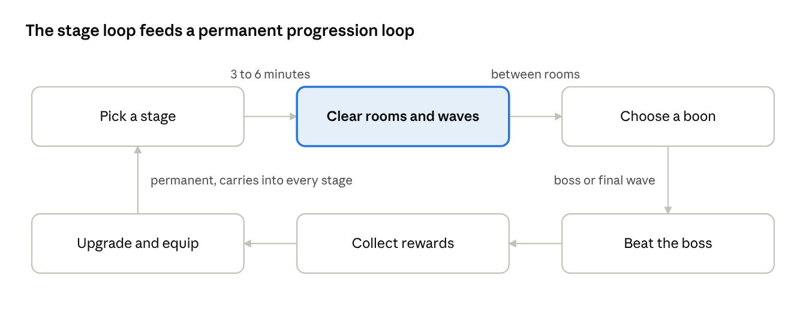
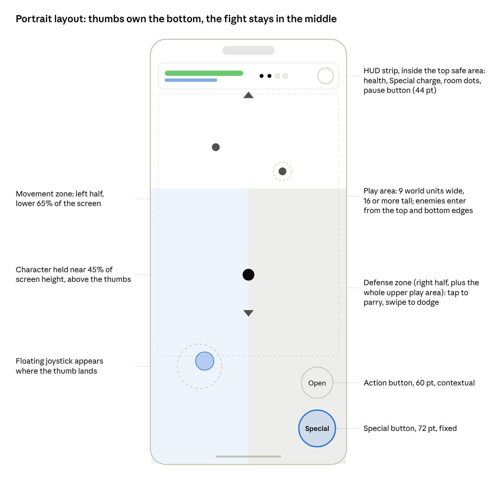
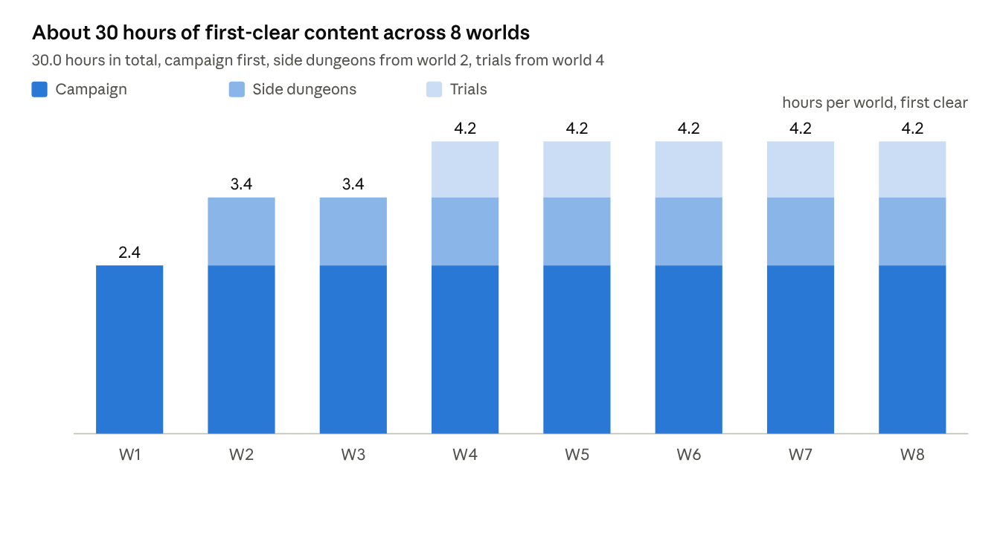
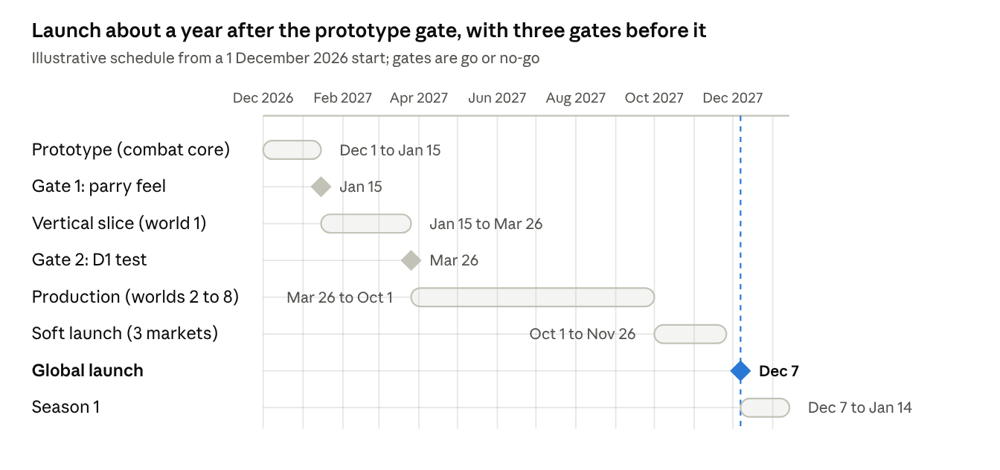

# Game Design Document: Portrait 2D Action RPG (working title: Parrylight)

As of 2 November 2026 · author Zaid

## 1. Overview

Parrylight is a portrait-only, single-player 2D action RPG for phones where your character attacks on its own and you win by moving, parrying, dodging and choosing when to fire abilities, across 8 worlds of hand-authored stages that take about 30 hours to clear the first time. "Parrylight" is a placeholder name; everything else in this document is a build spec.

This tab is the design. The build-level detail lives in four spec tabs: Build spec A: formulas and systems (formulas, state machines, schemas), Build spec B: content tables (every boon, skill, affix, stage, boss, quest and achievement), Build spec C: screens and copy (every screen and string) and Build spec D: backlog (epics, tickets, definition of done).

**One-page summary**

| Field | Decision |
| --- | --- |
| Genre | Stage-based action RPG with roguelite-style in-run upgrades (not a roguelike: progress is never lost) |
| Platform | iOS and Android phones; tablets supported in portrait with letterboxing |
| Orientation | Portrait only, locked. No landscape mode exists. |
| Players | One. No multiplayer, no co-op, no synchronous social features at launch. |
| Core fantasy | A lone fighter who wins through timing and positioning, not through stat inflation |
| Session shape | One stage is 3 to 6 minutes; a boss stage 6 to 10 minutes; a satisfying session is 10 to 20 minutes |
| Structure | World map, 8 worlds, each world 24 stages plus a boss, plus side dungeons and trials (section 9) |
| Content target | 30 hours of first-clear content without repeating stages for resources |
| Inputs | Auto-attack; left-thumb floating joystick for movement; right-zone tap to parry, swipe to dodge; one Special button; one contextual Action button (section 5) |
| Business model | Free to download, fair monetization (section 12). Every unit of power is earnable in play. |
| Reference games | Pixel Blade (structure and progression), Brotato (auto-attack with real decisions), Archero 2 and Survivor.io (portrait presentation), The Battle Bricks (campaign pacing and reward cadence) |

**Design pillars**

1. **Automatic offense, skillful defense.** Basic attacks are automated. Parry, dodge, positioning and ability timing are the whole game. If a stage can be won by standing still, the stage is wrong.
2. **Every stage is a new problem.** Each stage introduces or recombines an enemy behaviour, a hazard or a rule. Difficulty comes from new decisions, never only from larger health bars.
3. **Depth you can feel in ten seconds.** A parry must look, sound and feel decisive on first contact. Progression systems can be deep, but the combat read is instant.
4. **Portrait is the design, not a port.** Arenas are taller than wide, enemies approach along the vertical axis, HUD lives in the thumb zones, and the camera never asks the player to look where a thumb is.

**Hard constraints (from the brief)**

- Portrait only. No landscape layout, no rotation.
- Fully playable solo. No content is balanced for or gated behind other players.
- Minimum 30 hours of meaningful first-clear content. Grinding, daily chores and repeated stages do not count toward this.
- Level, wave and world based. No open world, no sandbox, no creativity-driven loop.
- No pop-culture IP, no meme characters, no borrowed brands. Original name, art, characters, audio and level content.
- The Roblox-style engagement layer (tutorial, daily rewards, streaks, quests, achievements, events, return rewards) ships at launch, as specified in section 13.
- Auto-attack with a small set of skill buttons; contextual, situation-aware UI.

**Non-goals**

- PvP, guilds, chat, leaderboards that require live opponents (asynchronous score boards are allowed later).
- Procedurally generated campaign stages. Stages are authored from data templates; randomness lives only in optional challenge modes.
- Gacha for units or power. Cosmetics only.
- Landscape, controller, or desktop support at launch.

## 2. Research and analysis

The research supports the concept but changes three things from the earlier discussion: the parry window must be wider than console values because of touch latency, Pixel Blade's progression should be borrowed for its structure and not its economy, and the portrait survivor-likes prove the control scheme but not the retention we want (their D30 is low and carried by gacha and energy, both of which this design excludes). Findings below are as of 2 November 2026; figures from third-party guides are marked.

**Reference games: what we take and what we leave**

| Game | What it proves | What we take | What we leave out |
| --- | --- | --- | --- |
| [Pixel Blade](https://rotrends.com/game/6161049307) (Roblox, 266M visits, 96.8% positive, 6.5 min average session) | Wave and room runs with one boss, per-world difficulty tiers, pick-1-of-3 upgrade cards between waves, rings as a rolled accessory slot, campaign solo-viable | World and difficulty structure, between-wave boon cards, the ring slot, campfire merchant as a rest beat | Duplicate-fed weapon levels, rings that cannot be rerolled, the Wishes gacha, raids that cannot be played alone, a World 4 spike with off-screen ranged attacks (guide reports, [roonby](https://roonby.com/2025/12/17/pixel-blade-world-4-guide-tips-and-tricks-to-clear-faster-and-farm-safely/)) |
| [Archero 2](https://www.levelwinner.com/archero-2-beginners-guide/) (Habby, $32.8M in 30 days per [PocketGamer.biz](https://www.pocketgamer.biz/archero-2-makes-328m-in-first-30-days-from-player-spending)) | Portrait room combat with a floating joystick works at scale; 50 waves per chapter, boss every 10 waves | Floating joystick, room-sized arenas, boss cadence, wave timer that pauses during bosses | Stop-to-shoot (ours attacks while moving), energy cap with ad refills, gear and character gacha, pay-to-win artifacts |
| [Survivor.io](https://naavik.co/deep-dives/survivorio-archeros-footsteps/) (Habby, D1 44%, D7 15%, D30 4% per data.ai via [mobilegamer.biz](https://mobilegamer.biz/two-months-in-survivor-io-passes-75m-from-37m-downloads/)) | One-finger auto-attack, confined boss arenas that guarantee telegraph visibility, pre-boss notifications | Confined boss arenas, boss warnings, a top-strip HUD with the timer and progress | 15-minute rounds (too long for our stage loop), gacha equipment, energy |
| [Brotato](https://brotato.wiki.spellsandguns.com/Waves) | Auto-aim and auto-fire with movement-only input still carries real decisions, because the decisions live between waves | Decision density between rooms, a small number of options at any moment, i-frames scaled by hit size (0.2 to 0.4 s) | 20-wave 17-minute runs; run-level permadeath |
| The Counter of Death, One Finger Death Punch 2 ([Gamesradar](https://www.gamesradar.com/a-delightfully-retro-deflectathon-you-should-be-playing-the-counter-of-death), [PocketGamer](https://www.pocketgamer.com/one-finger-death-punch-2/app-army-assemble-one-finger-death-punch-2-does-this-arcade-fighter-maintain-its)) | Tap-to-counter is a proven mobile core input; both use oversized hit zones and punish spamming | Oversized defense zone, spam penalty, rhythm-paced telegraphs | No published timing windows exist for any mobile parry game, so ours are set by prototype |
| [The Battle Bricks](https://www.roblox.com/) (from the earlier analysis) | Chapter, stage and daily-reward cadence that a solo player follows for weeks | Seven-day reward calendar, chapter milestones, challenge stages | Horizontal battlefield (wrong for portrait) |

**Parry timing anchors.** Shipped action games cluster their precise window at 130 to 200 ms with a lenient tier around 500 ms and a penalty for spamming: Nine Sols uses 133 ms precise, 133 to 500 ms imprecise, and shrinks the window on rapid repeat presses ([wiki](https://ninesols.wiki.gg/wiki/Parry)); Sekiro's deflect is about 30 frames and shrinks after repeated guards ([Fextralife](https://sekiroshadowsdietwice.wiki.fextralife.com/Deflection)); Dead Cells auto-parries hits in the first 0.2 s of a shield hold and locks blocking for 0.6 s after a failure ([wiki](https://deadcells.wiki.gg/wiki/Shield)); Hollow Knight's parry grants 0.25 s of invulnerability ([Fextralife](https://hollowknight.wiki.fextralife.com/Combat)). Clair Obscur's story mode widened parry and dodge windows by 40% as its accessibility lever ([Automaton](https://automaton-media.com/en/news/clair-obscur-expedition-33-makes-parrying-and-dodging-easier-in-story-mode-allowing-for-a-more-traditional-turn-based-rpg-experience/)). Touch adds latency a controller does not, so section 4 starts at 200 ms precise, a 450 ms soft tier, telegraphs of 600 to 800 ms, and a spam penalty.

**Platform rules that shape the layout.** Apple's game-control guidance: frequently used controls at least 44 x 44 pt, movement on the left and a floating thumbstick where the thumb lands, press state plus sound plus haptics, hide controls that are not relevant ([HIG](https://developer.apple.com/design/human-interface-guidelines/game-controls)). Android: 30 fps minimum for the core loop, 60 recommended, a slow frame is 50 ms, a slow session is over 25% slow frames, and Play steers users away from games under 20 fps ([Android quality](https://developer.android.com/quality/technical), [slow sessions](https://developer.android.com/google/play/vitals/slow-session)); bad-behaviour thresholds are 1.09% crash rate and 0.47% ANR rate overall ([Play vitals](https://developer.android.com/google/play/vitals)). On screens of 600 dp or wider, Android 16 ignores orientation locks, so the tablet layout in section 6 is required, not optional ([form factors](https://developer.android.com/games/develop/multiplatform/make-your-game-compatible-with-all-form-factors)).

**Retention benchmarks** (what "good" means for section 16)

| Metric | Median, all mobile | Top 25% | Top 10% | RPG reference |
| --- | --- | --- | --- | --- |
| D1 | about 22% | just over 30% | about 40% | 30.5% |
| D7 | 3.4 to 3.9% | 6 to 8% | 11 to 12% | 9.9% |
| D30 | 0.7 to 0.8% | 1.6 to 1.8% |  | 3.5% |
| Session length | 3.1 to 3.5 min | about 5.2 min |  | action genre has the longest sessions |

Sources: GameAnalytics 2026 benchmarks, 16,262 mobile games ([summary](https://gamedevreports.substack.com/p/gameanalytics-mobile-and-pc-game), [PDF](https://investgame.net/wp-content/uploads/2026/01/2026-01-27-2026-mobile-pc-benchmarks_compressed.pdf)); RPG column from Mistplay via [Segwise](https://segwise.ai/blog/mobile-gaming-app-user-retention-strategies.md), year not stated; Adjust 2026 for the action-session note ([summary](https://gamedevreports.substack.com/p/adjust-gaming-app-insights-report)). Archero 1 reached D1 49%, D7 23%, D30 11% in 2022 (data.ai). No 2026 source publishes an action-roguelite split, so the targets in section 16 use the top-quartile row with an RPG uplift.

**Engagement design guidance.** Roblox's creator docs are the most explicit public source on the systems this brief asks for: get players to the fun in five minutes or less and ship smaller updates every two to four weeks ([retention](https://create.roblox.com/docs/production/analytics/retention)); dailies should be finishable in one session with modest rewards ([quest design](https://create.roblox.com/docs/production/game-design/introduction-to-quest-design)); seasons of about one month with a week of rest, about ten tiers to start, never requiring hard currency ([season pass](https://create.roblox.com/docs/production/game-design/season-pass-design)); login-streak and time-played rewards with thresholds near 10, 30 and 60 minutes ([engagement rewards](https://create.roblox.com/docs/resources/feature-packages/engagement-rewards)). Mistplay and AppsFlyer's 2025 loyalty report found engagement bonuses are the top stated reason players return (64%), events second (50%) ([summary](https://gamedevreports.substack.com/p/mistplay-and-appsflyer-player-loyalty)). AppMagic counted midcore login-calendar usage up 93% year over year in 2025 ([summary](https://gamedevreports.substack.com/p/appmagic-mobile-live-ops-in-2025)).

**Monetization evidence.** Apple (guideline 3.1.1) and Google Play both require disclosing odds before purchase for any paid randomized item ([Apple](https://www.fenwick.com/insights/publications/apple-now-requires-disclosure-of-loot-box-odds), [Google](https://fenwick.com/insights/publications/google-play-now-requires-disclosure-of-loot-box-odds)); this design has none. Brawl Stars removed loot boxes in late 2022, lost about 14% of revenue over five months, then rebuilt around earned drops and an IAP-only pass and reported 8.8x revenue by February 2024 ([Deconstructor of Fun](https://www.deconstructoroffun.com/blog/why-removing-loot-boxes-in-brawlstars-failed), [mobilegamer.biz](https://mobilegamer.biz/supercell-explains-brawl-stars-big-comeback-from-an-all-time-low-to-8-8x-revenue/)). Battle passes in the market sit at roughly $5 to $15 per 4-to-8-week season (aggregator figures, directional only, [source](https://www.shanethegamer.com/research/battle-pass-statistics/)).

**Accessibility precedent.** Hades' God Mode adds 20% damage resistance, rising 2% per death to a cap of 80%, and can be toggled at any time ([Supergiant via Can I Play That](https://caniplaythat.com/2021/08/11/hades-god-mode-explained-by-supergiant-games)); Celeste's assist mode includes a game-speed slider down to half ([New Normative](https://newnormative.com/2018/01/25/celestes-assist-mode-brings-welcome-accessibility-options)); Xbox guideline 103 requires that cues never rely on colour alone ([XAG 103](https://learn.microsoft.com/en-gb/gaming/accessibility/xbox-accessibility-guidelines/103)). Section 5's assist options follow these.

**Engines.** Unity 6 is free below $200k revenue and Pro is $2,310 per seat per year from January 2026 ([Unity](https://unity.com/pricing-updates)); Godot 4.5 and 4.6 now ship foundation-maintained Google Play Billing, Play Games and StoreKit 2 plugins ([Godot mobile update](https://godotengine.org/article/godot-mobile-update-apr-2026/)) with larger Android builds reported by users; Defold is free with sub-2 MB bundles and an official IAP extension but fragmented haptics ([extension-iap](https://github.com/defold/extension-iap)). The choice is made in section 15 and depends on one open question: whether this ships as a standalone app or inside Playabl's own runtime.

## 3. Core loops

The game is four nested loops, and the inner two are where the skill lives. Everything in the outer loops exists to send the player back into the inner ones with a new reason.

**Moment to moment (1 to 3 seconds).** Read a telegraph, decide: parry it, dodge it, or ignore it and reposition. A successful parry opens a punish window; the auto-attack fills it. Failure costs health, never progress.

**Room (20 to 60 seconds).** A room is one wave or a small set of waves with a fixed enemy mix and a hazard rule. Rooms end when the last enemy dies. Between rooms the player picks one of three boons (temporary in-stage upgrades that expire when the stage ends).

**Stage (3 to 6 minutes, bosses 6 to 10).** Three to five rooms, then a final wave or a boss. Stages are authored; the order of rooms is fixed, so the player can learn and plan. Clearing a stage pays experience, currency, and at milestones an equipment or skill unlock.



Each stage ends in rewards and a permanent upgrade step, so the next stage is entered stronger and with a new problem.

**Session (10 to 20 minutes).** The home screen shows the next stage, any claimable reward and any quest that is one stage from completion, in that order. A session is two to four stages. Everything saves on stage completion and on room completion, so a phone call costs at most the current room.

**Meta (hours to weeks).** Worlds unlock in order, each with a new enemy family, a new mechanic, a boss, and side dungeons and trials that remix the world's rules. Character progression (section 8) and the engagement layer (section 13) sit on top of this and are never a substitute for it.

## 4. Combat system

Combat is a defense game: the character attacks by itself, and every point of skill expression is in the parry, the dodge, where you stand, and when you spend the Special. The rule that keeps this honest is that the auto-attack alone must never clear a stage above world 1; enemy damage is tuned so that an unparried stage ends in death.

**Auto-attack.** The character attacks the current target continuously, including while moving. There is no stop-to-shoot. Target priority: the enemy currently winding up an attack on the player, then the nearest, then the lowest health. The player can tap an enemy to pin it as priority for 5 seconds. Weapon families define the attack: range, cadence, hit shape and parry bonus.

| Weapon family | Hit shape | Cadence | Parry bonus | Role |
| --- | --- | --- | --- | --- |
| Blade | Short arc in front | Fast | Riposte deals 3x instead of 2x | Default, balanced |
| Spear | Line, mid range | Medium | Parry also pushes enemies back | Crowd control |
| Chakram | Thrown, returns, ranged | Medium | Parry reflects projectiles | Ranged, kiting |
| Hammer | Slow arc, area | Slow | Parry builds double break | Boss breaker |
| Wand | Homing bolt, ranged | Fast, low damage | Parry refunds 25% Special | Caster, ability focused |

**Parry.** Tap anywhere in the right-hand combat zone. The parry is active instantly for a short precise window, followed by a longer soft tier that halves damage without the reward, then a recovery during which a second tap does nothing. If an enemy's parryable hit lands inside the window: damage is negated, the enemy is staggered, the character's next attacks for 1.5 seconds are riposte attacks at double damage, and the Special meter gains charge. The parry is the only way to build meaningful break on bosses, so it is never optional against them.

**Dodge.** Swipe in the combat zone in any direction. A short dash with invulnerability frames in the first part of it. Dodge is for unparryable attacks (red telegraphs) and for repositioning out of area attacks. One charge at the start; a second charge is an unlock in world 3.

**Special.** One fixed button. Its effect comes from the equipped weapon, modified by class. It is charged by parries and hits, not by a timer, so a player who parries well casts more often. Full charge is roughly 6 parries or 25 hits. Examples: Blade Crescent (wide 180 degree slash), Hammer Quake (area stagger around the character), Wand Nova (ring of bolts that each apply the wand's status).

**Break and Execute.** Elites and bosses carry a break meter under their health bar. Parries fill it fast, hits fill it slowly. At full, the enemy is broken for 3 seconds, takes 1.5x damage, and the contextual Action button offers Execute: a cinematic high-damage strike that also clears the enemy's current attack pattern. Bosses break two to four times per fight by design, and each break is a planned beat in the fight script (section 10).

**Telegraph language.** Every enemy attack is announced before it lands, in one consistent visual grammar. Players learn the grammar in world 1 and never have to relearn it.

| Cue | Meaning | Correct answer |
| --- | --- | --- |
| White flash and wind-up pose, white outline on the enemy | Parryable melee or projectile | Parry on the flash |
| Red flash, red outline, red ground marker | Unparryable (grab, slam, barrage) | Dodge or leave the marker |
| Yellow ground ring that fills | Area attack with a delay; fills over the telegraph time | Leave the ring, or parry if it has a white edge |
| Blue pulse on an enemy | Enemy is about to buff or heal another | Target it (tap to pin) or Special |
| Enemy outline shakes, break bar flashes | Break imminent | Keep parrying, prepare Execute |

Colour never carries meaning alone: each cue also has a distinct shape and sound, and a colour-blind mode swaps the palette (section 14).

**Health, damage and status.** Damage is attack times a skill multiplier minus flat defense, never below 1. There are four status effects and no more: Burn (damage over time), Chill (slow), Shock (chains to a nearby enemy), Bleed (increased damage taken). Health does not regenerate. Healing comes from boons, from a potion offered through the Action button when health is below 40% and nothing else is in context, and from the stage reward screen.

**Failure.** In campaign stages, death restarts the current room with full health and the boons kept; boons picked so far are not re-rolled. In trials and side dungeons, death restarts the stage. Death never costs currency, experience or items. The failure screen names the attack that killed the player and shows its telegraph, with one sentence of advice ("Red flashes cannot be parried. Swipe to dodge.").

**Initial tuning values.** These are starting points for the prototype gate (section 17), not final.

| Parameter | Initial value | Note |
| --- | --- | --- |
| Precise parry window | 200 ms from touch-down | Full parry: no damage, stagger, riposte, Special charge. Console games sit at 130 to 200 ms; touch latency earns the extra. |
| Soft parry tier | 200 to 450 ms | Late parry: half damage, no riposte, no stagger. Keeps a near miss from feeling like nothing happened. |
| Spam penalty | Second tap within 400 ms shrinks the precise window to 120 ms; a third removes it until 600 ms of no taps | Borrowed from Nine Sols; makes mashing strictly worse than reading |
| Parry recovery after a whiff | 300 ms | No second parry during recovery |
| Enemy telegraph, normal enemies | 600 to 800 ms before the hit frame | Shorter in later worlds, never under 450 ms |
| Enemy telegraph, boss fast attacks | 450 to 550 ms | Always paired with a distinct sound |
| Input buffer | 100 ms | A tap slightly before the window still counts |
| Dodge duration / invulnerable | 250 ms / 180 ms | Starts on the first frame |
| Dodge cooldown | 800 ms | Second charge unlocked in world 3 |
| Riposte window after a parry | 1.5 s | Auto-attacks deal 2x (Blade 3x) |
| Stagger on parried normal enemy | 1.0 s | Elites 0.6 s, bosses build break instead |
| Broken state duration | 3.0 s | Execute available throughout |
| Hit stop on parry | 80 ms | Plus haptic pulse and screen flash |
| Assist: wider windows | Precise 280 ms, soft to 550 ms | Mirrors Clair Obscur's 40% story-mode widening |

The numbers above are anchored to the research in section 2 where it gives measured values from shipped games, and otherwise to the prototype's first playtest.

## 5. Controls and input

The phone is held in one or two hands in portrait, and the whole control scheme fits under two thumbs: the left thumb moves, the right thumb defends, and two fixed buttons in the bottom-right corner carry the Special and the one contextual Action. Nothing else is ever on screen during combat.

**Zones** (measured on a 390 x 844 pt phone; everything scales by percentage, section 6)

| Zone | Where | Input | Result |
| --- | --- | --- | --- |
| Movement | Left half of the screen, lower 65% | Touch and drag | Floating joystick appears under the thumb; direction and magnitude set movement. Lifting the thumb stops. |
| Defense | Everything not in the movement zone and not a button, including the whole upper play area | Tap | Parry (fires on touch-down for lowest latency) |
| Defense | Same | Swipe (12 pt of movement within 60 ms) | Dodge in the swipe direction; the parry started on touch-down is cancelled, except its first frames, which stay active |
| Defense | Same | Long press (350 ms) on an enemy | Pins that enemy as the auto-attack target for 5 s |
| Special | Fixed button, bottom-right corner, 72 pt | Tap | Fires the weapon Special when the meter is full; otherwise shows the charge |
| Action | Fixed button above Special, 60 pt | Tap | Performs the current contextual action (below); hidden content keeps its position |
| Pause | Top-right, inside the safe area, 44 pt | Tap | Pause menu; game pauses instantly, also on app background |

The left-handed setting mirrors all zones and buttons. A "dedicated dodge button" setting adds a third fixed button for players who dislike swiping; it is off by default to keep the screen clean.

**Why not "tap anywhere parries".** The left thumb is on the joystick for most of every fight, and a joystick touch-down must not parry. Splitting the screen gives the right thumb the entire remaining surface, which is as close to "anywhere" as the design allows without false parries.

**The contextual Action button.** One slot, one fixed position, one action at a time, chosen by priority:

1. Execute: a broken elite or boss is within reach.
2. Interact: a chest, lever, shrine or relic is within 1.5 character widths. The nearest wins.
3. Potion: health is below 40% and the player holds at least one potion.
4. Empty: the button is hidden, the position is reserved.

Rules that keep it trustworthy:

- The action and its icon never change while a touch is held on the button.
- A newly shown or changed action is not tappable for 200 ms and pulses once, so the player cannot tap an old action and get a new one.
- Execute uses a distinct colour, shape and sound; nothing else on the button looks like it.
- The label is written under the icon in one word (Execute, Open, Pull, Drink, Pray).
- In the tutorial, the first appearance of each action pauses the game for 1.5 s with a callout.

**Latency budget.** Touch-down to visible parry frame under 50 ms on the game thread, under 80 ms input-to-photon on a 60 Hz device. The parry fires on touch-down, not touch-up, which halves the perceived delay compared with tap-gesture recognition. Haptics fire in the same frame as the visual.

**Out-of-combat input.** Menus use standard taps and vertical scrolling only; no horizontal carousels (hard to reach one-handed and easy to mistake for a swipe). Minimum tap target 44 x 44 pt everywhere, with primary buttons at 56 pt or larger and placed in the lower half of the screen.

**Assist options** (settings, no gameplay penalty, no achievement lockout)

- Wider parry window: precise 200 ms becomes 280 ms, soft tier extends to 550 ms.
- Slower telegraphs: all telegraph times plus 20%.
- Hold to parry: holding the defense zone keeps a weaker guard up (50% damage reduction, no riposte) for players who cannot time taps.
- Colour-blind telegraph palettes (section 14).
- Reduced screen shake and flash.

## 6. Camera and portrait presentation

The camera is width-locked at 9 world units, follows the character vertically with a lead toward the enemies, and arenas are tall rectangles, so a narrow screen shows a full fight without zooming out. Taller phones see more of the arena above and below; nothing is ever cropped horizontally.



The thumbs own the lower third, the HUD sits in the top safe area, and the character is held above the thumb band so the fight is never under a hand.

**Camera rules**

| Rule | Specification |
| --- | --- |
| Projection | 2D orthographic, width-locked: exactly 9 world units are visible horizontally on every phone |
| Visible height | 16 units at 9:16, about 19.5 units at 9:19.5, 21 at 9:21. Arenas are authored for 16 and decorated beyond it. |
| Tablets and foldables (3:4, near 1:1) | Width grows to 12 units with the arena's decorative margin visible; UI stays at phone proportions, centred, with themed side panels. No landscape. |
| Follow | Damped follow, 150 ms smoothing. Vertical follow is free; horizontal follow is clamped to the arena so the walls never show gaps. |
| Character anchor | The character is held at 45% of screen height (measured from the top), above the control band, and drifts up to 15% toward the enemy centroid. |
| Lead | Camera leads 1.5 units toward the centroid of enemies that are winding up an attack, so telegraphs are on screen before the hit. |
| Threat band | The lower 22% of the screen sits under the thumbs. Any telegraph that originates there is mirrored as an edge indicator drawn just above the band. Arenas are designed so most threats come from above. |
| Hit stop | On parry the camera freezes for 80 ms with the world. No shake during hit stop. |
| Shake | Capped at 0.2 units, 120 ms, only on Executes, boss slams and the player's death. Off in reduced-motion mode. |
| Zoom | None during combat. A 10% zoom-in over 400 ms on Execute, released over 600 ms. Boss intro uses a 1.5 s pull-out from the boss to the arena. |

**Arenas for a vertical screen**

- Arena footprint is 9 wide by 20 to 28 tall. Width never exceeds 9, so the whole horizontal extent is always visible.
- Enemies spawn at the top and bottom edges, each spawn announced by a marker on that edge 1 second ahead. Side spawns do not exist.
- Hazards (pits, fire lines, pushers) are horizontal bands, because a horizontal band is read at a glance on a tall screen and a vertical one hides behind the character.
- Bosses are placed at the top of the arena and the camera's lead keeps both the boss and the character in frame; boss arenas are 9 by 16 so the fight needs no vertical scroll.
- Projectiles travel mostly vertically; diagonal shots are slow enough to read.

**Scale.** One world unit is one ninth of the screen width (43 pt on the reference phone). The character is 1.2 units tall; normal enemies 1 to 1.6 units; elites 2; bosses 3 to 4. Art is authored at 2x and 3x for a 1-unit grid, so sprites never scale non-integer on the reference phone.

**Safe areas.** The HUD strip starts 8 pt below the top safe area (Dynamic Island and notches), and no button sits within the bottom 34 pt home-indicator area. Both values come from the OS at runtime, never hard-coded.

**Portrait-specific readability checks** (run on every stage before it ships)

- Every telegraph that can hit the character is fully on screen at the moment it starts, on a 9:16 device.
- No enemy attack originates from inside the threat band without an edge indicator.
- Text in the play area is never smaller than 14 pt on the reference phone.
- A playtester holding the phone one-handed (right thumb only, movement by tilting is not supported) can clear world 1 stages, since world 1 is designed to need little movement.

## 7. UI and UX

The interface is a vertical stack of five screens behind a bottom tab bar, with one rule across all of them: the thing the player most likely wants next is a single tap away and sits in the lower half of the screen. In combat the HUD is four elements and nothing else.

**Combat HUD** (section 6 drawing)

| Element | Where | Behaviour |
| --- | --- | --- |
| Health bar | Top strip, left | Drains with hit flash; turns amber under 40% (the moment the Action button may offer a potion); numeric value on long press only |
| Special charge | Under the health bar, thin | Fills from parries and hits; pulses gold at full; the Special button mirrors it |
| Room dots | Top strip, centre | One dot per room in the stage; the boss room is a diamond; filled as cleared |
| Pause | Top strip, right, 44 pt | Opens pause; the game also pauses on app background, incoming call, or control-centre swipe |
| Target health and break | Floating above the pinned or attacking elite or boss | Only for elites and bosses; normal enemies show a small bar on hit for 1 s |
| Boon banner | Slides down from the HUD for 1.2 s | Names the boon just taken; never blocks the play area longer |
| Edge indicators | Just above the thumb band and at the top edge | Show spawns and telegraphs that originate off-screen or under the thumbs |

No damage numbers by default (they fight the telegraph read on a narrow screen); a setting turns them on, small and short-lived.

**Screen map**

| Tab | Screen | Purpose | Primary action (bottom half) |
| --- | --- | --- | --- |
| Map | World map | Vertical scroll of worlds, each a column of stage nodes; the current stage is centred on open | Play next stage |
| Map | Stage preview | Enemy families present, hazard rule, rewards, best clear, mastery objectives | Start |
| Map | Loadout sheet (slides up over preview) | Weapon, armour, two rings, class; swap without leaving the preview | Confirm |
| Hero | Character | Level, stats, class skills, mastery progress | Spend skill point |
| Forge | Inventory and upgrades | Equipment grid, upgrade, dismantle, ring refine | Upgrade |
| Quests | Daily, weekly, achievements, event track | Claimable items first, then in-progress sorted by closeness to done | Claim all |
| Shop | Currencies, cosmetics, passes | Clear labels of what is cosmetic and what is not | Buy |

**In-stage screens**

- Boon pick: three cards in a vertical column, each with icon, name, one line, and a small "stacks: 2/5" marker. The game is paused. Tap a card, then tap again to confirm (first tap enlarges it and shows the full text).
- Results: rewards fly into the currency counters, then experience fills the level bar, then any unlock is shown alone on a full card. Buttons: Next stage (primary, large), Replay, Map. The whole screen can be skipped with one tap after 0.8 s.
- Failure: the killing attack is replayed as a 2 s loop in a small window with its telegraph highlighted, one line of advice, then Retry room (primary) and Change loadout. No ad, no revive offer on the first failure of a stage.

**Flows that matter**

1. Cold start to first fight: splash, no account prompt, tap once on "Begin", straight into stage 1-1 with the tutorial overlays (section 13). Target under 30 seconds from app icon to first parry.
2. Returning session: app opens on the Map with the next stage centred, a single badge on Quests if something is claimable, and a reward popup only if a daily reward is waiting. No more than one popup per session, ever.
3. Stage to stage: Results, Next stage, 1.5 s transition. Loadout changes are offered only when the next stage introduces a new enemy family (a one-line hint, dismissable).
4. Death and retry: under 3 seconds from death to being back in the room.

**Reachability and readability rules**

- Primary buttons: 56 pt or taller, full width or bottom-right, never top of screen.
- Tab bar height 56 pt plus the bottom safe area; five tabs maximum.
- Body text 15 pt minimum, labels 13 pt minimum, numbers in a tabular figure font.
- No horizontal carousels. Lists scroll vertically; comparisons use side-by-side cards that fit one screen.
- Modal dialogs have the destructive option on the left and in muted colour; the safe option is primary.
- Every screen can be left with one tap on a persistent back or close control at the top-left, and the Android back gesture does the same.
- Loading between screens is never a spinner over black; the tab content stays visible and fades.

## 8. Player progression

Progression is five tracks that each change how a fight plays, not only how big the numbers are: class, level, equipment, skills, and mastery. Stats account for about half of the difficulty curve; the other half is the player learning the telegraph grammar. A skilled player 5 levels under the recommended level can clear any campaign stage; an unskilled player 5 levels over it can clear with potions. Nothing in the campaign is gated by level.

**Classes** (three at launch, each changes the defense game)

| Class | Unlock | Parry | Dodge | Special | Playstyle |
| --- | --- | --- | --- | --- | --- |
| Warden | Start | Parry also heals 3% of max health | Standard | Charges 20% faster from parries | Stand and deflect |
| Ranger | Clear world 2 | Standard | Two charges from the start; dodging through an enemy marks it (+15% damage taken) | Charges 20% faster from hits | Kite and punish |
| Mystic | Clear world 4 | A parry applies the weapon's status to the attacker | Standard | Special meter is 50% larger and effects last longer | Build around the Special |

Classes are switched freely at the loadout sheet. Each class has its own skill tree and its own mastery, so a second class is a second progression track, not a cosmetic.

**Level.** Levels 1 to 60 from stage experience. Each level adds health and attack on a gentle curve, and every second level grants one skill point. Experience is awarded for clearing stages and mastery objectives; repeating a cleared stage pays 20% experience, so grinding is possible but never efficient.

**Skills.** Each class has a tree of three branches of five nodes (15 nodes, 30 points available by level 60, so a full tree is possible but ordering matters for 30 hours). Nodes are rules, not percentages: "a perfect parry (first 60 ms of the window) refunds the dodge", "the third riposte hit staggers", "Chill lasts twice as long". Respec costs soft currency and is free the first three times.

**Equipment.** Four slots: weapon, armour, two rings.

| Slot | Source | Rarity | Upgrade path |
| --- | --- | --- | --- |
| Weapon | Guaranteed at campaign milestones (new families at 1-8 and at each world clear through world 3; a higher rarity as worlds 2, 4 and 7 open), plus Forge crafting from world materials (spec A3) | Common, Rare, Epic, Legendary | 8 levels per weapon with world materials; level 3 unlocks the weapon trait, level 6 upgrades the Special |
| Armour | Milestones and Forge | Same four | 8 levels; adds health, defense, and one defensive rule at level 5 ("the first hit in each room is halved") |
| Rings | Side dungeons, trials, bosses | Same four | Rolled affixes from a short, readable list; re-rolling costs a currency earned from dismantling, so a bad roll is never permanent |

There are no duplicate-based upgrades and no equipment gacha. The Forge shows exactly what a craft yields before the player commits.

**Mastery.** Two kinds. Weapon mastery levels 1 to 10 per family, earned by use, each unlocking a small perk for that family (Blade 3: riposte window 1.5 s becomes 1.8 s). Stage mastery: every stage has three objectives (for example: no damage taken in room 2, parry 12 attacks, clear under 4 minutes). Each earns a star; stars unlock side dungeons and trials (section 9) and cosmetic frames. Mastery objectives are the sanctioned reason to replay a stage, and they ask for a different approach, not a repeat.

**Pacing targets** (first-clear path, average skill)

| World | Expected level on entry | Weapon tier | New system introduced |
| --- | --- | --- | --- |
| 1 | 1 | Common Blade | Parry, dodge, Special, boons |
| 2 | 8 | Rare | Rings, Forge, first elite break, side dungeons |
| 3 | 15 | Rare to Epic | Ranger class, second dodge charge, status effects |
| 4 | 22 | Epic | Weapon mastery perks, trials |
| 5 | 30 | Epic | Mystic class, boss arenas with summons |
| 6 | 38 | Epic to Legendary | Boss re-fights with modifiers |
| 7 | 46 | Legendary | Multi-phase bosses with two break cycles |
| 8 | 54 | Legendary | Endgame trials, mastery hunts |

**What the Pixel Blade research changes here.** Pixel Blade's progression leans on duplicate-fed weapon levels, unidentified rings that cannot be rerolled, and a "Wishes" gacha for rare gear, and its guides describe World 4 as a difficulty spike with off-screen ranged attacks. Each of those is designed out above: milestone-guaranteed weapons, rerollable rings, no gacha, and a camera that keeps telegraphs on screen (section 6).

## 9. Content structure and the 30-hour budget

The campaign is 8 worlds of 25 stages (24 stages and a boss), 63 side-dungeon stages and 30 trials: 293 authored stages that take about 30 hours to clear once at average skill, with retries counted and no stage repeated for resources.



Each world adds about 2.4 hours of campaign; side dungeons and trials lift the later worlds to over 4 hours each.

**Inventory and timing assumptions**

| Content | Count | Minutes per first clear (with retries) | Hours |
| --- | --- | --- | --- |
| Campaign stages | 192 | 5.5 | 17.6 |
| Campaign bosses | 8 | 12 | 1.6 |
| Side dungeon stages (3 dungeons of 3 stages per world, worlds 2 to 8) | 63 | 6.5 | 6.8 |
| Trials (6 per world, worlds 4 to 8) | 30 | 8 | 4.0 |
| Total first-clear | 293 |  | 30.0 |

Mastery objectives, boss re-fights with modifiers, daily challenge stages and events are on top of this and are not counted. The per-stage minutes are design targets; the prototype gate (section 17) measures real values on stages 1-1 to 1-8 and the budget is re-run from them.

**Worlds.** Each world introduces one enemy family and one arena rule, then spends its stages recombining them with everything before. Names and themes are original placeholders.

| World | Theme | New enemy family | Arena rule | Boss beat |
| --- | --- | --- | --- | --- |
| 1 Hollow Orchard | Overgrown farmland | Thornbacks: slow melee with long white telegraphs | None; teaches the grammar | Single break cycle, one unparryable slam |
| 2 Salt Flats | Dry seabed | Shellbacks: shielded fronts that only a parry opens | Tide bands that push horizontally | Shield phases; break opens the shell |
| 3 Lantern Marsh | Fog and still water | Wisps: short-range teleports before attacking | Shock pools that chain between enemies standing in them | Boss splits into three wisps after each break |
| 4 Clockwork Quarry | Machines and conveyors | Automata: unparryable red slams, parryable jabs | Conveyor bands that move the character | Two break cycles; conveyors reverse after the first |
| 5 Ember Vaults | Furnace halls | Stokers: buffers that empower others (blue pulse) | Burn lines that cross the arena on a timer | Boss summons stokers; kill order matters |
| 6 Frost Reliquary | Ice crypt | Sentinels: delayed area rings with white edges | Chill floors that slow dodges | Rings overlap; parry the white edges to clear space |
| 7 Sky Bastion | Floating ramparts | Archers: volleys that can be reflected by parry | Wind bands that bend projectiles | Reflection-only damage phase |
| 8 The Undercrown | Below everything | All families, recombined | Rotating rules from worlds 2 to 7 | Three phases, two break cycles each |

**Stage cadence inside a world** (24 stages)

- Stages 1 to 4: the new family alone, the new rule alone, then together.
- Stages 5 to 12: the new family mixed with one earlier family per stage; a mid-world elite at stage 12.
- Stages 13 to 20: two earlier families plus the rule; hazards at full strength; stage 20 is a gauntlet (five rooms, no boon in the last two).
- Stages 21 to 24: boss preparation, each stage rehearsing one boss mechanic in a normal fight.
- Stage 25: the boss.

Every stage must pass the "new decision" test: a designer can name the decision this stage asks that the previous one did not. If not, the stage is cut or changed.

**Side dungeons** (unlocked by mastery stars from the same world). Three stages that remix the world's rule: for example, in Salt Flats, a dungeon where every enemy is shielded and boons are parry-only. Rewards are rings and crafting materials.

**Trials** (unlocked by clearing the world's boss). Fixed-loadout and modifier fights: boss rush, no-damage rooms, Special disabled, parry-only (dodge disabled), speed clears, and a "mirror" trial where telegraph colours are swapped as a grammar test. Rewards are Legendary materials and cosmetics.

**Endgame after world 8.** Boss re-fights with stackable modifiers, mastery hunts (all stars in a world), and the rotating challenge stage from the engagement layer. This is where new content updates land (section 13).

## 10. Enemy and boss design

Every enemy is defined by the question it asks the defense game (parry it, dodge it, or reposition), and every boss is a scripted sequence of those questions with two to four planned break windows. Enemies are data: a family, a behaviour set, a telegraph profile and stats, so a new enemy is a content entry, not new code.

**Enemy families** (one per world, then recombined)

| Family | Behaviour | Telegraph profile | The question it asks | Counter |
| --- | --- | --- | --- | --- |
| Thornback (W1) | Walks to melee range, one slow swing | White, 800 ms | Can you parry on the flash? | Parry |
| Shellback (W2) | Shielded front, immune from the front until parried | White jab, 700 ms; shield glows when open | Will you parry to open, or walk around? | Parry opens the shell for 3 s |
| Wisp (W3) | Teleports to a marked spot, then attacks | Blue blink marker 600 ms, then white 500 ms | Can you track a target that moves before it attacks? | Dodge the blink, parry the strike |
| Automaton (W4) | Alternates parryable jabs and unparryable slams | White 700 ms / red 900 ms with ground marker | Can you read red from white under pressure? | Parry jabs, dodge slams |
| Stoker (W5) | Stays back, buffs the nearest ally every 6 s | Blue pulse 1 s before the buff | Do you change target priority? | Pin it; Special |
| Sentinel (W6) | Places delayed area rings | Yellow ring fills over 1.2 s; white edge if parryable | Do you leave, or clear it with a parry? | Leave the ring or parry the edge |
| Archer (W7) | Volleys of 3 projectiles from range | White per arrow, 650 ms | Can you reflect, and where does the reflection go? | Parry reflects into the archer |
| Elite variants (all worlds) | Any family with a break bar and one extra trait | Same grammar, larger sprite, distinct outline | Can you keep the grammar going for longer? | Build break, Execute |

**Traits** (stackable on elites and used by stage data): Hasty (telegraphs 15% shorter), Armoured (first parry each room only staggers), Volatile (dies in a yellow ring), Linked (shares damage with another Linked enemy), Vengeful (buffs allies on death). Stages never combine more than two traits on one enemy.

**Rules for every enemy**

- Every attack has a telegraph that is readable on a 9:16 screen from the character's position; off-screen attacks do not exist (edge indicators, section 6).
- The hit frame is the last frame of the telegraph, never during it.
- Each family has one parryable and, from world 4 onward, at most one unparryable attack; red is reserved for the unparryable.
- Enemies approach from the top or bottom; none walk in from the sides.
- Normal enemies die in 2 to 5 seconds of auto-attack at the expected level; elites in 10 to 15 seconds plus one break.
- Maximum 6 active enemies on screen in campaign, 8 in trials. Portrait width does not fit more without stacking telegraphs.

**Boss design.** Each campaign boss is a script of phases, with break windows placed on purpose.

| Beat | What happens | Design intent |
| --- | --- | --- |
| Intro, 1.5 s | Camera pull-out, boss name, no attacks | Read the arena |
| Phase 1 | Two attacks: one parryable, one unparryable, alternating in a fixed order | Teach the boss's grammar |
| Break 1 | 6 parries fill the bar; Execute | Reward reading over DPS |
| Phase 2 | A new attack that combines the world's rule (tide band, conveyor, ring) | New decision |
| Break 2 | Fewer parries needed if the player used the rule (for example, parried from a conveyor) | Reward using the arena |
| Phase 3 (worlds 6 to 8) | Pattern order becomes semi-random from a set of 3; a summon or a split | Mastery check |
| Final break | Execute ends the fight with a cinematic | Memorable close |

Boss attacks are tuned so that a player who parries every parryable attack and dodges every red takes no damage; potions exist for everyone else. Boss arenas are 9 by 16 units with no scrolling. Bosses are re-fightable from the world map after the first clear, with modifiers unlocked at world 6.

**Elites and mini-bosses.** Stage 12 of each world is a mini-boss: an elite with a full script of two phases and one break. Side dungeons end on an elite pair, and trials use elites with stacked traits.

## 11. Encounter and level design

A stage is a data file: an arena, an ordered list of rooms, each room a list of timed spawn groups, a hazard rule, a boon pool and three mastery objectives. 293 stages are feasible only because designers author data against reusable templates and two bots validate every stage automatically before a human plays it.

**Stage definition** (illustrative schema; the real file is JSON validated against a schema in the repo)

```json
{
  "id": "w2-s07",
  "world": 2,
  "arena": { "template": "saltflats_long", "height": 24, "rule": "tide_band", "rule_params": { "period_s": 9, "push": 1.5 } },
  "recommended_level": 11,
  "rooms": [
    { "type": "wave", "spawns": [ { "t": 0, "edge": "top", "family": "thornback", "n": 2 }, { "t": 6, "edge": "bottom", "family": "shellback", "n": 1 } ] },
    { "type": "wave", "spawns": [ { "t": 0, "edge": "top", "family": "shellback", "n": 2, "traits": ["hasty"] } ], "boon_after": true },
    { "type": "gauntlet", "waves": 3, "spawns_per_wave": [ { "edge": "both", "family": "mixed_w1_w2", "n": 3 } ] },
    { "type": "elite", "family": "shellback", "traits": ["armoured"], "adds": { "family": "thornback", "n": 2, "every_s": 12 } }
  ],
  "boon_pool": ["riposte_plus", "chill_on_parry", "second_wind", "heavy_hands", "quick_feet"],
  "mastery": [ { "type": "no_damage_room", "room": 2 }, { "type": "parries", "n": 15 }, { "type": "time_under_s", "s": 240 } ],
  "rewards": { "xp": 420, "coins": 180, "materials": { "salt_shard": 3 }, "first_clear": { "ring": "rolled_rare" } }
}
```

**Room types**

| Type | Shape | Used for |
| --- | --- | --- |
| Wave | One spawn list, ends when all are dead | The default room |
| Gauntlet | Several waves with no pause, spawns from both edges | Pressure; late-stage rooms |
| Elite | One elite plus periodic adds | Mid-stage and dungeon finales |
| Rule room | A wave where the arena rule is at maximum strength | Teaching rooms early in a world |
| Rest | No enemies; a chest, a shrine or the merchant via the Action button | Pacing; one per stage at most, never in the last two rooms |
| Boss | Scripted (section 10) | Stage 25 |

**Boons** (in-stage, expire at stage end). A pool of about 40 across the game, five to eight per stage pool, three offered after rooms flagged "boon\_after". Each boon changes a rule rather than a number where possible ("parries also reflect projectiles", "your second dodge in 2 s is free"); pure stat boons exist but are never more than one of the three offered. The boon pick is where a stage gets replay variety without random stage layouts.

**Arena templates.** Each world has three arena templates (short 16, long 24, boss 16) with fixed decoration slots. Hazards attach to templates by rule name. Designers do not place individual tiles; they choose a template and parameters, which keeps every arena within the portrait rules in section 6 by construction.

**Spawn rules for portrait**

- Spawn edges are top and bottom only; a spawn marker shows on the edge 1 s before the enemy enters.
- No more than two spawn groups within 2 s of each other, and never from both edges within 1 s, so the player can turn to face one side at a time.
- Ranged families spawn at the top only, where the camera lead keeps them in frame.
- Active enemy cap per room is in the stage data and validated against the section 10 maximums.

**Validation before a human plays**

1. Schema validation: the file matches the schema; families, traits and boons exist; caps respected.
2. Perfect bot: an automated player that parries every parryable attack on its hit frame and dodges every red. It must clear the stage with zero damage taken. If it cannot, the stage has an unreadable or impossible overlap and is rejected.
3. Passive bot: an automated player that moves but never parries or dodges. It must die before the final room in every stage from world 2 onward. If it survives, the stage can be won by standing there, which violates pillar 1.
4. Timing report: the expected first-clear time from both bots brackets the design target in section 9; stages outside the bracket are flagged.
5. Human pass: a designer plays the stage once and names the new decision it asks (section 9). The name is stored in the file.

**Difficulty curve.** Three measured dials per stage, logged by the bots and by live analytics: telegraph density (attacks per 10 s that require a response), red share (fraction of attacks that are unparryable), and simultaneous threats (peak attacks overlapping within 500 ms). Each world raises one dial at a time; a stage that raises two at once must be stage 20 or the boss.

## 12. Economy and monetization

The economy is tuned so that the first-clear path alone keeps a player's gear within one level of the world cap, and monetization sells cosmetics, convenience and a season pass, never power. There is no energy system, no gacha, no interstitial ads and no paid revive in the campaign.

**Currencies**

| Currency | Earned from | Spent on | Purchasable |
| --- | --- | --- | --- |
| Coins (soft) | Every stage, quests, daily reward | Weapon and armour levels, respec, potions | No |
| World materials (one type per world) | Stages and dungeons of that world | Forge crafting and upgrades for that world's tier | No |
| Shards | Dismantling equipment | Ring re-rolls (3 shards each), rare Forge recipes | No |
| Gems (hard) | Achievements, mastery stars, season track, bosses | Cosmetics, loadout slots, season pass top-up | Yes |
| Potions (consumable) | Rest rooms, daily reward, Forge (coins) | Healing in combat via the Action button; cap 3 per stage | No |

**Economy targets** (validated by the bots in section 11 and by the analytics in section 16)

- Income from a world's first-clear path funds weapon level 7 of 8 for that world's weapon and armour level 6 of 8, with no stage repeated. Level 8 comes from side dungeons and mastery.
- Ring re-roll shards from dismantling the campaign's surplus drops fund about 6 re-rolls per world.
- Coins never become the bottleneck after world 2; materials do, and materials are world-specific so earlier worlds cannot be farmed for later tiers.
- Respec is free three times, then 500 coins, flat.
- Potions cost 60 coins at the Forge, about one stage's income in world 1 and a fraction of it later, so they are a convenience and not a tax.

**Monetization**

| Offer | Price (USD, placeholder) | What it contains | Fairness rule |
| --- | --- | --- | --- |
| Season pass | 7.99 per 5-week season | Premium track: cosmetics, titles, a cosmetic weapon skin, gem refund of 60%, material bundles | Every gameplay item on the premium track also exists on the free track or in play; the pass is bought with money, never with gems alone, to keep gems from inflating |
| Cosmetic shop | 1.99 to 9.99 | Skins, parry effects, Execute cinematics, frames | No stats |
| Starter bundle | 2.99, once | Cosmetic plus 10 potions and 2,000 coins | Equivalent to about 40 minutes of play; offered once, after stage 1-8, never again |
| Supporter pack | 19.99 | Cosmetic set and a badge | Nothing else |
| Rewarded ads | Free | Double stage rewards (up to 5 per day), one daily material crate, one revive per trial (not campaign) | Opt-in only; never shown unprompted; a one-time 4.99 purchase removes the ad step and grants the rewards directly |

No interstitial ads, no ads on failure screens, no timers that money skips, no paid randomized items (so the Apple and Google odds-disclosure rules in section 2 never apply).

**What this costs us.** The research in section 2 is clear that gacha and energy drive revenue in the portrait survivor-likes, and Brawl Stars lost revenue in the months after removing loot boxes before recovering on earned drops and a pass. The bet here is the Brawl Stars shape: a smaller but more durable payer base. The pass and cosmetics are sized to make that work, and section 16 sets the conversion targets to check it.

## 13. Retention and LiveOps

The engagement layer ships at launch in full: an in-play tutorial, a seven-day reward calendar with a streak that forgives a missed day, three daily and three weekly quests, achievements, mastery stars, a free season track, a rotating weekly challenge stage, and return rewards. Its job is to give a reason to open the app; the campaign's job is to make the session worth it. Nothing in this section counts toward the 30 hours.

**First-time experience** (stages 1-1 to 1-4, no separate tutorial mode)

| Stage | Teaches | How |
| --- | --- | --- |
| 1-1 room 1 | Move | One Thornback that never attacks; the joystick hint fades after the first drag |
| 1-1 room 2 | Parry | One Thornback with a 1,000 ms telegraph; the game slows to 30% on its first flash with a "tap now" marker; the first successful parry triggers the full hit-stop, flash, haptic and a one-word callout |
| 1-1 room 3 | Auto-attack and riposte | Two enemies; the riposte damage is shown once with a callout |
| 1-2 | Dodge | An Automaton-style red slam from a Thornback variant; the game slows on the first red and shows a swipe hint |
| 1-3 | Special and boons | The meter fills visibly; the first boon pick pauses with a one-line explanation of expiry |
| 1-4 | Action button and potions | A rest room with a chest; a scripted hit to 35% health, then the Drink prompt |
| After 1-4 | Daily reward and quests | The home screen shows the calendar and the first daily quest, once, with a two-line overlay |

Targets: first parry within 30 seconds of app open; first stage won within 2 minutes; 95% of installs reach 1-2; 90% clear 1-1 on the first attempt.

**Daily and weekly**

| System | Spec |
| --- | --- |
| Seven-day calendar | Day 1 coins; 2 potions; 3 materials; 4 shards; 5 coins; 6 a cosmetic frame; 7 gems and a Rare ring. Values scale with the player's current world. Resets after day 7. |
| Streak | Counts consecutive days; one missed day is forgiven per week; a streak at 14 and 30 days awards gems and a title. No reset to zero on one miss. |
| Daily quests (3) | Drawn from a pool tied to play: "parry 20 attacks", "clear any stage without a potion", "win with a Spear", "Execute twice". Each finishable in one session. Rewards: coins and materials for the current world. |
| Weekly quests (3) | "Earn 6 mastery stars", "clear a side dungeon", "defeat a boss re-fight". Rewards: gems and shards. |
| First win of the day | Double coins on the first stage cleared each day. |
| Weekly challenge stage | A rotating authored stage with a modifier (Hasty enemies, parry-only, mirrored colours). Leaderboard is personal best only at launch. Rewards gems. |
| Return rewards | Away 3 days or more: a catch-up crate of the current world's materials and a one-screen "what's new". Away 14 days or more: also a free respec and a Rare ring. |

**Achievements.** About 80 at launch in four groups: progression (worlds, bosses), mastery (stars, perfect parries, no-damage bosses), collection (weapons, rings, cosmetics), and style ("reflect 100 arrows", "win a boss using only soft parries"). Each pays gems; the style group exists to teach techniques.

**Seasons and events.** Five-week seasons with a free reward track of 30 tiers driven by season quests (three categories: campaign, mastery, challenge), one week of rest between seasons as Roblox's guidance suggests. Each season adds one event: a themed dungeon with three stages, a modifier set and cosmetics, available for the season and returning later. New campaign content ships between seasons: a new world or a trial set every 8 to 10 weeks after launch.

**Notifications.** Off by default until the player has opened the game on three separate days. Then at most one per day, only for a claimable reward or a new event, with a one-tap opt-out in the notification itself.

**What is deliberately not copied from the Roblox and survivor-like playbooks**

- No streak reset to zero on one missed day.
- No time-played rewards that reward leaving the app open; playtime milestones count active stage time only.
- No daily chores needed to progress; a player who ignores every quest clears the campaign on schedule.
- No energy, no AFK rewards, no paid skips.
- No more than one popup per session on the home screen.

**Measured by** D1, D7, D30 cohorts; calendar claim rate; quest completion rate per quest (quests under 20% completion are rewritten); streak length distribution; return-reward claim rate; event participation (section 16).

## 14. Art, audio and game feel

The art direction serves one priority: a telegraph must be readable in under 200 ms on a 6-inch screen held at arm's length. Everything else (style, palette, animation budget) is decided after that constraint.

**Visual direction**

- Original hand-painted 2D with hard silhouettes, three-quarter top-down view so vertical movement reads as depth. No pixel art: pixel sprites lose silhouette at 1 unit on a phone and invite comparison with Pixel Blade.
- Three layers always in this order: ground and hazards, characters, telegraphs and UI. Telegraphs are never occluded by anything.
- Per-world palette of five colours, chosen so that white, red, yellow and blue (the telegraph colours) are absent from the environment. A world that needs red decor uses a desaturated rust that the telegraph test flags as distinct.
- Enemy families are distinguishable by silhouette alone at 1 unit: no two families share an outline; elites are the same silhouette at 1.6x with a jagged outline.
- The character faces the auto-attack target; the weapon is large enough to read which family is equipped.

**Animation rules**

- Every attack has three poses: wind-up (held for the telegraph duration with the flash on the first frame), hit (one frame, the hit frame), recovery.
- The wind-up pose must differ between parryable and unparryable attacks beyond colour: parryable attacks raise a limb, unparryable attacks lower the body.
- Parry: the character's weapon flashes, the enemy's weapon is knocked aside, 80 ms hit stop, a white ring expands from the contact point, a 6-frame screen flash at 15% opacity.
- Soft parry: the same with no hit stop and a smaller ring.
- Execute: 600 ms cinematic with a zoom (section 6) and a unique animation per boss.
- Deaths: enemies fall in under 300 ms and fade; corpses never hide telegraphs.

**Colour-blind modes.** Three palettes (deuteranopia, protanopia, tritanopia) remap the four telegraph colours; shapes and sounds already differ, so the palette swap is sufficient. Tested with a simulation filter on every family's telegraph before shipping a world.

**Audio**

| Event | Sound | Rule |
| --- | --- | --- |
| Telegraph | One sound per family, a rising tone for parryable and a falling one for unparryable | Plays at the flash; the two contours are the audio equivalent of white and red |
| Parry | Short bright metallic transient, pitch up for a perfect parry | The most satisfying sound in the game; iterated on in the prototype |
| Soft parry | Duller version, no pitch-up | Tells the player it was late |
| Dodge | Short whoosh | Confirms the i-frames started |
| Break | A crack with a 300 ms tail | Distinct from everything else |
| Execute | Stinger with a 1 s tail | Music ducks |
| Panning | Sounds from the top of the arena pan slightly up (stereo left-right is useless in portrait); top and bottom spawns use different pitches | Portrait-specific |

Music is per world, with a low-intensity loop in rooms and a high-intensity layer during elites and bosses; both loops share a tempo so telegraphs can be authored on beats for the rhythm feel the research found in mobile counter games.

**Haptics.** Perfect parry: one sharp transient. Soft parry: a light tick. Dodge: none (it would blur with the parry). Break: a double pulse. Execute: a three-pulse pattern. Taking damage: a soft thud. All haptics are a setting and off on devices without a precise actuator.

**Feel checklist** (gate for the prototype in section 17)

- A parry feels decisive with sound off and with haptics off, each tested alone.
- A first-time player describes the parry unprompted after one session.
- Enemy wind-up poses are identified as parryable or not by a tester shown a still frame, with 90% accuracy, across all families.
- No telegraph is confused with a hazard or a boon pickup in a 1-second flash test.

## 15. Technical design

The simulation runs at a fixed 60 Hz step independent of rendering, input is timestamped at touch-down so a parry is judged against when the finger landed and not when the frame drew, and all content is data loaded at runtime. If the game ships as a standalone app the default engine is Unity 6 with the 2D renderer; if it ships inside Playabl's own runtime, this section maps onto that runtime unchanged except for the engine row.

**Engine decision**

| Option | Choose it when | Trade-off |
| --- | --- | --- |
| Unity 6 (2D, URP) | Default for a standalone app; the team has Unity experience; IAP, ads, haptics and analytics plugins are mature | Pro seats at $2,310 per year once revenue passes $200k; larger builds than Defold |
| Godot 4.6 | The team prefers open source and no licence cost; foundation-maintained billing and StoreKit plugins now exist | Reported larger Android builds; smaller plugin ecosystem for ads and analytics |
| Defold | Build size is the top constraint | Lua, fragmented haptics, smaller hiring pool |
| Playabl runtime | The game is a Playabl title | The portrait, touch and data-driven rules below still apply; engine-specific rows do not |

**Architecture**

- Simulation: fixed-step 60 Hz, deterministic given the same inputs and seed. Rendering interpolates between steps. Determinism is what makes the bots in section 11 and replay of the killing blow on the failure screen possible.
- Input: the touch handler records touch-down timestamps from the OS event, not the frame; the parry check compares that timestamp with the hit frame's time. A frame drop cannot turn a good parry into a late one.
- Entities: character, enemies, projectiles and hazards are data-driven entities with behaviour state machines defined in content files; families, traits, boons, boss scripts and stages are JSON validated by schema at build time.
- Telegraph system: a single module owns telegraph timing, colour, shape, sound and haptic for every attack, so the grammar cannot drift between enemies.
- Contextual Action: a priority resolver runs each step and emits the current action; the UI shows it with the 200 ms arm delay (section 5).
- Camera: width-locked orthographic; visible height derived from the device aspect; safe areas read from the OS each frame on resize.
- UI: one canvas scaled by width, anchored to the safe-area root; all layout in percentages and points, no pixel constants.

**Save and progress**

- Autosave on room clear, stage clear, any purchase, any equipment change, and on app background. Save is a versioned JSON blob with a migration table.
- Local save is the source of truth; cloud save through Game Center and Google Play Games Services, last-write-wins with a timestamp and a conflict prompt only if both saves have progress the other lacks.
- No account required. An optional account links purchases across platforms.
- Purchases are validated server-side through the store receipt; nothing else needs a server at launch.

**Performance budgets**

| Budget | Target | Floor |
| --- | --- | --- |
| Frame rate | 60 fps on 2021 mid-range phones (iPhone 12, Pixel 6a class) | 30 fps on 2019 budget Android; never under 20 fps (Play steers users away below that) |
| Slow frames (Android vitals) | Under 5% of frames over 50 ms | Under 25% (Play's slow-session threshold) |
| Crash-free sessions | 99.7% | 99.5%, above Play's 1.09% crash and 0.47% ANR bad-behaviour thresholds |
| Input to photon | Under 80 ms on 60 Hz | Under 100 ms |
| Memory | Under 350 MB resident | Under 500 MB |
| Install size | Under 150 MB initial, worlds 5 to 8 as on-demand packs | Under 200 MB |
| Cold start to Map screen | Under 4 s | Under 6 s |
| Stage load | Under 1 s | Under 2 s |

**Portrait handling**

- Orientation locked to portrait in the manifest and plist. On Android 16 large screens, where the lock is ignored, the game renders a portrait viewport centred with themed side panels (section 6).
- Aspect ratios tested on every build: 9:16, 9:18, 9:19.5, 9:20, 9:21, 3:4, and a 1:1 foldable inner screen. A build fails if any telegraph in the test stage is off screen on any of them.
- Safe areas: top inset from the OS plus 8 pt for the HUD; bottom inset (home indicator) excluded from the button band.
- Floating joystick origin is reset when the thumb lifts; dead zone 8 pt; full deflection at 48 pt.

**Tooling**

- Stage editor: a desktop tool that edits stage JSON against the schema with a live preview on the 9:16 reference frame, runs both bots, and prints the timing and difficulty dials from section 11.
- Telegraph lint: fails a content build if any attack's telegraph is under the minimum, uses a colour outside the grammar, or lacks a sound.
- Replay capture: every death in a playtest build records the last 10 s of inputs and the seed for exact replay.

**Analytics and services.** Event schema in section 16; a privacy-conscious analytics SDK with no advertising identifiers required; crash reporting; remote config for tuning values in section 4 (parry windows, telegraph times, reward multipliers) so live balance changes need no app update. Localization: English at launch, strings externalised from day one, right-to-left layout verified for Arabic in the menus (not combat, which has no text).

## 16. Analytics and success metrics

Success is measured against the top-quartile row of the 2026 benchmarks in section 2, lifted for the genre: D1 35%, D7 10%, D30 3%, and a content-depth check that at least 15% of D30 players have passed 20 hours of active stage time. These are launch targets for the first 60 days, reviewed after soft launch.

**Targets**

| Metric | Target | Benchmark context |
| --- | --- | --- |
| D1 retention | 35% | Median 22%, top quartile about 30%, RPG reference 30.5% |
| D7 retention | 10% | Top quartile 6 to 8%, RPG reference 9.9% |
| D30 retention | 3% | Top quartile 1.6 to 1.8%, RPG reference 3.5% |
| Reach stage 1-2 | 95% of installs | Funnel, section 13 |
| Clear 1-1 first attempt | 90% | Funnel |
| Time to first parry | Under 30 s median | Funnel |
| Session length | 12 min median | All-mobile median 3.1 to 3.5 min; action genre runs long |
| Sessions per day (D7 cohort) | 2 | All-mobile median 3.8 is driven by casual |
| Active stage hours at D30 | 15% of D30 players past 20 h; median D30 player past 8 h | The 30-hour claim, checked |
| World 8 clear rate | 8% of D30 players by day 60 | Content pacing |
| Payer conversion by D30 | 2.5% | No reliable 2026 genre benchmark; revisit after soft launch |
| Season pass attach | 6% of D7 players | Directional |
| Crash-free sessions | 99.7% | Section 15 |

**Event schema** (every event carries player id, session id, build, device class, world, stage, class, weapon)

| Event | Fields | Used for |
| --- | --- | --- |
| stage\_start, stage\_end | stage, result, duration, rooms\_cleared, deaths, potions\_used, boons | Drop-off per stage, first-clear time, 30-hour budget re-run |
| parry | precise or soft or miss, enemy family, attack id, time delta to hit frame | Parry success curves per family; telegraph tuning via remote config |
| dodge | success (i-frames absorbed a hit) or not, direction | Red-attack readability |
| death | killing attack id, health history for 10 s, replay seed | Unfair deaths, the failure screen |
| boon\_pick | offered three, chosen, room | Boon balance, dead picks |
| equip\_change | slot, item, from stage preview or hub | Loadout diversity |
| upgrade, craft, reroll | item, cost, currency balances after | Economy flow, bottleneck detection |
| quest\_complete, reward\_claim, streak\_day | ids, day index | Engagement layer health |
| purchase\_offer\_shown, purchase | offer id, price, context | Conversion by context |
| perf\_sample | fps bucket, slow frames, memory, thermal state | Budgets in section 15 |

**Dashboards reviewed weekly**

- Funnel from install to 1-4 clear, with the two tutorial targets.
- Stage heat map: attempts, clear rate, deaths per clear, median time, for all 293 stages. A campaign stage below 70% first-attempt clear or above 3 deaths per clear is reviewed; a stage above 98% from world 2 onward is also reviewed, because it may be winnable without parrying.
- Parry curves: precise and soft rates by family and by world. A family under 40% precise after its second world is retuned.
- Loadout diversity: share of clears per weapon family per world. A family under 8% share is buffed or its stages are rebalanced.
- Hours distribution: histogram of active stage hours per player by cohort, with the 20-hour and 30-hour lines.
- Economy: median gear level versus world cap at each world entry; shard and material balances.
- Engagement layer: calendar claims, streak lengths, quest completion per quest id, event participation.

**Experiments** (remote config, one at a time, minimum 7 days): parry window 200 versus 220 ms; telegraph minimum 600 versus 700 ms in world 1; calendar day-7 reward type; starter bundle timing (after 1-8 versus after world 1 boss).

## 17. Production plan

The plan is gated on the one thing the research could not settle: whether tap-to-parry feels good enough under touch latency to carry the whole game. Six weeks of prototype answer that before anything else is built, and a world-1 vertical slice must hit D1 30% in a closed test before production of the other seven worlds starts.



Gates are go or no-go; a failed gate loops the phase, it does not skip it.

**Phases and gates**

| Phase | Weeks | Builds | Gate to pass |
| --- | --- | --- | --- |
| Prototype | 1 to 6 | Combat core with Blade and Hammer, Thornback and Shellback, stages 1-1 to 1-8 in grey-box art, the section 6 camera, haptics, sound for parry only | Section 14 feel checklist; precise parry rate above 50% by stage 1-4 in a 20-person test; testers choose the parry build over an "attack button" control variant in a blind A/B |
| Vertical slice | 7 to 16 | World 1 complete in final art, boss, FTUE, HUD, save, analytics, stage editor and both bots, Forge basics | D1 30% or better in a 300-install closed test; first-clear times within 20% of the section 9 targets; both bots pass on all 25 stages |
| Production | 17 to 44 | Worlds 2 to 8, side dungeons, trials, three classes, full Forge, engagement layer, monetization, cloud save, localization hooks | Content complete: 293 stages pass validation; economy targets in section 12 hold on the bots' first-clear path |
| Soft launch | 45 to 52 | Three markets, remote-config tuning, two season cycles rehearsed | D7 8% or better; crash-free 99.5%; no stage above 3 deaths per clear in the campaign |
| Global launch and Season 1 | 53 onward | Launch, Season 1, first event dungeon | Section 16 targets reviewed at day 30 and day 60 |

**Team** (steady state in production; the prototype needs four people)

| Role | Count | Owns |
| --- | --- | --- |
| Design lead and producer | 1 | This document, gates, schedule |
| Content designers | 2 | 293 stages, bosses, boons, quests; about 10 stages per week between them with the editor |
| Gameplay engineer | 1 | Simulation, combat, enemies, bots |
| Platform and tools engineer | 1 | Editor, save, stores, analytics, performance |
| UI engineer | 1 | HUD, screens, contextual Action, safe areas |
| Character and enemy artist | 1 | Silhouettes, telegraph poses |
| Environment and UI artist | 1 | Arena templates, palettes, UI |
| Animator and VFX | 1 | Attack poses, parry and Execute effects |
| Audio (contract) | 0.5 | Telegraph sounds, parry sound, music |
| QA | 1 | Aspect-ratio matrix, device matrix, content validation |

**Risks and responses**

| Risk | Likelihood | Response |
| --- | --- | --- |
| Parry does not feel decisive on touch | Medium | Gate 1 exists for this; fallback is a larger precise window and a stronger soft tier, then a dedicated parry button variant |
| 293 stages at quality | High | Templates, two bots and the editor are built in the slice, before production; cut side dungeons to two per world before cutting campaign stages |
| Revenue without gacha or energy | Medium | Pass and cosmetics sized on the Brawl Stars precedent; soft launch measures attach before global |
| Six enemies crowd a narrow screen | Medium | Caps in section 10; perfect bot rejects unreadable overlaps |
| Android fragmentation on frame time | Medium | 30 fps floor, slow-frame budget, device matrix in QA from the slice onward |
| Engine or runtime decision slips | Low | Decide before the prototype starts; the open question in section 18 |
| Scope creep from LiveOps | Medium | Engagement layer is fixed in section 13; new systems need a gate review |

## 18. Appendix

**Open questions** (each one changes a section; answers go here and the section is revised)

- [ ] Standalone app (Unity 6 default) or a title inside Playabl's own runtime? Decides the engine row in section 15 and who owns the tooling.
- [ ] Is 8 worlds the launch scope, or do worlds 7 and 8 ship as the first two content updates with 6 at launch (about 22 hours) and the 30-hour target met by week 20 after launch? Section 9 and section 17 both move.
- [ ] Rewarded ads at all, or a purely IAP and pass model? Section 12 assumes opt-in rewarded ads with a 4.99 removal.
- [ ] Starting classes: Warden only at the start, or a class choice at 1-1? Section 8 assumes Warden only, to keep the FTUE to one defense style.
- [ ] Soft-launch markets and the test audience for Gate 2.
- [ ] Working title. "Parrylight" is a placeholder and has not been checked for trademark or store-name conflicts.

**Glossary**

| Term | Meaning |
| --- | --- |
| Precise parry | A tap landing within the 200 ms window before the hit frame; full reward |
| Soft parry | A tap in the 200 to 450 ms tier; half damage, no reward |
| Riposte | The 1.5 s after a precise parry in which auto-attacks deal double damage |
| Break | The meter on elites and bosses that parries fill; full means broken for 3 s |
| Execute | The contextual Action on a broken enemy; a cinematic high-damage strike |
| Telegraph | The wind-up of an attack: a colour, a pose, a sound, a duration |
| Red | An unparryable attack; the only correct answer is dodge or leave |
| Boon | A temporary in-stage upgrade chosen between rooms; expires at stage end |
| Room | One wave set inside a stage; ends when all enemies are dead |
| Stage | Three to five rooms plus a final wave or boss; the unit of content and of saving |
| World | 25 stages, one enemy family, one arena rule, one boss |
| Side dungeon | Three-stage remix of a world's rule, unlocked by mastery stars |
| Trial | Fixed-loadout or modifier fight unlocked by a world's boss |
| Mastery star | Reward for one of a stage's three optional objectives |
| Threat band | The lower 22% of the screen, under the thumbs; telegraphs there are mirrored above it |
| Perfect bot, passive bot | Automated players that validate every stage (section 11) |

**Quick reference: initial numbers in one place**

| Value | Number | Section |
| --- | --- | --- |
| Precise parry / soft tier / whiff recovery | 200 ms / 450 ms / 300 ms | 4 |
| Telegraphs, normal / boss fast / floor | 600 to 800 ms / 450 to 550 ms / 450 ms | 4 |
| Dodge duration / i-frames / cooldown | 250 / 180 / 800 ms | 4 |
| Visible width / character anchor / threat band | 9 units / 45% height / lower 22% | 6 |
| Buttons: Special / Action / minimum | 72 / 60 / 44 pt | 5, 7 |
| Stages: campaign / side / trials | 200 / 63 / 30 (293) | 9 |
| First-clear minutes: stage / boss / side / trial | 5.5 / 12 / 6.5 / 8 | 9 |
| Levels / skill points / classes / weapon families | 60 / 30 / 3 / 5 | 8 |
| Active enemies cap: campaign / trials | 6 / 8 | 10 |
| Frame rate target / floor | 60 / 30 fps | 15 |
| Retention targets D1 / D7 / D30 | 35% / 10% / 3% | 16 |
| Season length / rest | 5 weeks / 1 week | 13 |

**Sources** (pages opened for this document; the figures they support are cited inline in section 2)

- [Pixel Blade stats, rotrends](https://rotrends.com/game/6161049307) · [Pixel Blade World 4 guide, roonby](https://roonby.com/2025/12/17/pixel-blade-world-4-guide-tips-and-tricks-to-clear-faster-and-farm-safely/) · [Pixel Blade rings, Pocket Tactics](https://www.pockettactics.com/pixel-blade-rings)
- [Archero 2 guide, Level Winner](https://www.levelwinner.com/archero-2-beginners-guide/) · [Archero 2 revenue, PocketGamer.biz](https://www.pocketgamer.biz/archero-2-makes-328m-in-first-30-days-from-player-spending) · [Survivor.io teardown, Naavik](https://naavik.co/deep-dives/survivorio-archeros-footsteps/) · [Survivor.io retention, mobilegamer.biz](https://mobilegamer.biz/two-months-in-survivor-io-passes-75m-from-37m-downloads/)
- [Brotato waves](https://brotato.wiki.spellsandguns.com/Waves) · [Brotato i-frames](https://brotato.wiki.spellsandguns.com/Iframes)
- [Nine Sols parry](https://ninesols.wiki.gg/wiki/Parry) · [Sekiro deflection](https://sekiroshadowsdietwice.wiki.fextralife.com/Deflection) · [Dead Cells shield](https://deadcells.wiki.gg/wiki/Shield) · [Hollow Knight combat](https://hollowknight.wiki.fextralife.com/Combat) · [Clair Obscur story mode, Automaton](https://automaton-media.com/en/news/clair-obscur-expedition-33-makes-parrying-and-dodging-easier-in-story-mode-allowing-for-a-more-traditional-turn-based-rpg-experience/)
- [Apple HIG game controls](https://developer.apple.com/design/human-interface-guidelines/game-controls) · [Android game quality](https://developer.android.com/quality/technical) · [Play slow sessions](https://developer.android.com/google/play/vitals/slow-session) · [Play vitals thresholds](https://developer.android.com/google/play/vitals) · [Android form factors](https://developer.android.com/games/develop/multiplatform/make-your-game-compatible-with-all-form-factors)
- [GameAnalytics 2026 benchmarks, summary](https://gamedevreports.substack.com/p/gameanalytics-mobile-and-pc-game) · [GameAnalytics 2026 PDF](https://investgame.net/wp-content/uploads/2026/01/2026-01-27-2026-mobile-pc-benchmarks_compressed.pdf) · [Adjust 2026 summary](https://gamedevreports.substack.com/p/adjust-gaming-app-insights-report) · [Mistplay RPG figures via Segwise](https://segwise.ai/blog/mobile-gaming-app-user-retention-strategies.md) · [Mistplay and AppsFlyer loyalty](https://gamedevreports.substack.com/p/mistplay-and-appsflyer-player-loyalty) · [AppMagic live ops 2025](https://gamedevreports.substack.com/p/appmagic-mobile-live-ops-in-2025)
- [Roblox retention](https://create.roblox.com/docs/production/analytics/retention) · [Roblox onboarding](https://create.roblox.com/docs/production/game-design/onboarding) · [Roblox quest design](https://create.roblox.com/docs/production/game-design/introduction-to-quest-design) · [Roblox season pass](https://create.roblox.com/docs/production/game-design/season-pass-design) · [Roblox engagement rewards](https://create.roblox.com/docs/resources/feature-packages/engagement-rewards) · [Roblox LiveOps](https://create.roblox.com/docs/production/game-design/liveops-essentials)
- [Apple loot box odds rule](https://www.fenwick.com/insights/publications/apple-now-requires-disclosure-of-loot-box-odds) · [Google Play odds rule](https://fenwick.com/insights/publications/google-play-now-requires-disclosure-of-loot-box-odds) · [Brawl Stars loot box removal, Deconstructor of Fun](https://www.deconstructoroffun.com/blog/why-removing-loot-boxes-in-brawlstars-failed) · [Brawl Stars comeback, mobilegamer.biz](https://mobilegamer.biz/supercell-explains-brawl-stars-big-comeback-from-an-all-time-low-to-8-8x-revenue/) · [Battle pass statistics (aggregator)](https://www.shanethegamer.com/research/battle-pass-statistics/)
- [Hades God Mode](https://caniplaythat.com/2021/08/11/hades-god-mode-explained-by-supergiant-games) · [Celeste assist mode](https://newnormative.com/2018/01/25/celestes-assist-mode-brings-welcome-accessibility-options) · [Xbox accessibility guideline 103](https://learn.microsoft.com/en-gb/gaming/accessibility/xbox-accessibility-guidelines/103) · [Game Accessibility Guidelines](https://gameaccessibilityguidelines.com/?p=21)
- [Unity pricing](https://unity.com/pricing-updates) · [Godot mobile update, April 2026](https://godotengine.org/article/godot-mobile-update-apr-2026/) · [Defold IAP extension](https://github.com/defold/extension-iap)


---

# Build spec A: formulas and systems

Everything an engineer needs to implement the systems in the design tab without inventing a number. Values here are the initial tuning; remote-config keys (A7) override them live.

## A1. Character stats, level curve and XP curve

Health and attack grow on a gentle quadratic so levels 1 to 60 feel steady, and the XP curve is set so that the campaign's stage XP alone lands the player on the entry levels in design section 8 (1, 8, 15, 22, 30, 38, 46, 54). Total XP from level 1 to 60 is 948,200.

**Formulas** (L = level, 1 to 60)

```latex
\mathrm{MaxHealth}(L) = 100 + 12(L-1) + 0.15(L-1)^2
```

```latex
\mathrm{BaseAttack}(L) = 10 + 1.2(L-1) + 0.02(L-1)^2
```

```latex
\mathrm{XPtoNext}(L) = \mathrm{round}(60 \cdot L^{1.6})
```

Other base values at every level: Defense 0 (armour supplies it), move speed 4.5 units per second, dodge charges 1 (2 after the world 3 unlock), potion cap 3 per stage, Special meter 100 points (150 for Mystic).

**Skill points.** One point at every even level: 30 points by level 60. A full class tree is 15 nodes, so two full trees fit by 60 and the third is partial.

**Level table**

| Level | Max health | Base attack | XP to next level | Cumulative XP |
| --- | --- | --- | --- | --- |
| 1 | 100 | 10.0 | 60 | 0 |
| 2 | 112 | 11.2 | 182 | 60 |
| 3 | 125 | 12.5 | 348 | 242 |
| 4 | 137 | 13.8 | 551 | 590 |
| 5 | 150 | 15.1 | 788 | 1141 |
| 6 | 164 | 16.5 | 1055 | 1929 |
| 7 | 177 | 17.9 | 1350 | 2984 |
| 8 | 191 | 19.4 | 1671 | 4334 |
| 9 | 206 | 20.9 | 2018 | 6005 |
| 10 | 220 | 22.4 | 2389 | 8023 |
| 11 | 235 | 24.0 | 2782 | 10412 |
| 12 | 250 | 25.6 | 3198 | 13194 |
| 13 | 266 | 27.3 | 3635 | 16392 |
| 14 | 281 | 29.0 | 4092 | 20027 |
| 15 | 297 | 30.7 | 4570 | 24119 |
| 16 | 314 | 32.5 | 5067 | 28689 |
| 17 | 330 | 34.3 | 5583 | 33756 |
| 18 | 347 | 36.2 | 6118 | 39339 |
| 19 | 365 | 38.1 | 6670 | 45457 |
| 20 | 382 | 40.0 | 7241 | 52127 |
| 21 | 400 | 42.0 | 7829 | 59368 |
| 22 | 418 | 44.0 | 8434 | 67197 |
| 23 | 437 | 46.1 | 9056 | 75631 |
| 24 | 455 | 48.2 | 9694 | 84687 |
| 25 | 474 | 50.3 | 10348 | 94381 |
| 26 | 494 | 52.5 | 11018 | 104729 |
| 27 | 513 | 54.7 | 11704 | 115747 |
| 28 | 533 | 57.0 | 12405 | 127451 |
| 29 | 554 | 59.3 | 13122 | 139856 |
| 30 | 574 | 61.6 | 13853 | 152978 |
| 31 | 595 | 64.0 | 14599 | 166831 |
| 32 | 616 | 66.4 | 15360 | 181430 |
| 33 | 638 | 68.9 | 16135 | 196790 |
| 34 | 659 | 71.4 | 16925 | 212925 |
| 35 | 681 | 73.9 | 17728 | 229850 |
| 36 | 704 | 76.5 | 18545 | 247578 |
| 37 | 726 | 79.1 | 19376 | 266123 |
| 38 | 749 | 81.8 | 20221 | 285499 |
| 39 | 773 | 84.5 | 21079 | 305720 |
| 40 | 796 | 87.2 | 21951 | 326799 |
| 41 | 820 | 90.0 | 22835 | 348750 |
| 42 | 844 | 92.8 | 23733 | 371585 |
| 43 | 869 | 95.7 | 24643 | 395318 |
| 44 | 893 | 98.6 | 25567 | 419961 |
| 45 | 918 | 101.5 | 26503 | 445528 |
| 46 | 944 | 104.5 | 27451 | 472031 |
| 47 | 969 | 107.5 | 28412 | 499482 |
| 48 | 995 | 110.6 | 29386 | 527894 |
| 49 | 1022 | 113.7 | 30371 | 557280 |
| 50 | 1048 | 116.8 | 31369 | 587651 |
| 51 | 1075 | 120.0 | 32379 | 619020 |
| 52 | 1102 | 123.2 | 33401 | 651399 |
| 53 | 1130 | 126.5 | 34434 | 684800 |
| 54 | 1157 | 129.8 | 35480 | 719234 |
| 55 | 1185 | 133.1 | 36537 | 754714 |
| 56 | 1214 | 136.5 | 37606 | 791251 |
| 57 | 1242 | 139.9 | 38686 | 828857 |
| 58 | 1271 | 143.4 | 39777 | 867543 |
| 59 | 1301 | 146.9 | 40880 | 907320 |
| 60 | 1330 | 150.4 | max | 948200 |

**Stage XP.** Each world has a base value B(w) chosen so that 24 stages plus the boss sum to the XP between that world's entry level and the next:

```latex
\mathrm{StageXP}(w, s) = \mathrm{round}\big(B(w) \cdot (0.8 + 0.4 \cdot s / 25)\big), \quad \mathrm{BossXP}(w) = 3 \cdot \mathrm{StageXP}(w, 25)
```

| World | Entry level | XP needed to next entry level | B(w) | Stage 1 / stage 24 / boss XP |
| --- | --- | --- | --- | --- |
| 1 | 1 | 4334 | 157 | 128 / 186 / 565 |
| 2 | 8 | 19785 | 717 | 585 / 849 / 2581 |
| 3 | 15 | 43078 | 1561 | 1274 / 1848 / 5619 |
| 4 | 22 | 85781 | 3108 | 2536 / 3680 / 11189 |
| 5 | 30 | 132521 | 4801 | 3918 / 5685 / 17285 |
| 6 | 38 | 186532 | 6758 | 5515 / 8002 / 24330 |
| 7 | 46 | 247203 | 8957 | 7309 / 10605 / 32244 |
| 8 | 54 | 228966 | 8296 | 6769 / 9822 / 29865 |

Other XP sources, all multiples of the world's average stage XP (B(w) × 1.0): side dungeon stage 1.2x, trial 1.5x, each mastery objective 0.3x on first completion, repeat of a cleared stage 0.2x, boss re-fight 0.5x. Daily quests pay coins and materials, never XP, so the pacing above is independent of the engagement layer.

**Coins.** StageCoins(w, s) = round(0.5 × StageXP(w, s)); boss 2x. Side dungeon 1.2x, trial 1.5x, repeat 0.2x. Daily quests pay 1.0x a stage's coins each; weekly quests 5x.

## A2. Combat resolution

One damage formula, one parry resolver, one break rule and four status effects. Everything is integer damage after rounding, and every random roll uses the stage seed so the bots and the death replay are deterministic.

**Damage from the player**

```latex
\mathrm{Damage} = \max\big(1,\ \mathrm{round}((\mathrm{BaseAttack} + \mathrm{WeaponAttack}) \cdot m_{skill} \cdot m_{riposte} \cdot m_{broken} \cdot m_{crit} \cdot m_{boon}) - \mathrm{EnemyDefense}\big)
```

- m\_skill: 1.0 for an auto-attack; the Special's own multiplier (A3).
- m\_riposte: 2.0 during the riposte window (3.0 with Blade), else 1.0.
- m\_broken: 1.5 while the target is broken, else 1.0.
- m\_crit: 2.0 on a critical hit, else 1.0. Base crit chance 5%, raised by rings and skills; capped at 40%.
- m\_boon: product of active boon multipliers (B1), capped at 2.5.
- EnemyDefense: a flat value per family and world (A4), applied last, never reducing below 1.

**Damage to the player**

```latex
\mathrm{Damage} = \max\big(1,\ \mathrm{round}(\mathrm{AttackPower} \cdot m_{parry} \cdot m_{assist}) - \mathrm{Defense}\big)
```

- m\_parry: 0 on a precise parry, 0.5 on a soft parry, 1.0 otherwise. Red attacks ignore the parry entirely (m\_parry stays 1.0).
- m\_assist: 1.0 by default; the "hold to guard" assist applies 0.5 while held (no riposte, no break).
- Defense comes from armour (A3) and the Warden tree; capped so it never exceeds 40% of the incoming attack power (check after subtraction: if Damage < 0.6 × AttackPower × m\_parry × m\_assist, raise it to that).

**Parry resolver** (runs on the simulation thread at 60 Hz; times in ms; constants are remote-config keys in A7)

```
on TouchDown(zone == DEFENSE, t_touch):
  if parry.recoveryUntil > t_touch: return            // whiffed recently, ignore
  if parry.spamCount >= 2 and t_touch < parry.spamResetAt: return   // third rapid tap: no parry
  window = PRECISE_MS (200)                           // widened by assist to 280
  if parry.spamCount == 1 and t_touch < parry.spamResetAt: window = PRECISE_SPAM_MS (120)
  parry.activeFrom = t_touch - INPUT_BUFFER_MS (100)
  parry.preciseUntil = t_touch + window
  parry.softUntil   = t_touch + SOFT_MS (450)         // 550 with assist
  parry.spamCount   = (t_touch < parry.spamResetAt) ? parry.spamCount + 1 : 1
  parry.spamResetAt = t_touch + SPAM_WINDOW_MS (400)  // extended to 600 after a third tap
  play(parryStartAnim)

on EnemyHitFrame(attack, t_hit):                      // the last frame of the telegraph
  if attack.red: applyDamage(player, attack.power, m_parry=1.0); return
  if parry.activeFrom <= t_hit <= parry.preciseUntil:
      precise(attack)                                 // damage 0, stagger, riposte, break, Special charge
  elif t_hit <= parry.softUntil:
      soft(attack)                                    // damage x0.5, no stagger, no riposte, no break
  else:
      applyDamage(player, attack.power, m_parry=1.0)
      parry.recoveryUntil = max(parry.recoveryUntil, t_hit)

on ParryWhiff():                                      // precise window expired with no hit resolved
  parry.recoveryUntil = now + RECOVERY_MS (300)
```

A precise parry also consumes the attack: the attack cannot hit twice, and a multi-hit attack (volley) resolves each projectile separately against the same window, so one tap can reflect up to three arrows if they arrive inside 200 ms.

**Precise parry effects** (in this order)

1. Damage set to 0; hit stop 80 ms; haptic transient; parry sound with pitch-up if the tap was within the first 60 ms of the window ("perfect", used by skills).
2. Attacker staggered: 1.0 s normal, 0.6 s elite; bosses are not staggered.
3. Riposte window: 1.5 s (1.8 s at Blade mastery 3).
4. Break added: normal 0 (no bar), elite +25, boss +Break\_per\_parry from its script (B6), Hammer doubles it.
5. Special meter +16 (so 6 parries fill 100; Warden +20).
6. Projectiles are reflected back along their path at 1.5x speed and deal the weapon's current attack to the first enemy hit.

**Hits on enemies**: Special meter +4 per auto-attack hit (25 hits fill 100; Ranger +5). Break +2 per hit on elites and bosses.

**Break.** Elites: bar of 100, decays 10 per second when not hit, breaks at 100 for 3.0 s, then resets to 0 and the elite is immune to break for 8 s. Bosses: bar size and decay from the script (B6); on break, the current attack is cancelled, the boss is broken for 3.0 s, Execute becomes available. Execute damage = 6 × (BaseAttack + WeaponAttack), ignores defense, ends the broken state.

**Status effects** (applied by weapon trait, boons or skills; one stack each except Bleed)

| Status | Effect | Duration | Stacks | Applied by |
| --- | --- | --- | --- | --- |
| Burn | 4% of the applier's attack per 0.5 s | 4 s, refreshed | 1 | Wand trait, boons |
| Chill | Move and attack speed 0.7x; telegraphs 15% longer | 3 s | 1 | Chakram trait, boons |
| Shock | On application, 50% of the hit's damage jumps to the nearest enemy within 2 units | instant | n/a | Spear trait, boons |
| Bleed | Target takes +10% damage per stack | 5 s | up to 3 | Blade trait, boons |

Status effects never apply to the player; enemy hazards use their own rules (A4).

**Worked example** (world 2, stage 7, level 11, Rare Blade level 3)

- Player attack = 24.0 + 21.2 = 45.2. Thornback (world 2) HP 284, defense 4. Auto-attack: round(45.2) − 4 = 41 per hit, 2.0 per second: dead in 7 hits, 3.5 s.
- The Thornback swings (white, 800 ms). Tap at 150 ms before the hit frame: precise. Damage 0, stagger 1.0 s, riposte: next hits deal round(45.2 × 3.0) − 4 = 132, so two hits in the riposte window kill it: 1.0 s.
- Same swing, tap 320 ms before the hit frame: soft. Attack power 23 × 0.5 = 11.5, round 12, minus armour defense 3 = 9 damage; floor check: 0.6 × 23 × 0.5 = 6.9, so 9 stands. Player health 235 to 226.
- A Shellback jab unparried: 23 − 3 = 20 damage, about 8.5% of health; eight unparried hits kill, as designed (12% at the world's entry level, less once levelled).

## A3. Equipment numbers

Weapon attack is set by rarity and level, families trade attack for cadence so their auto-attack DPS sits within 25% of each other (the ranged families are lower on purpose), and upgrade costs are cheap in coins and gated by world materials.

**Weapon attack**

```latex
\mathrm{WeaponAttack} = \mathrm{RarityBase} \cdot f_{family} \cdot (1 + 0.09\,(n-1)), \quad n = \text{weapon level } 1..8
```

RarityBase: Common 8, Rare 18, Epic 40, Legendary 80. Family factor and cadence:

| Family | f\_family | Cadence (attacks/s) | Range (units) | Hit shape | Common L1 / L8 | Rare L1 / L8 | Epic L1 / L8 | Legendary L1 / L8 |
| --- | --- | --- | --- | --- | --- | --- | --- | --- |
| Blade | 1.0 | 2.0 | 1.4 | 90 degree arc, 1 target plus 50% to a second | 8.0 / 13.0 | 18.0 / 29.3 | 40.0 / 65.2 | 80.0 / 130.4 |
| Spear | 1.25 | 1.6 | 2.6 | Line 0.6 wide, all targets | 10.0 / 16.3 | 22.5 / 36.7 | 50.0 / 81.5 | 100.0 / 163.0 |
| Chakram | 0.9 | 1.8 | 5.0 | Projectile out and back, hits on both passes | 7.2 / 11.7 | 16.2 / 26.4 | 36.0 / 58.7 | 72.0 / 117.4 |
| Hammer | 2.0 | 1.0 | 1.6 | 150 degree arc, all targets | 16.0 / 26.1 | 36.0 / 58.7 | 80.0 / 130.4 | 160.0 / 260.8 |
| Wand | 0.6 | 2.6 | 6.0 | Homing bolt, 1 target | 4.8 / 7.8 | 10.8 / 17.6 | 24.0 / 39.1 | 48.0 / 78.2 |

**Weapon trait (unlocked at level 3)** and **Special** (upgraded at level 6)

| Family | Trait at level 3 | Special (meter 100) | Special at level 6 |
| --- | --- | --- | --- |
| Blade | Riposte hits apply Bleed | Crescent: 180 degree arc, 3.0x attack, 0.4 s | 4.0x and applies 2 Bleed stacks |
| Spear | Every third consecutive hit on one target applies Shock | Thrust: 6-unit line, 2.5x to all, knockback 2 units | 3.5x and Shock on all hit |
| Chakram | Return-pass hits apply Chill | Orbit: 3 chakrams orbit 2.5 units for 4 s, 0.8x per hit, 2 hits/s each | 6 s and 1.0x |
| Hammer | +30% damage to broken enemies | Quake: radius 3, 2.5x, +40 break (boss: 3x its per-parry break) | Radius 4, 3.5x |
| Wand | Every fourth bolt applies Burn | Nova: 8 bolts outward, 1.2x each, Burn | 12 bolts |

**Upgrade costs** (to reach level n; coins times a rarity factor of Common 1, Rare 2, Epic 4, Legendary 8; materials are the item's tier-world materials)

| Level n | 2 | 3 | 4 | 5 | 6 | 7 | 8 | Total to 7 | Total to 8 |
| --- | --- | --- | --- | --- | --- | --- | --- | --- | --- |
| Coins (Common) | 57 | 104 | 160 | 224 | 294 | 370 | 453 | 1209 | 1662 |
| Materials | 2 | 4 | 6 | 8 | 10 | 12 | 14 | 42 | 56 |

Material drops: 3 per campaign stage, 12 per boss (84 per world), 5 per side-dungeon stage, 8 per trial. So the campaign path funds weapon and armour to level 7 (84 materials) and side dungeons fund level 8, which is the design target in section 12. Coins are tight only in world 1 (about 2,060 from the campaign against 1,209 for the weapon and 846 for armour), by design.

**Forge crafting.** A weapon of the current world's rarity in any unlocked family: 10 materials and 500 coins times the rarity factor. Armour: same. Unlock order of families: Blade (start), Hammer (clear 1-8), Spear (clear world 1), Chakram (clear world 2), Wand (clear world 3).

**Armour** (one slot; adds health and defense, plus one rule from level 5)

| Rarity | Health bonus L1 / L8 | Defense L1 / L8 | Rules available (one per item, fixed at craft) |
| --- | --- | --- | --- |
| Common | 20 / 33 | 2 / 3 | Bulwark: the first hit taken in each room is halved |
| Rare | 45 / 73 | 4 / 7 | Bulwark; Quickstep: dodge cooldown 800 becomes 600 ms |
| Epic | 100 / 163 | 8 / 13 | Bulwark; Quickstep; Second Wind: once per stage at 20% health, heal 25% |
| Legendary | 200 / 326 | 14 / 23 | All above; Stonecoat: a soft parry also staggers for 0.4 s |

Health bonus and defense scale by (1 + 0.09(n − 1)). Defense is capped in the damage formula (A2) so it can never remove more than 40% of a hit.

**Rings** (two slots; affixes in B3)

| Rarity | Affixes | Quality tiers (value multiplier) | Source |
| --- | --- | --- | --- |
| Rare | 2 | Dull 0.6, Plain 0.8, Fine 1.0, Shiny 1.2, Heirloom 1.5 | Side dungeons, calendar day 7, return rewards |
| Epic | 3 | Same | Side dungeon finales, trials |
| Legendary | 3 plus one named rule | Same | Boss first clears in worlds 6 to 8, trial sets |

Re-roll: 3 shards re-draws one chosen affix (type and value) from the ring's rarity pool; quality tier is fixed at drop. Refine: 5 shards raise quality one tier, up to Shiny; Heirloom only drops. Dismantle yields 1 shard (Rare), 2 (Epic), 4 (Legendary).

**Potions.** Heal 35% of max health over 0.6 s (interrupted by a dodge, which keeps the potion). Cost 60 coins at the Forge. Carry cap 3 per stage; rest rooms hold one free potion.

## A4. Enemy numbers

Every enemy is a family base record scaled by a world multiplier, so authoring a world 5 Thornback is a lookup, not a balancing job. Base values are world 1; the multipliers are derived from the player's expected attack and health at each world's entry level (A1, A3) so that a normal enemy dies in about 3.5 s of auto-attack and an unparried normal hit costs about 12% of health.

**Family base records** (world 1, stage 1)

| Family | Health | Defense | Attack power | Move speed (units/s) | Telegraph (ms) | Attack cooldown (s) | Reach (units) | Attacks |
| --- | --- | --- | --- | --- | --- | --- | --- | --- |
| Thornback | 126 | 0 | 12 | 2.5 | 800 | 2.2 | 1.2 | Swing (white) |
| Shellback | 115 | 2 | 12 | 2.0 | 700 | 2.0 | 1.2 | Jab (white); front shield absorbs all damage until parried, open 3 s |
| Wisp | 76 | 0 | 10 | 3.5 | blink 600 then strike 500 | 2.6 | 1.0 | Blink (blue marker) then Strike (white) |
| Automaton | 176 | 3 | jab 10, slam 22 | 1.8 | jab 700, slam 900 | 2.4 | 1.4 / slam radius 1.6 | Jab (white), Slam (red, ground marker) alternating |
| Stoker | 88 | 0 | bolt 8 | 2.2 | bolt 650, buff pulse 1000 | 3.0 | 5.0 | Bolt (white projectile); Buff: nearest ally +25% attack for 6 s, every 6 s |
| Sentinel | 139 | 2 | ring 18 | 1.6 | ring fill 1200 | 3.2 | ring radius 1.8 at 3 units | Delayed ring (yellow; white edge = parryable edge) |
| Archer | 63 | 0 | arrow 7 x 3 | 2.0 | 650 per arrow, 120 ms apart | 2.8 | 7.0 | Volley (white projectiles, reflectable) |

**World scaling**

```latex
\mathrm{Health}(w,s) = \mathrm{Base} \cdot M(w) \cdot (1 + 0.012\,(s-1)), \quad \mathrm{Attack}(w) = \mathrm{Base} \cdot A(w), \quad \mathrm{Defense}(w) = \mathrm{round}(\mathrm{Base} \cdot (1 + 0.35\,(w-1)))
```

| World | M(w) health | A(w) attack | Thornback health at stage 1 | Normal hit vs entry-level health |
| --- | --- | --- | --- | --- |
| 1 | 1.00 | 1.00 | 126 | 12 of 100 |
| 2 | 2.25 | 1.92 | 284 | 23 of 191 |
| 3 | 3.16 | 3.00 | 398 | 36 of 297 |
| 4 | 5.06 | 4.17 | 638 | 50 of 418 |
| 5 | 6.44 | 5.75 | 812 | 69 of 574 |
| 6 | 7.97 | 7.50 | 1004 | 90 of 749 |
| 7 | 11.05 | 9.42 | 1392 | 113 of 944 |
| 8 | 13.66 | 11.58 | 1721 | 139 of 1157 |

Telegraph times shorten by world, floored: telegraph(w) = max(450, base × (1 − 0.04 (w − 1))). Boss fast attacks are authored directly in their scripts (B6).

**Elite multipliers.** Health 4.0x, attack 1.4x, defense +2, size 1.6x, break bar 100 (A2), one or two traits. Elites are immune to stagger from soft parries and to knockback.

**Boss baselines** (each script in B6 overrides)

| Field | Value |
| --- | --- |
| Health | 18 × Thornback health of the world at stage 25 |
| Attack power | 1.7 × A(w) × 12 (about 20% of entry-level health per hit) |
| Defense | 2 × world defense of a Shellback |
| Break bar | 100, decays 6 per second when not parried, per-parry gain in the script (18 to 25) |
| Stagger | Never; parries build break instead |
| Phase thresholds | Health 100 to 60% phase 1, 60 to 25% phase 2, under 25% phase 3 (worlds 6 to 8 only) |

**Traits as numbers**

| Trait | Effect |
| --- | --- |
| Hasty | Telegraphs 0.85x, move speed 1.15x |
| Armoured | Health 1.3x; only the first precise parry per room staggers it (later parries still riposte and build break) |
| Volatile | On death, a yellow ring of radius 1.5 fills over 0.8 s and deals 1.5x the family attack |
| Linked | Takes 50% of the damage dealt to its Linked partner; both show a tether |
| Vengeful | On death, allies within 3 units gain +25% attack for 6 s (blue flash) |

**Hazards (arena rules) as numbers**

| Rule | Effect | Timing |
| --- | --- | --- |
| Tide band (W2) | Horizontal push 1.5 units/s on the character and enemies inside the band | Band 3 units tall, sweeps top to bottom over 9 s, 2 s warning shimmer |
| Shock pool (W3) | 8% of max health per 0.5 s while standing in it; enemies in a pool are Shocked when hit | Pools are static, 1.5 units across, shown with a rim |
| Conveyor (W4) | Moves anything on it 1.2 units/s in the arrow direction | Reverses every 12 s with a 1 s warning |
| Burn line (W5) | 10% of max health on contact, then 0.5 s immunity | Crosses the arena horizontally over 2 s, every 8 s, 1.5 s warning |
| Chill floor (W6) | Move speed 0.8x, dodge cooldown 1.5x while on it | Static patches, 2 units across |
| Wind band (W7) | Projectiles crossing it bend 30 degrees toward the band's direction | Direction flips every 10 s with a 1 s warning |
| Rotating rules (W8) | One of the above active at a time | Switches every room, announced at room start |

Hazards never deal more than 10% of max health per second in total, and no hazard damages during hit stop or inside a dodge.

## A5. State machines and algorithms

The player has nine states and auto-attack is a layer that runs on top of three of them; enemies share one eight-state machine with per-family overrides; four small algorithms (targeting, Action resolver, camera, gesture classifier) are specified as pseudocode so two engineers would implement them the same way.

**Player state machine**

| State | Enter on | Exit to | Auto-attack layer runs | Notes |
| --- | --- | --- | --- | --- |
| Idle | no input | Move, Parry, Dodge, Special, Action states | yes |  |
| Move | joystick magnitude > dead zone | Idle on release | yes | speed 4.5 units/s times magnitude |
| Parry | defense tap | Idle or Move after 200 ms window plus recovery if whiffed | no (attack animation is interrupted, cadence timer keeps running) | movement continues at 0.5x during the window |
| Dodge | defense swipe with a charge available | Idle or Move after 250 ms | no | i-frames 0 to 180 ms; cannot be cancelled |
| Special | Special button with meter 100 | Idle or Move after the Special's duration | no | movement locked for Blade and Hammer, free for others |
| Drink | Action = Potion | Idle after 600 ms; Dodge cancels and refunds the potion | yes |  |
| Interact | Action = Open, Pull, Pray, Pick up | Idle after 400 ms | no | enemies cannot spawn during the first 400 ms of a rest room |
| Execute | Action = Execute | Idle after the 600 ms cinematic | no | invulnerable throughout |
| Hit | damage taken and not parried | previous state after 120 ms | no | no knockback except from red slams (1.0 unit) |
| Dead | health 0 | Failure screen | no | replay buffer frozen |

Auto-attack layer: every 1/cadence seconds, if a target is in reach and the state allows it, play the attack and resolve the hit at the animation's hit frame (40% through the swing). If the state does not allow it, the timer keeps running so the next attack fires as soon as the state returns.

**Targeting** (runs every step)

```
candidates = enemies within weapon.range * 1.25 (so the character steps toward a target just out of reach)
if pinned and pinned in candidates: return pinned
winding = candidates with state == Windup and attack targets player
if winding: return nearest(winding)
if candidates: return nearest(candidates) tie-break lowest health
return nearest(enemies)    // out of reach: face it, do not attack
```

**Enemy state machine**

| State | Behaviour | Transitions |
| --- | --- | --- |
| Spawn | Edge marker shown 1.0 s, then enter at 1.5x speed for 0.5 s; untargetable until fully inside | Approach |
| Approach | Move toward the player along the vertical axis first, then horizontal; keep 0.3 units from allies | Windup when in reach and cooldown elapsed; family override: Stoker and Archer hold at range, Wisp blinks |
| Windup | Telegraph pose, flash on first frame, sound; duration from the family record | Hit at the end; Stagger if parried precisely; Broken if the bar fills |
| Hit | One frame; resolve damage against the parry window (A2) | Recover |
| Recover | 300 ms idle; cooldown timer starts | Approach |
| Stagger | 1.0 s (elite 0.6 s): no movement, takes riposte damage | Approach |
| Broken | 3.0 s: takes 1.5x damage, Execute available; cancels any windup | Approach; immune to break 8 s |
| Dead | Death animation under 300 ms; drops, trait on-death effects, spirit of the room counter | removed |

Family overrides are data: Shellback adds a shield flag that routes frontal damage to zero until a precise parry sets shieldOpen for 3 s; Wisp inserts Blink (600 ms marker, teleport, then Windup); Automaton alternates attack ids; Stoker adds a Buff state every 6 s; Sentinel's Windup places the ring, and its Hit resolves against everyone inside; Archer's Hit spawns three projectiles 120 ms apart, each a parryable entity of its own.

**Contextual Action resolver** (every step; emits one action or none)

```
action = none
broken = nearest enemy with state Broken within 1.5 units
if broken: action = EXECUTE(broken)
else:
  interactables = objects within 1.5 units with a prompt (chest, lever, shrine, relic, merchant)
  if interactables: action = INTERACT(nearest)
  elif player.health < 0.40 * max and player.potions > 0 and not inCombatPause: action = POTION
if action != shown.action:
  shown = action; shown.armedAt = now + 200 ms; pulseOnce()
if touch is held on the button: keep shown unchanged until release
button.enabled = shown.action != none and now >= shown.armedAt
```

**Camera** (every render frame; world units; portrait)

```
visibleW = 9; visibleH = 9 * screenH / screenW
anchorY = 0.45 * visibleH                       // character's target distance from the top edge
threatCentroid = mean position of enemies in Windup, or player position if none
lead = clamp(threatCentroid - player, -1.5, +1.5) per axis
targetCenter = player + lead; targetCenter.y -= (visibleH/2 - anchorY)
targetCenter.x = clamp(targetCenter.x, arena.left + visibleW/2, arena.right - visibleW/2)   // arena is 9 wide, so x is fixed
targetCenter.y = clamp(targetCenter.y, arena.bottom + visibleH/2, arena.top - visibleH/2)
if hitStopActive: do not move
else camera.center = damp(camera.center, targetCenter, 150 ms)
threatBandTop = screenH * 0.78 (in screen space)
for each enemy in Windup whose attack origin projects below threatBandTop: draw edge indicator at (x, threatBandTop - 16 pt)
for each spawn marker off the top edge: draw at (x, hudBottom + 8 pt)
```

**Gesture classifier** (touch events with OS timestamps; zones from design section 5)

```
on down(t0, p0):
  if p0 in button: route to button; return
  if p0 in MOVE zone: joystick.origin = p0; joystick.active = true; return
  // DEFENSE zone
  parryResolver.touchDown(t0)          // fires immediately (A2)
  gesture = {t0, p0, decided: false}
on move(t, p):
  if joystick.active: joystick.vector = clamp((p - origin) / 48 pt, 1.0); dead zone 8 pt; return
  if gesture and not decided and |p - p0| >= 12 pt and t - t0 <= 60 ms:
      decided = true; dodge(direction = normalize(p - p0))      // parry frames already active stay active
on up(t, p):
  if joystick.active: joystick.active = false; joystick.vector = 0; return
  if gesture and not decided and t - t0 >= 350 ms and enemyUnder(p): pin(enemyUnder(p), 5 s)
  gesture = none
```

Left-handed mode mirrors the zones and buttons; the dedicated dodge button setting adds a 56 pt button above the Action button and disables swipe-to-dodge.

**Boon offer** (after rooms flagged boon\_after; seeded by stage seed and room index)

```
pool = stage.boon_pool minus boons at max stacks minus boons excluded by class
statBoons = pool where kind == stat; ruleBoons = pool where kind == rule
offer = 2 random from ruleBoons + 1 random from statBoons (if either runs short, fill from the other, never two of the same id)
if the player has a pick-once boon already, it is excluded
```

**Spawn director.** Reads the room's spawn list in order; a group spawns at its time t unless the active-enemy cap would be exceeded, in which case it waits and all later times shift by the wait. Both-edge groups alternate top, bottom. The room ends when the list is exhausted and no enemy is alive. A gauntlet room starts the next wave 1.0 s after the previous wave's last death.

## A6. Save file schema

One versioned JSON document, written atomically (write to a temp file, then rename), kept locally as the source of truth and mirrored to the platform cloud save. Everything the player owns or has done is in it; nothing about the current room is, because a stage resumes at the start of the current room, not mid-fight.

```json
{
  "schema": 3,
  "player_id": "uuid",
  "created_at": "2027-12-07T10:00:00Z",
  "updated_at": "2027-12-09T18:21:04Z",
  "playtime_active_s": 61420,
  "character": {
    "level": 23, "xp": 70212, "class": "warden", "skill_points_unspent": 1,
    "skills": { "warden": ["w1","w2","w4","w7"], "ranger": ["r1"], "mystic": [] },
    "loadout": { "weapon": "inv_0f3a", "armour": "inv_9c21", "ring_1": "inv_1b77", "ring_2": null },
    "unlocks": { "classes": ["warden","ranger"], "families": ["blade","hammer","spear"], "dodge_charges": 2 }
  },
  "inventory": [
    { "id": "inv_0f3a", "kind": "weapon", "family": "blade", "rarity": "epic", "level": 3, "mastery_xp": 1200 },
    { "id": "inv_9c21", "kind": "armour", "rarity": "epic", "level": 2, "rule": "bulwark" },
    { "id": "inv_1b77", "kind": "ring", "rarity": "rare", "quality": "fine", "affixes": [ { "id": "crit_chance", "value": 0.06 }, { "id": "riposte_duration", "value": 0.3 } ] }
  ],
  "currencies": { "coins": 4120, "gems": 85, "shards": 7, "potions": 2, "materials": { "w1": 3, "w2": 0, "w3": 14, "w4": 22 } },
  "progress": {
    "stages": { "w1-s01": { "cleared": true, "best_time_s": 142, "deaths": 0, "stars": [true,true,false] } },
    "current": { "stage": "w4-s09", "room": 2, "boons": ["riposte_plus","quick_feet"], "potions_at_start": 3, "seed": 918273 },
    "worlds_unlocked": 4, "dungeons_cleared": ["w2-d1","w2-d2"], "trials_cleared": [], "bosses_refought": {}
  },
  "mastery": { "weapons": { "blade": { "level": 4, "xp": 3100 } }, "stars_total": 41 },
  "engagement": {
    "calendar": { "day_index": 4, "last_claim_date": "2027-12-09" },
    "streak": { "days": 9, "last_play_date": "2027-12-09", "forgiveness_used_week": "2027-W49" },
    "daily": { "date": "2027-12-09", "quests": [ { "id": "dq_parry_20", "progress": 14, "done": false, "claimed": false } ], "first_win_claimed": true },
    "weekly": { "week": "2027-W49", "quests": [] },
    "achievements": { "ach_w1_clear": "2027-12-07T12:00:00Z" },
    "season": { "id": "s1", "tier": 6, "points": 1340, "premium": false, "claimed_tiers": [1,2,3,4,5,6] },
    "events": { "ev_frost_01": { "stages_cleared": 1 } },
    "last_seen_at": "2027-12-09T18:21:04Z", "return_reward_claimed_at": null
  },
  "settings": { "left_handed": false, "dodge_button": false, "assist_parry": false, "assist_telegraph": false, "hold_guard": false, "colour_mode": "default", "haptics": true, "reduced_motion": false, "damage_numbers": false, "music": 0.8, "sfx": 1.0, "notifications": "off" },
  "purchases": { "ad_free": false, "starter_bundle_offered_at": "2027-12-07T12:40:00Z", "receipts": [] },
  "tutorial": { "steps_done": ["move","parry","riposte","dodge","special","boon","action","potion","home"] }
}
```

**Rules**

- Save triggers: room clear, stage end (win or fail), any purchase, any equipment or skill change, any claim, app background. A save takes under 20 ms on the main thread or runs on a worker.
- Resume: on launch, if `progress.current.stage` is set, the Map centres on it and offers Continue, which starts at `room` with the listed boons and `potions_at_start` minus potions used in earlier rooms (tracked by a `potions_used` field added on room clear).
- Migration: `schema` increments on any breaking change; each version has a migration function run in order; migrations are tested against saved fixtures from every shipped version.
- Cloud: upload after each local save, debounced to 30 s; on launch, if the cloud copy's `updated_at` is newer and its `playtime_active_s` is greater, prompt once ("Use cloud progress from 9 Dec, 17:02?"); otherwise keep local.
- Dates are UTC; the day boundary for calendar, streak and dailies is 04:00 in the device's local time zone, stored as the date string shown above.
- Corruption: if the file fails to parse, restore the previous write (two rotating copies) and log `save_recovered`.

## A7. Analytics event schema and remote-config keys

Thirteen events with typed fields and a common envelope, and 38 remote-config keys that cover every number a live balance change might need. Events are batched and sent on stage end and app background; nothing is sent per frame.

**Envelope on every event**: `event` (string), `ts` (ISO 8601 UTC), `player_id` (uuid), `session_id` (uuid), `build` (string, e.g. 1.0.3+412), `platform` (ios | android), `device_class` (low | mid | high, from a benchmark at first launch), `world` (int), `stage` (string id), `class` (string), `weapon_family` (string), `weapon_rarity` (string), `level` (int), `assist_flags` (string list).

| Event | Fields | Type |
| --- | --- | --- |
| app\_open | cold (bool), seconds\_since\_last\_open (int), return\_reward\_shown (bool) | per launch |
| tutorial\_step | step (string), seconds\_from\_app\_open (int) | FTUE funnel |
| stage\_start | mode (campaign, dungeon, trial, refight, challenge), attempt\_n (int), potions (int), loadout (object) |  |
| stage\_end | result (win, fail, quit), duration\_s (int), rooms\_cleared (int), deaths (int), potions\_used (int), boons (string list), damage\_taken (int), parries\_precise (int), parries\_soft (int), parries\_missed (int), dodges\_ok (int), executes (int), stars\_earned (int list), xp (int), coins (int), materials (int) | the core event |
| parry | result (precise, soft, miss, spam\_blocked), enemy\_family (string), attack\_id (string), delta\_ms (int, signed: tap time minus hit frame), room (int) | sampled 100% in soft launch, 20% after |
| dodge | absorbed\_hit (bool), direction (string), trigger (swipe, button) | sampled as above |
| death | attack\_id (string), enemy\_family (string), room (int), health\_history (int list, 10 s at 10 Hz), seed (int) |  |
| boon\_pick | offered (string list), chosen (string), room (int) |  |
| equip\_change | slot (string), from\_item (string), to\_item (string), context (preview, hub) |  |
| economy | action (upgrade, craft, reroll, refine, dismantle, respec, potion\_buy), item (string), coins\_delta (int), materials\_delta (int), shards\_delta (int), balances (object) |  |
| engagement | action (calendar\_claim, streak\_day, quest\_complete, quest\_claim, first\_win, challenge\_play, return\_claim, season\_tier, event\_stage), id (string), value (int) |  |
| monetization | action (offer\_shown, offer\_dismissed, purchase, ad\_offered, ad\_completed, ad\_skipped), offer\_id (string), price\_usd (float), context (string) |  |
| perf | fps\_p50 (float), fps\_p05 (float), slow\_frames\_pct (float), memory\_mb (int), thermal (string), load\_s (float), scene (string) | per stage end |

Settings changes send `engagement` with action `setting_change` and id = the setting key.

**Remote-config keys** (type, default; read at app open and on stage start, never mid-stage)

| Group | Key | Default |
| --- | --- | --- |
| Parry | parry.precise\_ms | 200 |
|  | parry.soft\_ms | 450 |
|  | parry.recovery\_ms | 300 |
|  | parry.input\_buffer\_ms | 100 |
|  | parry.spam\_window\_ms | 400 |
|  | parry.spam\_precise\_ms | 120 |
|  | parry.assist\_precise\_ms | 280 |
|  | parry.assist\_soft\_ms | 550 |
|  | parry.perfect\_ms | 60 |
|  | parry.riposte\_s | 1.5 |
|  | parry.special\_gain | 16 |
| Dodge | dodge.duration\_ms | 250 |
|  | dodge.iframes\_ms | 180 |
|  | dodge.cooldown\_ms | 800 |
| Telegraph | telegraph.floor\_ms | 450 |
|  | telegraph.world\_shrink | 0.04 |
|  | telegraph.assist\_mult | 1.2 |
| Enemy | enemy.M (list of 8) | 1.00, 2.25, 3.16, 5.06, 6.44, 7.97, 11.05, 13.66 |
|  | enemy.A (list of 8) | 1.00, 1.92, 3.00, 4.17, 5.75, 7.50, 9.42, 11.58 |
|  | enemy.stage\_growth | 0.012 |
|  | enemy.elite\_health\_mult | 4.0 |
|  | enemy.cap\_campaign | 6 |
|  | enemy.cap\_trial | 8 |
| Break | break.elite\_decay\_per\_s | 10 |
|  | break.boss\_decay\_per\_s | 6 |
|  | break.broken\_s | 3.0 |
|  | break.execute\_mult | 6 |
| Economy | econ.stage\_xp\_B (list of 8) | 157, 717, 1561, 3108, 4801, 6758, 8957, 8296 |
|  | econ.coin\_ratio | 0.5 |
|  | econ.repeat\_mult | 0.2 |
|  | econ.materials\_per\_stage | 3 |
|  | econ.materials\_per\_boss | 12 |
|  | econ.potion\_cost | 60 |
|  | econ.reroll\_shards | 3 |
| Engagement | eng.calendar\_values (object by world) | B8 |
|  | eng.streak\_forgiveness\_per\_week | 1 |
|  | eng.return\_days | 3 |
|  | eng.notification\_min\_days\_played | 3 |
| Monetization | mon.starter\_bundle\_after\_stage | w1-s08 |
|  | mon.rewarded\_double\_per\_day | 5 |

A remote-config change is logged as an `engagement` event with action `config_applied` and the changed keys, so cohorts can be split by config version.


---

# Build spec B: content tables

The complete content lists the design tab refers to. Content designers author stages from B4 and B5; everything else here is final launch scope unless a gate cuts it.

## B1. Boons (40)

28 rule boons and 12 stat boons. A stage's pool lists 5 to 8 ids from this table; the offer algorithm (A5) shows two rule boons and one stat boon. All boons expire at stage end. "Max" is the stack cap within one stage.

**Rule boons**

| Id | Name | Effect | Max | Availability |
| --- | --- | --- | --- | --- |
| riposte\_plus | Long Riposte | Riposte window +0.5 s | 2 | all |
| reflect\_all | Mirror Guard | Precise parries reflect projectiles with any weapon; reflected damage 1.5x weapon attack | 1 | world 2+ |
| quick\_feet | Quick Feet | A dodge within 2 s of a previous dodge costs no charge | 1 | all |
| chill\_on\_parry | Frost Guard | Precise parry applies Chill to the attacker | 1 | world 3+ |
| burn\_on\_parry | Ember Guard | Precise parry applies Burn | 1 | world 3+ |
| shock\_on\_parry | Arc Guard | Precise parry Shocks: 50% of weapon attack jumps to the nearest other enemy | 1 | world 3+ |
| bleed\_on\_parry | Razor Guard | Precise parry adds one Bleed stack | 1 | world 2+ |
| second\_wind | Second Wind | Once per stage, at 20% health, heal 25% | 1, pick-once | all; excluded if armour rule is Second Wind |
| heavy\_hands | Heavy Hands | Riposte hits knock the target back 1 unit | 1 | all |
| breaker | Breaker | Parries build 50% more break | 2 | world 2+ |
| overcharge | Overcharge | Special meter can reach 150; at 150 the Special casts at 1.5x | 1 | world 3+ |
| echo | Echo | The Special casts a second time at 50% power, 0.5 s later | 1 | world 4+ |
| soft\_steel | Soft Steel | Soft parries negate all damage (still no riposte or break) | 1 | world 4+; excluded from trials |
| perfect\_refund | Perfect Step | A perfect parry (first 60 ms) refunds a dodge charge | 1 | all |
| hunter | Hunter's Mark | Pinned enemies take +20% damage | 1 | all |
| crowd\_edge | Crowd Edge | +8% damage per enemy within 2 units, up to +32% | 1 | all |
| lone\_edge | Duelist | +25% damage while exactly one enemy is alive | 1 | all |
| thorns | Thorns | An unparried hit deals 50% of its damage back to the attacker | 1 | all |
| potion\_plus | Deep Draught | Potions heal 50% instead of 35% | 1 | all |
| chest\_sense | Forager | Rest rooms hold a second potion; chests give +50% materials | 1 | all |
| stagger\_long | Long Stagger | Stagger lasts 1.5 s (elite 0.9 s) | 1 | all |
| execute\_heal | Reaper's Rest | Execute heals 15% of max health | 1 | world 2+ |
| special\_on\_room | Opening Act | Special meter +30 at the start of each room | 1 | all |
| parry\_chain | Rhythm | Each consecutive precise parry without taking damage adds +5% damage, up to +50%; a hit resets it | 1 | all |
| dash\_strike | Dash Strike | Dodging through an enemy deals 1.0x weapon attack to it | 1 | world 3+ |
| telegraph\_sense | Foresight | Telegraphs last 15% longer | 1 | all; excluded from trials |
| iron\_will | Iron Will | No Hit state: you can parry while taking damage | 1 | world 5+ |
| last\_stand | Last Stand | Under 30% health, +30% damage | 1 | all |

**Stat boons**

| Id | Name | Effect per stack | Max |
| --- | --- | --- | --- |
| attack\_up | Keen Edge | +10% attack | 5 |
| health\_up | Hardy | +10% max health, and heals the added amount | 5 |
| crit\_up | Lucky Edge | +6% crit chance | 4 |
| crit\_dmg | Vicious | Crit multiplier +0.25 (2.0 becomes 2.25, 2.5, 2.75) | 3 |
| haste | Haste | +8% attack cadence | 3 |
| swift | Swift | +8% move speed | 3 |
| tough | Tough | +3 defense, scaled by the square root of M(w) | 3 |
| special\_gain | Attuned | +25% Special charge from all sources | 2 |
| burn\_dmg | Hot Coals | Burn deals 6% per tick instead of 4% | 2 |
| chill\_long | Deep Frost | Chill lasts 5 s instead of 3 | 2 |
| shock\_wide | Fork | Shock jumps to two enemies | 2 |
| bleed\_cap | Open Wounds | Bleed stacks to 5 instead of 3 | 1 |

**Class exclusions.** Warden never sees Thorns (its parry heal covers the niche); Ranger never sees Foresight; Mystic never sees Overcharge (its meter is already larger). Boons that reference a status the equipped weapon or picked boons cannot apply are excluded from the offer (for example Hot Coals without any Burn source).

## B2. Skill trees (45 nodes)

Three classes, three branches each, five nodes per branch, one point per node, nodes taken in order within a branch. Every node is a rule or a threshold change, so the tree reads as a list of play-style decisions. Ids are `w`, `r`, `m` plus branch letter and tier.

**Warden** (parry and endurance)

| Branch | Tier | Id | Name | Effect |
| --- | --- | --- | --- | --- |
| Bastion | 1 | wa1 | Firm Guard | Soft parry tier extends from 450 to 500 ms |
| Bastion | 2 | wa2 | Steady Hands | Spam penalty resets after 300 ms instead of 400 |
| Bastion | 3 | wa3 | Shield Mind | Precise parry heal 3% becomes 5% |
| Bastion | 4 | wa4 | Unbroken | A precise parry during the riposte window extends it by 0.5 s (max 3 s) |
| Bastion | 5 | wa5 | Bulwark Stance | Holding the defense zone for 400 ms raises a guard: 50% damage reduction, parries still work; moves at 0.5x |
| Vitality | 1 | wv1 | Thick Skin | +5% max health |
| Vitality | 2 | wv2 | Potion Lore | Potions heal 45% |
| Vitality | 3 | wv3 | Resolve | Second Wind triggers at 30% health and heals 30% (stacks with armour rule as a second trigger) |
| Vitality | 4 | wv4 | Stone Feet | Immune to push from hazards (tide, conveyor, wind) |
| Vitality | 5 | wv5 | Last Wall | Under 25% health, defense doubles |
| Retaliation | 1 | wr1 | Counter Edge | Riposte multiplier 2.0 becomes 2.3 (Blade 3.0 becomes 3.3) |
| Retaliation | 2 | wr2 | Heavy Counter | The first riposte hit after each parry staggers elites for 0.4 s |
| Retaliation | 3 | wr3 | Breakwater | Parries on bosses build +4 break |
| Retaliation | 4 | wr4 | Executioner | Execute multiplier 6 becomes 8 |
| Retaliation | 5 | wr5 | Retribution | Every third consecutive precise parry fires a free Special at 50% power |

**Ranger** (dodge and targeting)

| Branch | Tier | Id | Name | Effect |
| --- | --- | --- | --- | --- |
| Fleet | 1 | rf1 | Light Step | Dodge cooldown 800 becomes 650 ms |
| Fleet | 2 | rf2 | Long Step | Dodge distance +30% |
| Fleet | 3 | rf3 | Phase Step | i-frames 180 becomes 220 ms |
| Fleet | 4 | rf4 | Third Charge | Three dodge charges |
| Fleet | 5 | rf5 | Afterimage | Dodging through an enemy's windup cancels that attack |
| Marksman | 1 | rm1 | Sharp Eye | Crit chance +5% |
| Marksman | 2 | rm2 | Pin Master | Pin lasts 10 s and marks for +15% damage taken (replaces the base +15% mark, stacks with Hunter's Mark boon) |
| Marksman | 3 | rm3 | Ricochet | Reflected projectiles hit a second enemy |
| Marksman | 4 | rm4 | Deadeye | Ranged families (Chakram, Wand) +20% attack |
| Marksman | 5 | rm5 | Headshot | Crits on marked enemies deal 3.0x |
| Hunter | 1 | rh1 | Tracker | Enemies below 20% health are outlined; auto-attack prefers them |
| Hunter | 2 | rh2 | Opportunist | Hits on staggered or Chilled enemies +15% |
| Hunter | 3 | rh3 | Quick Draw | Special meter +6 per hit instead of +5 |
| Hunter | 4 | rh4 | Trapper | Dash Strike boon effect is always on at 0.6x |
| Hunter | 5 | rh5 | Apex | Each kill grants +4% attack for the room, up to +40% |

**Mystic** (Special and status)

| Branch | Tier | Id | Name | Effect |
| --- | --- | --- | --- | --- |
| Resonance | 1 | ms1 | Attunement | Special charge from parries +25% |
| Resonance | 2 | ms2 | Reservoir | Meter 150 becomes 200; casts still cost 100 |
| Resonance | 3 | ms3 | Aftershock | Special effects last +50% |
| Resonance | 4 | ms4 | Twin Cast | Casting at 200 fires twice |
| Resonance | 5 | ms5 | Cadence | Each precise parry during a Special's effect adds +0.5 s to it |
| Elements | 1 | me1 | Kindling | Burn ticks every 0.4 s |
| Elements | 2 | me2 | Rime | Chill also reduces enemy attack 15% |
| Elements | 3 | me3 | Conduit | Shock jumps twice |
| Elements | 4 | me4 | Haemorrhage | Bleed stacks to 5 |
| Elements | 5 | me5 | Confluence | An enemy with two statuses takes +20% damage; three statuses +40% |
| Tempo | 1 | mt1 | Slow Read | Telegraphs +8% longer |
| Tempo | 2 | mt2 | Counter Status | Precise parries apply the weapon's status |
| Tempo | 3 | mt3 | Still Mind | Parry recovery 300 becomes 200 ms |
| Tempo | 4 | mt4 | Borrowed Time | A perfect parry slows all enemies 50% for 0.8 s |
| Tempo | 5 | mt5 | Eclipse | Execute applies every status the weapon can apply and resets the Special meter to 50 |

**Respec** is free three times, then 500 coins; class switch keeps each class's spent points.

## B3. Ring affixes, world materials, Forge recipes

**Ring affixes** (values at Fine quality; multiply by the quality tier in A3; a ring never carries the same affix twice; two rings may stack the same affix)

| Id | Affix | Fine value range | Cap across both rings |
| --- | --- | --- | --- |
| crit\_chance | Crit chance | +4% to +8% | +16% |
| crit\_damage | Crit damage | +0.15 to +0.30 multiplier | +0.6 |
| attack\_pct | Attack | +4% to +8% | +16% |
| health\_pct | Max health | +5% to +10% | +20% |
| defense\_flat | Defense | +2 to +4, scaled by the square root of M(w) at drop | none |
| riposte\_duration | Riposte window | +0.2 to +0.4 s | +0.8 s |
| special\_gain | Special charge | +10% to +20% | +40% |
| dodge\_cooldown | Dodge cooldown | −100 to −200 ms | −300 ms |
| parry\_window | Precise window | +10 to +20 ms | +30 ms |
| status\_duration | Status duration | +20% to +40% | +80% |
| coin\_find | Coins from stages | +5% to +15% | +30% |
| material\_find | Materials from dungeons and trials | +5% to +15% | +30% |
| potion\_power | Potion heal | +5% to +10% | +20% |
| break\_gain | Break from parries | +10% to +20% | +40% |
| move\_speed | Move speed | +3% to +6% | +12% |
| execute\_damage | Execute damage | +20% to +40% | +80% |

**Legendary named rules** (one per Legendary ring, fixed; six exist at launch)

| Id | Name | Rule | Drops from |
| --- | --- | --- | --- |
| lr\_mirror | Mirror | Reflected projectiles deal 3x weapon attack | World 7 boss first clear |
| lr\_pulse | Pulse | Every fifth precise parry casts a 1.0x Quake around you | World 6 boss first clear |
| lr\_anchor | Anchor | Immune to push from hazards | World 6 trial set complete |
| lr\_wick | Wick | Burn spreads to enemies within 1.5 units when its target dies | World 7 trial set complete |
| lr\_lull | Lull | Chilled enemies telegraph 25% longer | World 8 boss first clear |
| lr\_echoing | Echoing Steel | The riposte window does not end while you keep landing precise parries | World 8 trial set complete |

**World materials**

| World | Material | Used for |
| --- | --- | --- |
| 1 | Orchard Sap | Common tier upgrades and crafts |
| 2 | Salt Shard | Rare tier |
| 3 | Lantern Oil | Rare tier (second source) and Epic crafts' secondary cost |
| 4 | Cog Iron | Epic tier |
| 5 | Ember Glass | Epic tier |
| 6 | Rime Crystal | Epic tier and Legendary crafts' secondary cost |
| 7 | Sky Feather | Legendary tier |
| 8 | Crown Dust | Legendary tier |

An item's tier world is the world whose rarity it belongs to: Common items use world 1 material; Rare items use world 2 or 3; Epic items use world 4, 5 or 6; Legendary items use world 7 or 8. Upgrades accept any material of the tier's worlds.

**Forge recipes**

| Recipe | Cost | Result |
| --- | --- | --- |
| Craft weapon (unlocked family, current rarity) | 10 tier materials, 500 coins x rarity factor | Level 1 weapon, no roll |
| Craft armour (choose rule from the rarity's list) | 10 tier materials, 500 coins x rarity factor | Level 1 armour |
| Upgrade weapon or armour | A3 table | +1 level |
| Transmute | 10 materials of world w | 3 materials of world w+1 (never above world 8) |
| Re-roll ring affix | 3 shards | Chosen affix redrawn |
| Refine ring | 5 shards | Quality +1 tier, up to Shiny |
| Dismantle | the item | Shards 1, 2, 4 by rarity; weapons also return 30% of materials spent |
| Potion | 60 coins | 1 potion, up to the carry cap |
| Respec | free x3, then 500 coins | All points refunded for one class |

## B4. World 1, Hollow Orchard: all 25 stages

World 1 uses four enemy records and no arena rule, so every stage is about the grammar: white means tap, red means swipe, a projectile can be sent back. XP and coins follow A1 (B(1) = 157; coins are half of XP). Arena templates: `orchard_short` (16 tall) for stages with up to 3 rooms, `orchard_long` (24) for 4 or more, `orchard_boss` (16) for stage 25.

**World 1 enemy records** (base values in A4 scale; all are Thornback-family sprites with distinct silhouettes)

| Code | Record | Difference from Thornback |
| --- | --- | --- |
| T | Thornback | the base record |
| L | Lunger | Health 0.8x; one attack: Lunge, red, 900 ms, power 18, dashes 2.5 units; cooldown 2.8 s |
| S | Seedspitter | Health 0.5x; holds at 5 units; Seed: white projectile, 650 ms, power 9, speed 6 units/s, reflectable; cooldown 2.6 s |
| U | Burrower | Health 1.0x; Burrow: vanishes, yellow marker at the player's position fills 1,200 ms, red emergence hit power 16 radius 1.2; then behaves as T for 6 s |
| B | Brute | Elite Thornback (A4 elite multipliers); Sweep: white, 800 ms, 150 degree arc, power 15; traits per stage |

Spawn notation: `2T top` = two Thornbacks from the top edge; `bot` = bottom edge; `+6s` = spawns 6 s after the room starts; `rest` = a rest room with a chest and one potion; `boon` after a room = a boon pick follows it.

| Stage | Rooms | Mastery objectives | XP / coins | First-clear extra | New decision |
| --- | --- | --- | --- | --- | --- |
| 1-1 | R1: 1T top (never attacks) · R2: 1T top, telegraph 1,000 ms, game slows on first flash · R3: 2T top | parry 3 · no damage in R3 · under 1:30 | 128 / 64 | none | tap on the white flash |
| 1-2 | R1: 1L top, game slows on first red · R2: 1T + 1L top · R3: 2T top, 1L bot +4s | dodge 3 lunges · no damage in R1 · under 2:00 | 131 / 66 | 1 potion | red means swipe, not tap |
| 1-3 | R1: 2T top, boon · R2: 2T top + 1L bot · R3: 3T top | cast the Special twice · no damage in R1 · under 2:30 | 133 / 67 | 2 potions | spend the Special or hold it |
| 1-4 | R1: 2T top · R2: rest (chest: 3 Orchard Sap) · R3: 2T top + 1L bot +5s; scripted hit to 35% if above it, Drink prompt | open the chest · parry 8 · no damage in R3 | 136 / 68 | 60 coins | the Action button changes with context |
| 1-5 | R1: 1T top + 1T bot · R2: 2T top + 1T bot +3s · R3: 2T top + 2T bot | parry 10 · no damage in R2 · under 2:30 | 138 / 69 | none | threats from both edges; turn, do not run |
| 1-6 | R1: 2L top · R2: 2T top + 1L bot, boon · R3: gauntlet 2 waves (2T top; 2T top + 1L bot) | dodge 5 · no potion · under 3:00 | 141 / 70 | Common armour, Bulwark | waves with no pause between them |
| 1-7 | R1: 3T top, boon · R2: 2T top + 2L bot · R3: 3T top + 1L bot +6s | parry 15 · no damage in R1 · perfect parry 3 | 143 / 71 | none | parry rhythm against three |
| 1-8 | R1: 2T top · R2: 3T top + 1L bot, boon · R3: 3T top + 2L bot +4s | no damage in R2 · parry 12 · under 3:00 | 146 / 73 | Hammer family unlocked, Common Hammer | choose a weapon for the stage |
| 1-9 | R1: 1S top (seed is slow: 4 units/s this stage) · R2: 1S top + 2T top, boon · R3: 2S top + 1L bot | reflect 4 seeds · no damage in R1 · under 3:00 | 148 / 74 | 1 potion | a projectile is a parry, and it goes back |
| 1-10 | R1: 2S top · R2: 2T top + 1S top, boon · R3: 3T top + 1S top + 1L bot +5s | kill both Seedspitters first in R1 · reflect 6 · no damage in R3 | 151 / 75 | none | kill order: ranged first |
| 1-11 | R1: 2T top + 1L bot · R2: rest · R3: gauntlet 3 waves (3T top; 2T top + 2L bot; 2S top + 2T top) | no potion · parry 20 · under 3:30 | 153 / 76 | none | manage health across a long gauntlet |
| 1-12 | R1: 2T top · R2: 2T top + 1S top, boon · R3: B (Armoured) top, adds 2T top every 12 s | break the Brute twice · no potion · under 4:00 | 156 / 78 | 150 coins, 10 Orchard Sap | elites: parries build break, Execute ends it |
| 1-13 | R1: 3T top · R2: 2S top + 2T bot, boon · R3: 2L bot + 2T top + 1S top +4s | reflect 5 · dodge 4 · no damage in R2 | 158 / 79 | none | ranged behind melee |
| 1-14 | R1: 2L (Hasty) top + 1S top · R2: 4T top, boon · R3: 2S top + 2L bot · R4: 3T top + 1L bot +3s | dodge 6 · no damage in R4 · under 4:00 | 161 / 80 | none | faster reds |
| 1-15 | R1: 3T top · R2: B (Hasty) top · R3: boon after; 2S top + 2T bot · R4: 3T top + 2L bot +5s | break the Brute · parry 20 · no potion | 163 / 81 | none | a faster elite before the stage is over |
| 1-16 | R1: 2T top, boon · R2: gauntlet 3 waves (3T top; 2T top + 2L bot; 3T top + 1S top + 1L bot) · R3: rest · R4: 4T top + 1S top | no damage in R2 · reflect 3 · under 4:30 | 166 / 83 | second loadout slot | save potions for the long room |
| 1-17 | R1: 2S top + 1T top · R2: 2S top + 2L bot, boon · R3: rest · R4: 3T top + 2S top +6s | reflect 8 · no damage in R2 · kill both Seedspitters in R4 within 20 s | 168 / 84 | none | reflect while something is in your face |
| 1-18 | R1: B top + 1S top · R2: boon after; 3L bot + 1T top · R3: 2T top + 2L bot + 2S top +4s (cap 6) | break the Brute · dodge 6 · no potion | 171 / 85 | 1 potion | the elite is not the priority |
| 1-19 | R1: 4T top · R2: 3L bot, boon · R3: 2U top (Burrower introduced; marker 1,500 ms this stage) · R4: B (Hasty) top + 2T bot +8s | dodge both emergences · parry 20 · under 4:30 | 173 / 86 | none | yellow marker on you: move |
| 1-20 | R1: 3T top + 1L bot, boon · R2: 2T top + 2L bot, boon · R3: 2S top + 2T bot, boon · R4: 3L bot + 1S top · R5: B (Volatile) top + 2T bot +6s | no potion · no damage in R4 · under 5:30 | 176 / 88 | 100 coins, 8 Orchard Sap | five rooms, no boon late; leave the Volatile ring |
| 1-21 | R1: B top (Sweep only) · R2: 2T top + 1U bot, boon · R3: B top + 1S top | parry 6 Sweeps · no damage in R1 · under 3:30 | 178 / 89 | none | boss rehearsal: the wide white sweep |
| 1-22 | R1: 3L bot · R2: 2L top + 2L bot, boon · R3: 2U top + 2T bot | dodge 8 · no potion · under 3:30 | 181 / 90 | none | boss rehearsal: reds from both sides |
| 1-23 | R1: 3S top · R2: 2S top + 2T top, boon · R3: 3S top + 1L bot | reflect 10 · reflect 3 seeds inside 1 s · no damage in R1 | 183 / 91 | none | boss rehearsal: the volley |
| 1-24 | R1: 2U top + 1T bot · R2: rest · R3: B (Hasty) top + 2U bot, boon · R4: 3T top + 2L bot + 1S top | dodge 4 emergences · break the Brute · under 4:30 | 186 / 93 | 2 potions | boss rehearsal: the burrow |
| 1-25 | Boss: Rootmaw (B6) | no damage in phase 1 · Execute twice · under 6:00 | 565 / 282 | Spear family unlocked, Common Spear, 300 coins, 20 Orchard Sap, title Orchard Keeper, world 2 opens | the boss script |

**Boon pools** for world 1 (five ids per stage, rotating; all from the "all" availability set): riposte\_plus, quick\_feet, heavy\_hands, second\_wind, potion\_plus, chest\_sense, stagger\_long, special\_on\_room, parry\_chain, perfect\_refund, lone\_edge, crowd\_edge, last\_stand, attack\_up, health\_up, crit\_up, haste, swift, tough. Each stage lists 5 to 8 of these in its file; no world 1 stage offers a status boon because world 1 weapons have no status trait until level 3.

**Validation expectations** (A5 bots): the passive bot must die by R3 in every stage from 1-5 onward; the perfect bot must clear every stage with zero damage; expected first-clear times 1-1 at 2 minutes rising to 1-24 at 6 minutes; 1-25 at 9 minutes.

## B5. Worlds 2 to 8: the authoring matrix

Each world's 24 stages are authored from the same five-block pattern as world 1, with the block's family mix, rule strength and difficulty dials fixed here. A content designer fills a stage file by choosing spawn counts and timings that hit the dials; the bots confirm them. Dials are measured per stage: telegraph density (attacks requiring a response per 10 s), red share (fraction of attacks that are unparryable), simultaneous threats (peak attacks overlapping within 500 ms).

**Dial targets by world and block**

| World | Stages 1 to 4 | Stages 5 to 12 | Stages 13 to 20 | Stages 21 to 24 | Enemy cap |
| --- | --- | --- | --- | --- | --- |
| 2 | 4 / 0.10 / 1.2 | 5 / 0.15 / 1.4 | 6 / 0.15 / 1.6 | 6 / 0.20 / 1.6 | 5 |
| 3 | 5 / 0.10 / 1.4 | 6 / 0.15 / 1.6 | 7 / 0.20 / 1.8 | 7 / 0.20 / 1.8 | 5 |
| 4 | 5 / 0.25 / 1.4 | 6 / 0.30 / 1.6 | 7 / 0.30 / 2.0 | 7 / 0.30 / 2.0 | 6 |
| 5 | 6 / 0.20 / 1.6 | 7 / 0.25 / 1.8 | 8 / 0.25 / 2.0 | 8 / 0.30 / 2.2 | 6 |
| 6 | 6 / 0.20 / 1.8 | 7 / 0.25 / 2.0 | 8 / 0.30 / 2.2 | 8 / 0.30 / 2.2 | 6 |
| 7 | 7 / 0.20 / 1.8 | 8 / 0.25 / 2.0 | 9 / 0.30 / 2.4 | 9 / 0.30 / 2.4 | 6 |
| 8 | 7 / 0.30 / 2.0 | 8 / 0.30 / 2.2 | 9 / 0.35 / 2.5 | 9 / 0.35 / 2.5 | 6 |

Values are density / red share / simultaneous threats. World 1 for reference: 3 / 0.10 / 1.0 rising to 5 / 0.20 / 1.4. A stage may exceed its block's density by 1 only if it is stage 12 or 20.

**Family mix per world**

| World | New records (variants of the family in A4) | Earlier families used in stages 5 to 12 (one per stage, in this order) | Pairs used in stages 13 to 20 (two earlier families plus the new one) | Rule strength by block |
| --- | --- | --- | --- | --- |
| 2 Salt Flats | Shellback; Shellback Charger (shield plus a red charge, 900 ms, 2 units); Shellback Warden elite (shield re-closes after 2 s) | T, L, S, T, U, S, L, T | T+S, L+S, T+U, L+T, S+U, T+L, S+T, U+L | 1 to 4: tide band period 12 s, push 1.0 · 5 to 12: period 9 s, push 1.5 · 13 to 20: period 9 s, push 1.5, band 4 tall · 21 to 24: period 7 s |
| 3 Lantern Marsh | Wisp; Wisp Flicker (two blinks before striking); Wisp Lantern elite (blink leaves a Shock pool) | Shellback, T, S, Shellback, L, Charger, S, U | Shellback+S, T+L, Charger+S, Shellback+U, L+S, T+Shellback, Charger+L, S+U | pools: 2 per room · 4 · 6, placed near spawn edges · 6 with one at the centre |
| 4 Clockwork Quarry | Automaton; Automaton Piston (slam only, red, 800 ms); Automaton Foreman elite (jab, slam, and a 3-jab chain) | Wisp, Shellback, S, Wisp, Charger, T, Flicker, L | Wisp+Shellback, S+Charger, Wisp+S, Shellback+L, Flicker+S, T+Charger, Wisp+Charger, Flicker+Shellback | conveyor: one band 1.0 units/s · one band 1.2 · two bands opposing · two bands, reversal every 10 s |
| 5 Ember Vaults | Stoker; Stoker Bellows (buff hits two allies); Stoker Furnace elite (buff pulse also Burns the player within 2 units) | Automaton, Wisp, Shellback, Piston, S, Charger, Flicker, Archer-free: U | Automaton+Wisp, Piston+Shellback, Wisp+S, Automaton+Charger, Flicker+Piston, Shellback+S, Automaton+Shellback, Wisp+U | burn line every 10 s · every 8 s · every 8 s, two lines offset 4 s · every 7 s |
| 6 Frost Reliquary | Sentinel; Sentinel Twin (two rings, the second 0.6 s later); Sentinel Warden elite (rings leave Chill floor) | Stoker, Automaton, Wisp, Shellback, Piston, Bellows, Charger, Flicker | Stoker+Automaton, Wisp+Piston, Shellback+Stoker, Bellows+Automaton, Flicker+Charger, Stoker+Wisp, Piston+Bellows, Automaton+Charger | chill patches: 2 · 3 · 4 · 4 plus one under each spawn edge |
| 7 Sky Bastion | Archer; Archer Volleyer (5 arrows); Archer Captain elite (volleys alternate with a red dive) | Sentinel, Stoker, Automaton, Twin, Wisp, Bellows, Piston, Shellback | Sentinel+Stoker, Twin+Automaton, Wisp+Bellows, Sentinel+Piston, Stoker+Shellback, Twin+Wisp, Automaton+Bellows, Sentinel+Charger | wind band flips every 12 s · 10 s · 10 s, bend 40 degrees · 8 s |
| 8 The Undercrown | No new family; Crowned variants of each elite (health 1.2x, one extra trait) | Archer, Sentinel, Stoker, Automaton, Wisp, Shellback, Archer, Sentinel | Archer+Sentinel, Stoker+Automaton, Wisp+Shellback, Volleyer+Twin, Bellows+Piston, Flicker+Charger, Captain-free: Archer+Stoker, Sentinel+Automaton | rotating rule: one rule per room, announced; blocks 13 to 24 may run two rules in gauntlet rooms |

**Block rules shared by every world**

- Stages 1 to 4: stage 1 new family alone; stage 2 the rule alone with world 1 families; stage 3 both; stage 4 the new family's variant. Telegraphs on the new family are 15% longer in stage 1 and 2.
- Stages 5 to 12: one earlier family per stage as listed; stage 12 is the mini-boss: the world's elite with its listed trait plus adds every 12 s.
- Stages 13 to 20: pairs as listed; one elite appears in stages 15 and 18; stage 20 is five rooms with no boon after rooms 4 and 5 and an elite with Volatile or Vengeful in room 5.
- Stages 21 to 24: each stage rehearses one boss mechanic (B6 names them) using the record that shares the animation.
- Traits: Hasty from stage 9, Armoured on elites from stage 12, Volatile from stage 14, Linked from world 4 stage 13, Vengeful from world 5 stage 16. Never more than two traits on one record.
- Rest rooms: one in stages 4, 11, 16, 17 and 24 of every world (same positions as world 1), none in 20 or 25.
- Boon pools: 6 ids in stages 1 to 12, 8 ids from stage 13, drawn from the ids whose availability allows the world; each world's pool must include at least two status boons that match the world's new weapon trait.
- Side-dungeon stars: stage mastery stars in a world unlock that world's dungeons at 15, 35 and 55 stars (of 75).

**Expected first-clear minutes** by block (used in the section 9 budget and checked by the bots): stages 1 to 4 about 4.5, 5 to 12 about 5, 13 to 20 about 6, 21 to 24 about 6, boss 12 including retries.

## B6. Boss scripts (8)

Every boss follows the beat structure in design section 10 and the baselines in A4: health 18x the world's stage-25 Thornback, attack baseline P = 1.7 × A(w) × 12, break bar 100 that decays 6 per second, finisher at 15% health (the next break's Execute ends the fight with the cinematic). Attack power is given as a multiple of P; telegraphs in ms; phase thresholds are health percentages.

**Rootmaw, world 1** (break per parry 18; rehearsed in 1-21 to 1-24)

| Phase | Attack order (loops) | Attack | Colour, telegraph, power, shape |
| --- | --- | --- | --- |
| 1 (100 to 60%) | Sweep, Sweep, Slam | Sweep | white, 800, 1.0P, 150 degree arc reach 2.0 |
|  |  | Slam | red, 900, 1.3P, ground marker radius 1.6 |
| Break 1 | about 6 parries | Execute | opens phase 2 |
| 2 (60 to 15%) | Sweep, Volley, Slam, Burrow | Volley | 3 white seeds, 650, 0.5P each, 120 ms apart, reflectable |
|  |  | Burrow | yellow marker on the player 1,200, red emergence 1.2P radius 1.2; the boss is untargetable while burrowed (1.5 s) |
| Break 2 | about 6 parries | Execute | at or under 15%: finisher |

**Saltcrown, world 2** (break per parry 18; shield mechanic)

| Phase | Behaviour | Attacks |
| --- | --- | --- |
| 1 (100 to 60%) | Shield up: frontal damage 0 until 4 precise parries open it for 6 s | Jab (white, 700, 1.0P); Charge (red, 900, 1.3P, crosses the arena vertically, 2 units wide) |
| Break 1 | Parries made while standing in a tide band count double | Execute |
| 2 (60 to 15%) | Shield re-closes every 10 s; Tide Call every 15 s sets the tide period to 5 s for 8 s | adds Shell Slam (red, 800, 1.2P, radius 1.8, fires when the shield closes) |
| Break 2 |  | Execute, finisher at 15% |

**The Lanternkeeper, world 3** (break per parry 20; split mechanic)

| Phase | Behaviour | Attacks |
| --- | --- | --- |
| 1 (100 to 60%) | Blink twice (blue, 600 each) then Strike | Strike (white, 500, 1.1P); Lantern Toss (yellow ring 1,200, 0.9P, leaves a Shock pool for 8 s) |
| Break 1 | After Execute the boss splits into 3 Wisps (0.15x boss health each, white Strike only); killing 2 re-forms the boss at phase 2 |  |
| 2 (60 to 15%) | Blink three times; pools chain: standing in any pool when any enemy is hit Shocks the player for 0.3P | adds Lantern Sweep (white, 650, 1.0P, 180 degrees) |
| Break 2 | Split again; re-form at the finisher threshold if under 15% | Execute, finisher |

**The Foreman, world 4** (break per parry 18, the third jab in a chain gives 30)

| Phase | Behaviour | Attacks |
| --- | --- | --- |
| 1 (100 to 60%) | Jab chain of three (white 700, 600, 500; 0.8P, 0.9P, 1.0P) then Piston Slam | Piston Slam (red, 900, 1.4P, radius 2.0) |
| Break 1 | Both conveyor bands reverse after Execute |  |
| 2 (60 to 15%) | Double Slam: two markers 1.0 s apart; jab chain becomes four | adds Steam Vent (yellow line across the arena, 1,000, 0.6P, parryable white edge) |
| Break 2 | Conveyors stop for 6 s | Execute, finisher |

**The Furnace, world 5** (break per parry 22; kill-order mechanic)

| Phase | Behaviour | Attacks |
| --- | --- | --- |
| 1 (100 to 60%) | Summons 2 Stokers at the top edge every 20 s; while any Stoker's buff is on the boss, parries build 0 break | Bolt Fan (5 whites, 650, 0.4P each, 15 degrees apart, reflectable); Flame Line (burn line every 6 s) |
| Break 1 | Execute also kills all live Stokers |  |
| 2 (60 to 15%) | Summons 3 Stokers (one Bellows); Furnace Pulse: blue 1,000 then a red ring radius 2.5, 1.2P | adds Ember Slam (red, 850, 1.3P, radius 1.6) |
| Break 2 |  | Execute, finisher |

**The Reliquary Warden, world 6** (break per parry 20; three phases)

| Phase | Behaviour | Attacks |
| --- | --- | --- |
| 1 (100 to 60%) | Ring Lattice: three rings 0.4 s apart (yellow, 1,200, 0.8P each, white edges parryable: a precise parry on an edge clears that ring) | Frost Slam (red, 900, 1.3P, radius 1.8, leaves chill floor radius 2 for 10 s) |
| Break 1 | Chill floor cleared | Execute |
| 2 (60 to 25%) | Lattice of four rings; chill patches spawn under each slam | adds Shard Volley (3 whites, 600, 0.5P, reflectable) |
| Break 2 |  | Execute |
| 3 (25 to 15%) | Rings overlap on purpose; a parried edge clears all overlapping rings | Pattern order random from a set of 3 |
| Break 3 |  | Execute, finisher |

**The Bastion Captain, world 7** (break per parry 20; reflection phase)

| Phase | Behaviour | Attacks |
| --- | --- | --- |
| 1 (100 to 60%) | Alternates Volley and Dive | Volley (5 whites, 650, 0.45P each, bends in wind bands, reflectable); Dive (red, 900, 1.4P, line 1.5 wide) |
| Break 1 | Wind flips | Execute |
| 2 (60 to 25%) | Rampart: the boss is immune to non-reflected damage for 10 s every 25 s; reflected arrows deal 3x weapon attack | adds Arrow Rain (yellow ring radius 2.5 with a white edge, 1,100, 0.9P) |
| Break 2 |  | Execute |
| 3 (25 to 15%) | Volleys of 7; Dive from both edges in sequence | random order from a set of 3 |
| Break 3 |  | Execute, finisher |

**The Undercrown, world 8** (break per parry 22; six breaks)

| Phase | Rule active | Attack set | Breaks |
| --- | --- | --- | --- |
| 1 (100 to 65%) | tide band | Rootmaw's Sweep and Slam at 1.2P, Saltcrown's shield (3 parries to open) | 2 |
| 2 (65 to 30%) | conveyor | Lanternkeeper's double blink Strike, the Foreman's four-jab chain, Furnace Bolt Fan | 2 |
| 3 (30 to 15%) | wind band | Reliquary Lattice (four rings), Captain's Volley of 7 and Dive; order random from a set of 4 | 2, the last is the finisher |

All eight bosses: intro 1.5 s with the camera pull-out; arena 9 by 16, boss anchored in the top half; no adds beyond those listed; the boss never attacks during the player's Execute; after the fight, a 4 s victory beat before the Results screen.

## B7. Side dungeons (21) and trials (30)

Side dungeons remix a world's rule across three stages and end on an elite pair; trials are fixed-loadout or modifier fights with one room each. Both restart from the stage start on death (design section 4) and pay the XP multiples in A1.

**Side dungeons** (three per world, worlds 2 to 8; unlock at 15, 35 and 55 mastery stars in that world; each stage 3 rooms, the third stage's last room is the elite pair)

| Id | World | Name | Remix | Stage 1 / 2 / 3 | Elite pair | First-clear reward |
| --- | --- | --- | --- | --- | --- | --- |
| w2-d1 | 2 | Shallows | Every enemy is a Shellback; boons are parry-only | 3 Shellbacks / Chargers join / tide period 6 s | Warden + Charger (Linked) | Rare ring |
| w2-d2 | 2 | Undertow | Tide band always on, 2.0 push | mixed W1 and W2 / bottom spawns only / both edges | Warden (Armoured) + Brute | Rare ring, 5 shards |
| w2-d3 | 2 | Brine Court | No potions; rest rooms give Second Wind instead | W1 families at W2 scale / Shellbacks / gauntlet 4 waves | Warden + Warden (Linked) | Epic ring (quality Fine or better) |
| w3-d1 | 3 | Marshlight | Wisps only; pools under every spawn | 3 Wisps / Flickers / Lantern elite early | Lantern + Flicker (Hasty) | Rare ring |
| w3-d2 | 3 | Still Water | Pools cover 50% of the arena; Chill floor absent | Shellbacks in pools / Wisps / mixed | Lantern + Warden | Rare ring, 5 shards |
| w3-d3 | 3 | Lantern Walk | Dodge disabled; parry only (Soft Steel always on) | Seedspitters / Wisps / Flickers | Lantern + Lantern (Linked) | Epic ring |
| w4-d1 | 4 | Gear Pit | Three conveyors | Automata / Pistons / Foreman early | Foreman + Piston (Armoured) | Rare ring |
| w4-d2 | 4 | Press Line | Conveyors reverse every 5 s | Shellbacks on conveyors / Wisps / mixed | Foreman + Lantern | Rare ring, 5 shards |
| w4-d3 | 4 | Scrapyard | Every enemy Volatile | Thornbacks / Automata / gauntlet | Foreman + Foreman (Linked) | Epic ring |
| w5-d1 | 5 | Stokehold | Stokers buff every 3 s | Stokers + Thornbacks / Bellows / Furnace elite | Furnace + Bellows | Rare ring |
| w5-d2 | 5 | Cinder Run | Burn lines every 4 s, no rest rooms | Automata / Wisps / mixed | Furnace + Foreman | Rare ring, 5 shards |
| w5-d3 | 5 | Kiln | Vengeful on everything | Shellbacks / Stokers / gauntlet | Furnace + Furnace (Linked) | Epic ring |
| w6-d1 | 6 | Rime Hall | Chill floor everywhere | Sentinels / Twins / Warden elite early | Sentinel Warden + Twin | Rare ring |
| w6-d2 | 6 | Lattice | Rings overlap by design | Sentinels + Stokers / Twins / mixed | Sentinel Warden + Furnace | Rare ring, 5 shards |
| w6-d3 | 6 | Reliquary Vault | Special disabled | Automata / Sentinels / gauntlet | Sentinel Warden x2 (Linked) | Epic ring |
| w7-d1 | 7 | Rampart | Archers only; wind flips every 5 s | Archers / Volleyers / Captain early | Captain + Volleyer | Rare ring |
| w7-d2 | 7 | Gale Stair | Reflection deals 2x; melee deals 0.5x | mixed / Sentinels + Archers / Volleyers | Captain + Sentinel Warden | Rare ring, 5 shards |
| w7-d3 | 7 | Eyrie | Enemy cap 8; Hasty on everything | Wisps + Archers / Stokers + Archers / gauntlet | Captain x2 (Linked) | Epic ring |
| w8-d1 | 8 | Crown Steps | Rule changes every 30 s | all families / elites mixed / gauntlet | Crowned Foreman + Crowned Captain | Epic ring |
| w8-d2 | 8 | Deep Court | Two rules at once | all families / all elites / gauntlet | Crowned Lantern + Crowned Furnace | Epic ring, 10 shards |
| w8-d3 | 8 | The Throne Road | No boons; every room an elite | 3 elites / 3 Crowned elites / final pair | Crowned Sentinel Warden + Crowned Captain | Legendary ring (random named rule) |

**Trials** (six per world, worlds 4 to 8; unlocked by clearing that world's boss; one room each, fixed by the type; completing all six in a world is a "trial set")

| Type | Rule | World twist (4 / 5 / 6 / 7 / 8) | Target to pass |
| --- | --- | --- | --- |
| Boss rush | The world's boss at 60% health, then the previous world's boss at 60% | Foreman then Lanternkeeper / Furnace then Foreman / Warden then Furnace / Captain then Warden / Undercrown phases 1 and 2 only | clear |
| No damage | Any damage fails the trial; 3 rooms of the world's stage 15 | same spawns as stage 15 | clear |
| Silent Special | Special disabled; meter shows locked | elite with Armoured at room end | clear |
| Parry only | Dodge disabled; red attacks are replaced by white versions at 1.5P | the world's elite plus two adds | clear |
| Speed clear | Clear stage 10's spawns under a time limit | 2:30 / 2:30 / 2:45 / 2:45 / 3:00 | under the limit |
| Mirror | Telegraph colours swapped (white becomes red and the reverse); shapes and sounds unchanged | stage 8 spawns | clear |

Trial rewards: 8 materials of the world each, plus per set: world 4 Epic armour (Quickstep), world 5 Epic weapon of choice, world 6 Anchor ring, world 7 Wick ring, world 8 Echoing Steel ring and the title Trialborne. Trials pay no XP after the first clear and cannot be used with assist options (the assist toggle is greyed with the line "Trials run without assists").

## B8. Engagement content

**Daily quest pool** (three drawn per day, never two of the same group; progress counts in any mode; reward = one stage's coins at the player's current world, plus the listed extra)

| Id | Group | Objective | Extra |
| --- | --- | --- | --- |
| dq\_parry\_20 | parry | Land 20 precise parries | 3 materials |
| dq\_perfect\_5 | parry | Land 5 perfect parries | 3 materials |
| dq\_reflect\_6 | parry | Reflect 6 projectiles | 3 materials |
| dq\_soft\_0 | parry | Clear a stage with no soft parries | 1 shard |
| dq\_dodge\_10 | dodge | Dodge through 10 red attacks | 3 materials |
| dq\_nodamage\_room | dodge | Clear 3 rooms without taking damage | 1 shard |
| dq\_special\_4 | special | Cast the Special 4 times | 3 materials |
| dq\_execute\_2 | special | Execute 2 enemies | 3 materials |
| dq\_weapon\_spear | loadout | Win a stage with a Spear | 2 materials |
| dq\_weapon\_hammer | loadout | Win a stage with a Hammer | 2 materials |
| dq\_weapon\_chakram | loadout | Win a stage with a Chakram | 2 materials |
| dq\_weapon\_wand | loadout | Win a stage with a Wand | 2 materials |
| dq\_class\_other | loadout | Win a stage with a class you did not use yesterday | 1 shard |
| dq\_stage\_any | progress | Clear any campaign stage | 1 potion |
| dq\_stage\_new | progress | Clear a stage for the first time | 2 materials |
| dq\_star\_2 | progress | Earn 2 mastery stars | 1 shard |
| dq\_dungeon | progress | Clear a side dungeon stage | 3 materials |
| dq\_nopotion | challenge | Clear a stage without drinking | 1 shard |
| dq\_boon\_rule | challenge | Win a stage having picked only rule boons | 2 materials |
| dq\_time | challenge | Clear a stage under its mastery time | 2 materials |

Loadout quests only draw from families the player has unlocked; a quest the player cannot progress (for example dq\_dungeon before world 2) is never drawn.

**Weekly quest pool** (three per week; reward 5x a stage's coins plus the extra)

| Id | Objective | Extra |
| --- | --- | --- |
| wq\_stars\_6 | Earn 6 mastery stars | 20 gems |
| wq\_dungeon\_clear | Clear a side dungeon | 10 shards |
| wq\_refight | Win a boss re-fight | 20 gems |
| wq\_trial | Clear a trial | 15 gems, 5 shards |
| wq\_parry\_150 | Land 150 precise parries | 15 gems |
| wq\_families\_3 | Win stages with 3 different weapon families | 15 gems |
| wq\_challenge | Clear the weekly challenge stage | 25 gems |
| wq\_nodamage\_boss | Beat any boss re-fight without taking damage | 30 gems |
| wq\_stages\_12 | Clear 12 stages (any mode) | 10 shards |
| wq\_execute\_10 | Execute 10 enemies | 15 gems |

**Seven-day calendar** (values scale by the player's highest world w; the day-6 frame and day-7 ring are fixed)

| Day | Reward |
| --- | --- |
| 1 | Coins: 2 × StageCoins(w, 12) |
| 2 | 2 potions |
| 3 | Materials: 6 of world w |
| 4 | 3 shards |
| 5 | Coins: 3 × StageCoins(w, 12) |
| 6 | Cosmetic frame from the calendar set (12 frames, one per cycle, then gems 20) |
| 7 | 30 gems and a Rare ring (Epic from world 5; quality Plain to Shiny) |

Streak milestones: day 7 title Regular, day 14 60 gems, day 30 150 gems and the title Devoted, day 60 a cosmetic parry effect. One missed day per calendar week is forgiven; a second miss resets the streak count to 0 but not the calendar day index.

**Season track** (30 tiers; season points from season quests: campaign 100 per stage first clear, mastery 60 per star, challenge 300 per weekly challenge clear; 60,000 points to tier 30; free track shown, premium adds the cosmetics column)

| Tier | Points | Free | Premium adds |
| --- | --- | --- | --- |
| 1 | 1,000 | 2 potions | seasonal frame |
| 2 | 2,500 | 6 materials |  |
| 3 | 4,000 | 3 shards | parry effect colour |
| 4 | 5,500 | 20 gems |  |
| 5 | 7,000 | Rare ring | title |
| 6 to 9 | 8,500 to 13,000 | alternating 6 materials, 3 shards, coins, 2 potions | tier 8 weapon skin part 1 |
| 10 | 15,000 | 40 gems | Execute cinematic |
| 11 to 14 | 17,000 to 23,000 | alternating as above | tier 12 weapon skin part 2 |
| 15 | 25,000 | Epic ring | seasonal armour skin |
| 16 to 19 | 27,500 to 35,000 | alternating as above |  |
| 20 | 37,500 | 60 gems | title |
| 21 to 24 | 40,000 to 49,000 | alternating as above | tier 24 weapon skin part 3 (complete) |
| 25 | 52,000 | 10 shards |  |
| 26 to 29 | 54,000 to 58,000 | alternating as above |  |
| 30 | 60,000 | 100 gems and the season's Legendary ring (one of the six named rules, rotating) | seasonal Execute cinematic and the season title |

Premium refunds 60% of the pass price in gems across tiers 5, 10, 15, 20 (section 12). The Legendary ring at tier 30 is on the free track on purpose: power is never behind the pass.

**Achievements (80; gems in brackets)**

| Group | Achievements |
| --- | --- |
| Progression (16) | Clear world 1 to 8 (20 each: ach\_w1 to ach\_w8); beat each boss without a potion (15 each: ach\_b1np to ach\_b8np) |
| Mastery (24) | 25, 50, 75 stars in each of worlds 1 to 8 (10, 15, 25) |
| Parry (12) | 100, 1,000, 10,000 precise parries (10, 25, 50); 50, 500 perfect parries (15, 40); 100, 1,000 reflections (10, 30); parry chain of 10, 25, 50 (10, 20, 40); clear a boss with only precise parries (50); 1,000 soft parries (10, named Close Enough) |
| Dodge (6) | 100, 1,000 dodges through reds (10, 25); 100 Dash Strikes (15); a stage with 0 damage in world 4+ (20); a boss with 0 damage (50); Afterimage cancel 50 windups (20) |
| Combat (10) | 100, 1,000 Executes (10, 30); 50 breaks on elites (15); kill 3 enemies with one Special (15); 10,000 enemies (30); 100 kills with each status (4 × 10); Execute heal 1,000 total (10) |
| Collection (8) | Unlock all 5 families (20); all 3 classes (20); a Legendary of each slot (30); all six named rings (60); all 40 boons picked at least once (25); 10 cosmetics (10); all calendar frames (30); level 60 (50) |
| Style (4) | Win a boss using only soft parries (60, named Grace Under Pressure); clear a world 6+ stage with the Wand and no Special (30); clear 1-20 with a Hammer under 5:00 (25); clear a mirror trial first try (40) |

Achievement ids follow `ach_<group>_<slug>`; each is claimed from the Quests tab and shows a one-line hint for progress-type achievements ("312 of 1,000 reflections").

## B9. Shop catalogue, cosmetics and ids

**Launch catalogue** (prices are USD placeholders for store tiers; gem prices in the gem column)

| Id | Item | Money | Gems | Notes |
| --- | --- | --- | --- | --- |
| pass\_s1 | Season pass, season 1 | 7.99 | not for gems | 5-week season |
| bundle\_starter | Starter bundle: Orchard Keeper cape, 10 potions, 2,000 coins | 2.99 |  | once, after 1-8 |
| pack\_supporter | Supporter pack: Gilded set (weapon, armour, parry effect) and the Patron badge | 19.99 |  |  |
| adfree | Ad-free: rewarded-ad rewards granted directly | 4.99 |  | one-time |
| gems\_s / gems\_m / gems\_l | 120 / 650 / 1,400 gems | 1.99 / 9.99 / 19.99 |  |  |
| skin\_w\_\* (12) | Weapon skins: 2 per family, plus 2 seasonal |  | 180 | no stats |
| skin\_a\_\* (6) | Armour skins: Orchard, Salt, Lantern, Clockwork, Ember, Frost |  | 220 |  |
| fx\_parry\_\* (6) | Parry effects: Spark, Frost, Ember, Arc, Petal, Ink |  | 150 |  |
| fx\_exec\_\* (4) | Execute cinematics: Guillotine, Overhead, Pierce, Shatter |  | 300 |  |
| frame\_\* (10) | Profile frames |  | 80 | plus 12 calendar frames, not sold |
| title\_\* | Titles |  | 60 | most are earned, 6 are sold |
| slot\_loadout\_3 | Third loadout slot |  | 200 | second slot is earned at 1-16 |

Gem earn rate check: the campaign's achievements, stars and season track pay about 2,400 gems over the 30-hour path, enough for two skins, a parry effect and an Execute cinematic without spending.

**Cosmetic rules**: no cosmetic changes a silhouette's readability (weapon skins keep the family's outline; armour skins keep the character's outline); parry effects are tested against the telegraph palette and the colour-blind modes; Execute cinematics keep the 600 ms duration.

**String and id conventions** (used by every table in this doc and by the analytics in A7)

| Thing | Pattern | Example |
| --- | --- | --- |
| Stage | `w<world>-s<stage, 2 digits>` | w3-s07 |
| Side dungeon stage | `w<world>-d<n>-s<n>` | w4-d2-s3 |
| Trial | `w<world>-t<type>` | w6-tmirror |
| Boss and re-fight | `w<world>-boss`, `w<world>-boss-m<modifier set>` | w2-boss-m1 |
| Enemy record | `<family>[_<variant>]`, elites `<family>_elite_<name>` | wisp\_flicker, shellback\_elite\_warden |
| Attack | `<record>.<attack>` | rootmaw.sweep |
| Boon | ids in B1 | parry\_chain |
| Skill node | ids in B2 | wa3 |
| Item instance | `inv_<4 hex>` | inv\_0f3a |
| Affix | ids in B3 | crit\_chance |
| Quest | `dq_*`, `wq_*`, season `sq_*` | dq\_parry\_20 |
| Achievement | `ach_<group>_<slug>` | ach\_parry\_chain50 |
| Offer | ids in the catalogue | bundle\_starter |
| UI string | `ui.<screen>.<element>`; combat callouts `cb.<event>` | ui.results.next\_stage, cb.perfect |

All player-facing strings live in one string table keyed by these ids (C3 and C4 list the launch copy); no string is hard-coded in a scene.


---

# Build spec C: screens and copy

Screen-by-screen specification for the UI engineer and the artist, with the strings the game ships with.

## C1. Screen inventory

Fourteen screens, five behind the tab bar and nine modal or in-stage. Positions are on the 390 x 844 pt reference phone, measured from the top-left inside the safe area; everything anchors by percentage and scales by width. Every screen lists its elements with ids (for analytics and strings), its states, and where each tap goes.

**Shell: tab bar** (`ui.tabs`): height 56 pt plus bottom inset; five tabs Map, Hero, Forge, Quests, Shop with 24 pt icons and 11 pt labels; a red badge dot on Quests when anything is claimable and on Shop only during a new event. The tab bar is hidden in combat and on full-screen modals.

| Screen | Elements (id: position, size) | States | Taps go to |
| --- | --- | --- | --- |
| Splash (`ui.splash`) | logo centred; `begin` button 0 to 390 x 740 to 796 (full width, 56 pt) on first launch only | first launch; returning (auto-advances after 0.8 s) | Begin: stage 1-1 directly (no Map on first launch) |
| Map (`ui.map`) | vertical scroll of 8 world columns; stage nodes 44 pt, 72 pt apart; current stage centred on open with a pulsing ring; `play_next` button 16 to 374 x 700 to 756; currency strip top (coins, gems, materials of the current world); `continue` replaces `play_next` when a stage is in progress | locked world (greyed, lock icon with the boss name); cleared (filled node, stars 0 to 3 under it); current; in progress | node: Stage preview; play\_next: Stage preview of the next uncleared stage; world header: world summary sheet (families, rule, stars, dungeons, trials) |
| Stage preview (`ui.preview`) | sheet from the bottom, 70% height: stage name and number, enemy family icons, rule icon with one line, rewards row, best time and deaths, 3 mastery rows with checkmarks, `loadout` chip (weapon, armour, rings, class icons) at 16 x 560, `start` button 16 to 374 x 620 to 676 | first visit (rewards show first-clear extra); cleared; in progress (`start` reads Continue, room number shown) | loadout chip: Loadout sheet over the preview; start: Combat |
| Loadout sheet (`ui.loadout`) | class selector (3 cards, 110 pt wide); weapon, armour, ring 1, ring 2 slots 72 pt; tapping a slot opens a vertical list filtered to that slot with stat deltas in green or red; `confirm` 16 to 374 x 740 to 796 | locked class cards show the unlock condition | confirm: back to the preview with the chip updated |
| Combat (`ui.combat`) | C2 | C2 |  |
| Boon pick (`ui.boon`) | dim overlay; 3 cards stacked vertically 16 to 374, each 150 pt tall, 12 pt apart, starting at y 160: icon 44 pt, name 17 pt, effect 15 pt, stack marker right; `skip` text button at bottom (keeps nothing, +20 Special) | first tap enlarges the card to 200 pt and shows the full text; second tap confirms | card: confirm; skip: resume |
| Results (`ui.results`) | title (stage name, Cleared); reward row animates in: coins, XP bar fill, materials, shards; stars earned row with the objectives' text; unlock card full width when an unlock exists; `next_stage` 16 to 374 x 680 to 736 (primary); `replay` and `map` as 44 pt text buttons under it | first clear (extra shown); repeat (20% label on XP); world cleared (boss) adds the world-complete banner and leads to the next world's intro | next\_stage: Stage preview of the next stage with a 1.5 s auto-start countdown that any tap cancels |
| Failure (`ui.failure`) | the last 2 s replayed in a 300 x 170 window at y 120 with the killing attack's telegraph highlighted; attack name; one advice line (C4); `retry` 16 to 374 x 620 to 676 (primary, reads Retry room or Retry stage); `change_loadout` text button; `map` text button | campaign (room retry); dungeon and trial (stage retry); assist suggestion line after 3 deaths in one stage ("Assist options are in Settings", tap opens them) | retry: Combat at the room start |
| Pause (`ui.pause`) | resume (primary), restart room, settings, quit to map (confirm dialog); current boons listed with icons; objectives with progress |  |  |
| Hero (`ui.hero`) | character portrait with equipped skin 0 to 390 x 0 to 260; level and XP bar; stats list (health, attack, defense, crit, Special rate); class tabs; skill tree as three vertical columns of five nodes, 56 pt nodes; `spend` on a node when a point is unspent; respec button with cost | nodes: locked, available, taken | node: confirm dialog with the effect text |
| Forge (`ui.forge`) | inventory grid 4 wide, 80 pt cells, grouped by slot with headers; item detail sheet: name, rarity colour, level, stats, trait or rule, `upgrade` (cost line: coins and materials with have/need), `equip`, `dismantle`, for rings `reroll` per affix and `refine`; craft tab with family cards and a cost line; transmute tab | insufficient funds greys the button and shows the shortfall |  |
| Quests (`ui.quests`) | segments: Daily, Weekly, Achievements, Season, Event; claimable items first with a `claim_all` button at the top; each quest row: icon, text, progress bar, reward chips; calendar strip at the top of Daily (7 day cells, today highlighted) |  | claim: reward animation inline |
| Shop (`ui.shop`) | sections: Season pass (one card), Cosmetics (grid), Gems, Bundles; each item card shows gem or money price and a Cosmetic tag; purchase confirm dialog with the platform sheet | starter bundle appears once, after 1-8, as the first card, and is gone after dismissal plus 24 hours or purchase |  |
| Settings (`ui.settings`) | C5 list |  |  |
| World intro (`ui.world_intro`) | full-screen art, world name, one line, the new family and rule icons with one line each, `continue` | shown once per world | continue: Map centred on stage 1 |

**Transitions**: screens slide vertically (sheets up, full screens cross-fade 200 ms); Combat loads behind the Stage preview so Start is instant; Results fades in over the frozen last frame of combat. No screen shows a spinner; loading states keep the previous screen visible with a thin progress line under the HUD strip.

**Dialogs**: `confirm_quit` ("Leave the stage? Progress in this room is lost." Stay primary, Leave muted), `confirm_respec`, `confirm_dismantle` (lists what comes back), `confirm_purchase`, `cloud_conflict` (two cards with dates and playtime, choose one), `notifications_prompt` (shown once, after the third day played, from the Quests tab, never on launch).

## C2. Combat HUD and Action button states

**HUD elements** (`ui.combat.*`; positions on the reference phone, y measured from the top safe-area inset)

| Id | Element | Position and size | States |
| --- | --- | --- | --- |
| hud.health | Health bar | x 16 to 196, y 16, 10 pt tall, rounded | full; damaged (white flash 120 ms on hit); low (under 40%: amber, slow pulse); healing (green fill animation) |
| hud.special | Special meter | x 16 to 136, y 32, 5 pt tall | filling; full (gold pulse, the Special button glows); Overcharge (extends to 150 with a second colour) |
| hud.rooms | Room dots | centred, y 24; 8 pt dots 12 pt apart; boss room a diamond | pending; current (ring); cleared (filled); boon room (small plus) |
| hud.pause | Pause button | right, 44 x 44 at x 330, y 8 | enabled; disabled during Execute cinematic |
| hud.target | Target bar | floats 12 pt above an elite or boss, 120 pt wide: health bar with break bar under it | hidden; shown; break filling; broken (bar flashes, timer ring 3 s) |
| hud.edge\_top | Spawn and threat indicators | 8 pt under the HUD strip | arrow for a spawn 1 s before; telegraph colour chip for an off-screen windup |
| hud.edge\_band | Threat band indicators | 16 pt above the band line at 78% height | same chips for telegraphs originating under the thumbs |
| hud.banner | Boon banner | slides down to y 56, 1.2 s | one at a time, queued |
| hud.callout | Combat callouts | centred at 45% height, 24 pt, 400 ms | Perfect, Reflected, Break, Execute, Last Stand; one at a time; off in reduced-motion mode except Break and Execute |
| hud.joystick | Floating joystick | appears under the left thumb: 68 pt ring, 28 pt knob | hidden; active |
| hud.special\_btn | Special button | 72 pt circle, centre at x 342, y 780 | charging (ring fills); ready (glow); locked (trial) |
| hud.action\_btn | Action button | 60 pt circle, centre at x 342, y 700 | below |
| hud.dodge\_btn | Dodge button (setting) | 56 pt circle, centre at x 342, y 630 | ready; cooldown (ring) |

**Action button states** (one at a time; icon plus one-word label under it)

| State | Icon and label | Colour | Enabled when | Tap |
| --- | --- | --- | --- | --- |
| hidden | none (position reserved) |  |  | nothing |
| execute | blade over a cracked ring, "Execute" | accent gold, distinct pulse and sound | 200 ms after shown, while a broken enemy is within 1.5 units | Execute (A2) |
| open | chest, "Open" | neutral | chest within 1.5 units | opens; rewards fly to the HUD |
| pull | lever, "Pull" | neutral | lever within 1.5 units | triggers the room object |
| pray | shrine, "Pray" | neutral | shrine within 1.5 units | heals 20% and ends the shrine |
| pick | relic, "Take" | neutral | relic within 1.5 units | collects |
| trade | merchant, "Trade" | neutral | merchant within 1.5 units | opens the merchant sheet (potions for coins, one ring re-roll) |
| drink | potion, "Drink" with the count | neutral, amber ring | health under 40%, potions above 0, no other context | Drink (0.6 s) |
| arming | the new state's icon at 60% opacity |  | the 200 ms arm delay | nothing |

The button never shows two options; when two contexts apply the resolver in A5 picks one, and the dropped context reappears when the first one ends. In trials where potions are disabled, the drink state never appears.

## C3. Tutorial scripts

Tutorial steps are data (`tutorial.steps[]`): a trigger, an optional slow-motion, a callout string, a highlight target, and a completion condition. Each step runs once, records into `save.tutorial.steps_done`, and never repeats. All copy below is final launch copy; one line each, under 60 characters, no exclamation marks.

| Step id | Stage and trigger | Slow-mo | Highlight | Copy (string id) | Completes when |
| --- | --- | --- | --- | --- | --- |
| move | 1-1 R1 start | no | left half shimmer | `tut.move`: Drag on the left to move | joystick held 1 s |
| parry | 1-1 R2, first white flash | 30% for up to 2 s | the enemy's outline, a tap ripple on the right half | `tut.parry`: White flash. Tap the right side now | first precise or soft parry |
| parry\_ok | after the first precise parry | no | none | `tut.parry_ok`: Parried. Your next hits strike harder | 1.5 s |
| riposte | 1-1 R3, first riposte hit lands | no | damage pop shown once | `tut.riposte`: Riposte. Parry first, then let the blade work | 1.5 s |
| dodge | 1-2 R1, first red flash | 30% for up to 2 s | the enemy's red outline, a swipe arrow on the right half | `tut.dodge`: Red cannot be parried. Swipe to dodge | first dodge during a red |
| dodge\_ok | after the first successful dodge | no | none | `tut.dodge_ok`: Dodged. Red means swipe | 1.5 s |
| special | 1-3 R1, meter reaches 100 | no | Special button pulse | `tut.special`: The Special is ready. Tap it | Special cast |
| boon | 1-3 after R1, boon pick opens | paused | the three cards | `tut.boon`: Pick one. It lasts until the stage ends | a card confirmed |
| action\_open | 1-4 R2, chest in range | paused 1.5 s | Action button | `tut.action`: This button changes with what is near you | chest opened |
| potion | 1-4 R3, health drops under 40% (scripted hit if needed) | paused 1.5 s | Action button (Drink) | `tut.potion`: Low health. The button offers a potion | potion drunk or room cleared |
| results | 1-1 Results screen | no | Next stage button | `tut.results`: Rewards are yours. Next stage is one tap | tap |
| home | after 1-4, first Map visit | no | calendar and quest badge | `tut.home`: Daily rewards and quests live here | tap anywhere |
| edges | 1-5 R1, first bottom spawn marker | no | the bottom edge marker | `tut.edges`: Enemies also come from below. Watch the edge | 1.5 s |
| reflect | 1-9 R1, first seed in flight | 30% for up to 1.5 s | the seed, tap ripple | `tut.reflect`: Parry the seed to send it back | first reflection |
| pin | 1-10 R1 start | no | the Seedspitters | `tut.pin`: Hold on an enemy to make it the target | first pin or room cleared |
| elite | 1-12 R3, Brute appears | no | the break bar | `tut.break`: Parries fill the break bar. Full means Execute | first break |
| execute | first broken enemy | paused 1.5 s | Action button (Execute) | `tut.execute`: Execute now | Execute |
| burrow | 1-19 R3, first yellow marker | 30% for up to 1.5 s | the marker | `tut.burrow`: A yellow marker on you means move | marker resolves |
| forge | after 1-6 (first armour), Map visit | no | Forge tab | `tut.forge`: Equip the armour you found in the Forge | Forge opened |
| hero | first skill point (level 2) | no | Hero tab | `tut.hero`: A skill point is waiting | Hero opened |

Slow-motion applies to the simulation clock, not to input timestamps, so the parry window is judged in real time and the tutorial parry is easier only because the telegraph is longer. After `parry` and `dodge` complete, no tutorial step ever pauses combat again except `action_open`, `potion` and `execute`, each once.

**Hints after failures** (not tutorial steps; shown on the Failure screen, C4) are selected by the killing attack's type, and after three deaths in one stage the line `tut.assist`: Assist options are in Settings. They never cost rewards. is appended.

## C4. System strings

**Failure advice** (`adv.<attack_type>`; one line, chosen by the attack that killed the player; the replay highlights the same attack)

| Attack type | Copy |
| --- | --- |
| white\_melee | White flash means tap. Try parrying a beat earlier. |
| white\_melee\_late (killing hit landed inside the soft tier) | Close. Tap a little earlier for a full parry. |
| red | Red cannot be parried. Swipe to dodge, or step away. |
| projectile | Projectiles can be parried. Tap as they arrive. |
| ring | Leave the ring before it fills, or parry its white edge. |
| blink\_strike | It blinks first, then strikes. Parry the strike, not the blink. |
| burrow | A yellow marker on you means move. |
| hazard\_tide | The tide pushes. Face the band and parry from inside it. |
| hazard\_pool | Standing in a pool hurts. Fight beside it. |
| hazard\_conveyor | The floor moves you. Walk against it before you parry. |
| hazard\_burn | The burn line crosses on a timer. Cross it after it passes. |
| hazard\_chill | Chill floor slows your dodge. Parry here, dodge elsewhere. |
| hazard\_wind | Wind bends arrows. Reflect them with the wind, not against it. |
| buffed (killed by a buffed enemy) | Blue pulse means a buff. Target the one pulsing. |
| volatile | It explodes on death. Step back before the last hit. |
| boss\_phase | New phase, new pattern. Watch two attacks before you commit. |

**Reward and progress copy** (`ui.*`)

| Id | Copy |
| --- | --- |
| ui.results.cleared | Stage cleared |
| ui.results.first\_clear | First clear |
| ui.results.repeat | Repeat clear: 20% rewards |
| ui.results.star | Mastery star earned |
| ui.results.unlock\_family | New weapon family: {family} |
| ui.results.unlock\_class | New class: {class} |
| ui.results.world\_cleared | {world} cleared. {next\_world} is open. |
| ui.results.next\_stage | Next stage |
| ui.map.continue | Continue, room {n} |
| ui.quests.claim\_all | Claim all |
| ui.quests.daily\_reset | New quests in {h}h {m}m |
| ui.calendar.claim | Claim day {n} |
| ui.streak.forgiven | A missed day was forgiven. Streak kept. |
| ui.streak.reset | The streak reset. Day 1 again. |
| ui.return.title | Welcome back |
| ui.return.body | Here is what changed while you were away, and a crate to catch up. |
| ui.season.tier | Tier {n} reached |
| ui.forge.short | Need {n} more {material} |
| ui.forge.reroll\_confirm | Re-roll {affix} for 3 shards? The other affixes stay. |
| ui.hero.respec\_cost | Respec: {cost} |
| ui.trial.no\_assist | Trials run without assists |
| ui.pause.quit\_body | Leave the stage? Progress in this room is lost. |
| ui.cloud.conflict | Two saves found. Which one do you want to keep? |

**Combat callouts** (`cb.*`; 400 ms, 24 pt): cb.perfect Perfect · cb.reflect Reflected · cb.break Break · cb.execute Execute · cb.last\_stand Last Stand · cb.second\_wind Second Wind · cb.phase Phase {n} · cb.boon {boon name} (banner, not callout).

**Notifications** (`push.*`; at most one per day; only after three days played and opt-in)

| Id | Copy | Sent when |
| --- | --- | --- |
| push.calendar | Day {n} reward is ready. | the daily claim is available and the player has not opened the app by 18:00 local |
| push.weekly | A new weekly challenge stage is up: {name}. | weekly rotation, Monday 10:00 local |
| push.event | {event} has started. New stages and rewards until {date}. | event start |
| push.return | Your catch-up crate is waiting. | day 3 of absence, once |

Every notification deep-links to the screen it names and carries a "Stop these" action that turns the category off.

## C5. Settings

| Group | Setting (key) | Options | Default |
| --- | --- | --- | --- |
| Controls | Left-handed (`left_handed`) | off, on | off |
| Controls | Dodge button (`dodge_button`) | off, on | off |
| Controls | Joystick size (`joystick_size`) | small, medium, large | medium |
| Controls | Tap to pin (`pin_enabled`) | off, on | on |
| Assist | Wider parry window (`assist_parry`) | off, on | off |
| Assist | Slower telegraphs (`assist_telegraph`) | off, on | off |
| Assist | Hold to guard (`hold_guard`) | off, on | off |
| Assist | Damage resistance (`assist_resist`) | off, 20%, 40% | off |
| Display | Colour mode (`colour_mode`) | default, deuteranopia, protanopia, tritanopia | default |
| Display | Damage numbers (`damage_numbers`) | off, on | off |
| Display | Reduced motion (`reduced_motion`) | off, on | off (follows the OS setting on first launch) |
| Display | Screen shake (`shake`) | off, on | on |
| Display | Frame rate (`fps_target`) | 30, 60, auto | auto |
| Display | Text size (`text_scale`) | 100%, 115%, 130% | follows the OS |
| Audio | Music (`music`) | 0 to 100 | 80 |
| Audio | Effects (`sfx`) | 0 to 100 | 100 |
| Audio | Haptics (`haptics`) | off, on | on where supported |
| Audio | Telegraph sounds (`telegraph_audio`) | off, on | on |
| Notifications | Daily reward (`push_calendar`) | off, on | off |
| Notifications | Weekly and events (`push_events`) | off, on | off |
| Account | Cloud save (`cloud_save`) | off, on | on |
| Account | Link account | button |  |
| Account | Restore purchases | button |  |
| Account | Delete local data | button, double confirm |  |
| About | Version, licences, privacy policy, support link |  |  |

Assist settings show one line: "Assists never cost rewards. Trials run without them." The `assist_resist` option follows the Hades God Mode shape in design section 2 without the per-death escalation: a fixed 20% or 40%, chosen by the player.


---

# Build spec D: backlog and build order

What to build first, in what order, and what done means, so the team can start on Monday without a planning meeting.

## D1. Epics in build order

22 epics across the four phases in design section 17. The prototype is epics 1 to 6 only; nothing else starts until gate 1 passes. Each epic names the spec it implements, so a ticket is "implement A5 player state machine", not a paragraph.

| # | Epic | Phase | Owner | Depends on | Implements | Exit criteria |
| --- | --- | --- | --- | --- | --- | --- |
| 1 | Simulation core | Prototype | Gameplay eng | none | A5 (fixed step, determinism, replay buffer) | 60 Hz step, same inputs replay to the same frame hashes on two devices |
| 2 | Input and gestures | Prototype | Gameplay eng | 1 | A5 gesture classifier, design 5 zones | Touch-down timestamps from the OS; parry fires on down; swipe within 60 ms converts to dodge |
| 3 | Combat resolution | Prototype | Gameplay eng | 1, 2 | A2 (damage, parry resolver, break, status) | Resolver unit tests for precise, soft, miss, spam, red, buffer; worked example in A2 reproduces |
| 4 | Enemy framework | Prototype | Gameplay eng | 3 | A4 records, A5 enemy state machine, telegraph module | Thornback, Lunger, Seedspitter, Brute from data; telegraph lint runs |
| 5 | Camera and portrait frame | Prototype | UI eng | 1 | A5 camera, design 6 | Width-locked 9 units; aspect matrix 9:16 to 1:1 letterboxed; threat-band indicators |
| 6 | Prototype feel | Prototype | Animator, audio | 3, 4 | design 14 parry feel, haptics | Feel checklist passed in a 20-person test; gate 1 |
| 7 | Stage data and loader | Slice | Tools eng | 4 | design 11 schema, B4 | All 25 world 1 files load; schema validation in CI |
| 8 | Bots and validation | Slice | Tools eng | 7 | A5, design 11 steps 2 to 4 | Perfect and passive bots run headless on all world 1 stages in CI under 10 minutes |
| 9 | Stage editor | Slice | Tools eng | 7, 8 | design 15 tooling | Edit a stage, preview on 9:16, run both bots, see the dials |
| 10 | Player progression | Slice | Gameplay eng | 3 | A1, A3, B2 (Warden tree only) | Level 1 to 15 reachable in world 1 with the XP table exactly |
| 11 | Combat HUD and Action button | Slice | UI eng | 2, 5 | C2 | All HUD states; Action resolver with the 200 ms arm; no two options |
| 12 | Shell screens | Slice | UI eng | 10 | C1 (Map, Preview, Loadout, Results, Failure, Pause, Hero, Forge basic, Settings) | Cold start to first parry under 30 s on a mid device |
| 13 | Save and resume | Slice | Tools eng | 10 | A6 | Kill the app mid-room; relaunch resumes at the room start with boons; migration test harness |
| 14 | Tutorial system | Slice | UI eng, designer | 11, 12 | C3 | All 20 steps data-driven; each fires once |
| 15 | Analytics | Slice | Tools eng | 12 | A7 events | Every event in A7 visible in the dashboard from a device build |
| 16 | World 1 content | Slice | Content designers, artists | 7 to 9 | B4, B6 Rootmaw, design 14 art | 25 stages pass both bots; first-clear times within 20% of targets; gate 2 |
| 17 | Worlds 2 to 8 content | Production | Content designers, artists | 16 | B5, B6, B7, A4 families | 268 stages pass validation; dials within block targets |
| 18 | Classes, trees, Forge full | Production | Gameplay eng | 10 | B2 all, A3, B3 | Ranger and Mystic; rings, re-roll, refine, transmute, craft |
| 19 | Engagement layer | Production | Gameplay eng, UI eng | 12, 13, 15 | design 13, B8, C4 | Calendar, streak, dailies, weeklies, achievements, season track, return rewards, weekly challenge |
| 20 | Monetization and stores | Production | Tools eng | 13, 19 | design 12, B9 | Receipts validated; pass, cosmetics, bundles, rewarded ads, ad-free; odds disclosure not needed (no random purchases) |
| 21 | Cloud save, accounts, localization hooks | Production | Tools eng | 13 | A6 cloud rules, design 15 | Conflict prompt works; strings externalised; Arabic RTL menus verified |
| 22 | Soft launch tooling | Soft launch | Tools eng | 15, 20 | A7 remote config | Config keys live; cohorts split by config version |

**Parallel lanes in the slice**: tools (7, 8, 9, 13, 15) run beside gameplay (10, 11) and UI (12, 14); content (16) starts the day the loader (7) accepts a file and does not wait for the editor (9). **Critical path**: 1, 3, 4, 7, 8, 16.

## D2. Tickets for the prototype and the vertical slice

Tickets are sized to one to three days; each has acceptance criteria an engineer or designer can check without asking. Ids are `P-` for prototype and `S-` for slice; the epic number in brackets.

**Prototype (weeks 1 to 6)**

| Id | Ticket | Acceptance criteria |
| --- | --- | --- |
| P-01 (1) | Fixed-step simulation with render interpolation | Simulation runs 60 Hz independent of frame rate; a 30 fps throttle changes nothing in a 60 s input replay (frame hashes equal) |
| P-02 (1) | Seeded RNG and replay buffer | Every random call takes the stage seed; the last 10 s of inputs replay to the same state |
| P-03 (2) | Touch router with OS timestamps | Touch-down event time is logged; a synthetic 50 ms frame stall does not change which window a tap lands in |
| P-04 (2) | Floating joystick | Appears under the thumb in the movement zone; dead zone 8 pt; full at 48 pt; resets on lift; mirrored in left-handed mode |
| P-05 (2) | Gesture classifier | Tap parries on down; a 12 pt move within 60 ms becomes a dodge in that direction; a 350 ms hold on an enemy pins it; unit tests for all three |
| P-06 (3) | Parry resolver | All branches in A2's pseudocode covered by tests: precise, soft, miss, red, buffer, spam 2 and 3, recovery |
| P-07 (3) | Damage formulas | A2 player and enemy formulas with the 40% defense floor; worked example reproduces to the integer |
| P-08 (3) | Riposte, stagger, Special meter | Riposte 1.5 s at 2x (Blade 3x); stagger 1.0 s; meter +16 per parry, +4 per hit, cast at 100 |
| P-09 (3) | Break and Execute | Elite bar 100, decay 10/s, broken 3 s, immune 8 s; Execute 6x ignoring defense; cinematic stub 600 ms |
| P-10 (4) | Enemy record loader | Thornback, Lunger, Seedspitter, Brute load from JSON with A4 fields; a bad field fails the load with a line number |
| P-11 (4) | Enemy state machine | All eight states; family overrides via data flags (shield, blink, projectile) |
| P-12 (4) | Telegraph module | One module owns colour, pose, sound, haptic and duration per attack; lint fails on a telegraph under 450 ms or a colour outside the four |
| P-13 (4) | Projectiles | Seed projectile is a parryable entity; reflection at 1.5x speed hits the first enemy |
| P-14 (5) | Width-locked camera | 9 units visible on 9:16, 9:19.5, 9:21 and 3:4; character at 45% height; lead and damping per A5 |
| P-15 (5) | Threat band and edge indicators | A windup originating under the band draws a chip above the band line; spawn markers 1 s ahead at the edge |
| P-16 (5) | Arena templates | `orchard_short` and `orchard_boss` grey-boxed with decorative margins |
| P-17 (6) | Parry feel pass | Hit stop 80 ms, flash, ring, haptic transient, sound with pitch-up on perfect; A/B build with an "attack button" control for the gate test |
| P-18 (6) | Grey-box stages 1-1 to 1-8 | Loaded from the stage schema; both bots pass (passive bot dies from 1-5 on) |
| P-19 (6) | Prototype HUD | Health, Special meter, room dots, Special button, Action button with Execute and Drink only |
| P-20 (6) | Gate 1 test kit | 20-person protocol: feel checklist, precise parry rate per stage, A/B preference; results sheet template |

**Vertical slice (weeks 7 to 16)**

| Id | Ticket | Acceptance criteria |
| --- | --- | --- |
| S-01 (7) | Stage schema and CI validation | JSON schema from design 11; CI fails on an invalid file; all B4 stages committed |
| S-02 (8) | Perfect bot | Parries on the hit frame, dodges reds, leaves rings; clears every world 1 stage with 0 damage in CI |
| S-03 (8) | Passive bot | Moves toward enemies, never defends; must die before the final room from 1-5 on; CI asserts it |
| S-04 (8) | Timing and dial report | Per stage: expected first-clear minutes, telegraph density, red share, simultaneous threats; written to a CSV in CI |
| S-05 (9) | Stage editor v1 | Desktop tool: edit rooms and spawns, 9:16 preview, run both bots, show the report |
| S-06 (10) | Level and XP | A1 table loaded from data; level-up at the exact thresholds; +1 skill point on even levels |
| S-07 (10) | Weapons and armour | A3 attack formula, cadence, hit shapes for Blade and Hammer; armour rules Bulwark and Quickstep; upgrade costs |
| S-08 (10) | Warden tree | 15 nodes from B2 with effects wired; respec |
| S-09 (10) | Boons | 19 world 1 boons from B1; offer algorithm with the seed; stack caps; expiry at stage end |
| S-10 (11) | Full HUD | All C2 elements and states; damage numbers setting; callouts |
| S-11 (11) | Action resolver | A5 priority, 200 ms arm, hold-lock, pulse; all C2 states |
| S-12 (12) | Map and Stage preview | C1 layouts; current stage centred; stars; loadout chip |
| S-13 (12) | Results and Failure | Reward animation, stars, unlock card; replay window with highlighted telegraph; advice lines from C4 |
| S-14 (12) | Hero, Forge (basic), Pause, Settings | Equip, upgrade, dismantle; settings in C5 with persistence |
| S-15 (13) | Save and resume | A6 schema; atomic writes; two rotating copies; resume at room start; migration harness with fixtures |
| S-16 (14) | Tutorial system | C3 steps as data; slow-motion on the simulation clock only; each step once |
| S-17 (15) | Analytics SDK and events | A7 envelope and 13 events; batching on stage end and background; dashboard shows the FTUE funnel |
| S-18 (16) | World 1 final art | Thornback family silhouettes, four variants, Brute; orchard templates; telegraph palette check against the world palette |
| S-19 (16) | Rootmaw | B6 script; intro pull-out; two breaks; finisher at 15% |
| S-20 (16) | World 1 audio | Telegraph sounds for 5 attack types, parry set, music loops at a shared tempo |
| S-21 (16) | Stages 1-9 to 1-25 authored | From B4; both bots pass; times within 20% of targets |
| S-22 (12) | Cold-start path | Splash to first parry under 30 s on a mid device with no account prompt |
| S-23 (15) | Perf budget check | 60 fps on the mid device class, 30 on low; slow frames under 5%; memory under 350 MB in world 1 |
| S-24 (16) | Gate 2 closed test | 300-install cohort; D1, funnel, first-clear times, parry curves reported against section 16 targets |

**Production tickets** are generated per world from the same shapes: one content ticket per block (five per world), one art ticket per family record, one boss ticket, three dungeon tickets, one trial-set ticket, plus the system epics 17 to 21 broken down the same way. The pattern above is the template; the production backlog is produced from B5 by the design lead at the start of week 17.

## D3. Definition of done and the content pipeline

**Definition of done per content type**

| Content | Done means |
| --- | --- |
| Enemy record | Fields complete per A4; silhouette distinct from every other family at 1 unit; two wind-up poses (parryable raised, unparryable lowered); telegraph lint passes; sounds for every attack; appears in the enemy encyclopedia with its one-line counter |
| Campaign stage | File validates; perfect bot clears with 0 damage; passive bot dies by the final room (world 2 onward: by room 3); dials within the block target (B5); first-clear estimate within 20% of the block target; three mastery objectives of different types; the "new decision" field filled and approved by a second designer; played once by a human on a 9:16 device and once on a 3:4 device |
| Boss | Script per B6; every attack rehearsed by a stage in 21 to 24; a no-damage clear is possible for the perfect bot; break count and finisher verified; intro and victory beats; unique Execute animation |
| Side dungeon | Three stages as above; the remix rule is visible in the first room; elite pair script; reward entry in the loot table |
| Trial | Type rule enforced by data flags; assists disabled; pass condition tested by both bots (perfect passes, passive fails) |
| Boon | Effect implemented as a rule hook, not a special case; stack cap; class exclusion; shows correctly on the pick card and the pause list; one automated test per boon |
| Skill node | Effect hook; tooltip string; respec returns it; one test |
| Ring affix | Value range by quality; cap across both rings enforced; re-roll excludes duplicates on the same ring |
| Quest or achievement | Progress hook fires from the right event; claim flow; string; a test that completes it in a scripted run |
| Screen | Matches C1 positions within 4 pt; all states reachable; back gesture and close control; safe-area insets on the device matrix; strings from the table, none hard-coded; analytics events on open and primary action |
| Cosmetic | Readability check against the telegraph palette and colour-blind modes; no silhouette change |

**Content pipeline** (one stage, start to ship)

1. Designer picks the block in B5 and writes the stage file in the editor (spawns, timings, rule parameters, boon pool, mastery, rewards from A1).
2. Editor runs schema validation and both bots locally; the designer adjusts until the dials and the time estimate are inside the targets.
3. Designer fills `new_decision` in the file; a second designer approves it in review or sends it back.
4. CI runs validation and both bots on the merge; failures block the merge.
5. Art attaches the arena template decoration and any new record's assets; the telegraph palette check runs on the world's palette.
6. QA plays the stage on the device matrix (one 9:16, one 9:19.5, one 3:4, one low-end Android) and checks the portrait readability list in design section 6.
7. The stage ships behind the world's unlock; analytics watch its first-attempt clear rate and deaths per clear for the thresholds in section 16; a stage outside them goes back to step 1 with the data attached.

**Weekly content cadence in production**: 10 stages across two designers, which with 268 remaining stages is 27 weeks; the schedule in section 17 allows 28. Bosses, dungeons and trials are inside that count (a boss counts as 4 stages of effort, a dungeon as 3, a trial as 1).

**Cuts in order, if the schedule slips**: third side dungeon per world (saves 21 stages), trials in worlds 4 and 5 (12), world 8's side dungeons (9). Campaign stages and bosses are never cut; the 30-hour target drops to about 26 hours after the first cut and is restored by the first content update.
