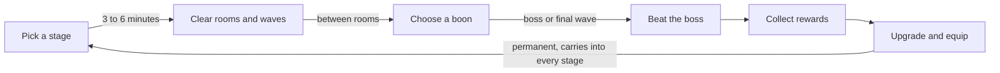

# Stage loop (text version of 03-stage-loop.png)

Six steps in a loop; the last step is permanent progression that carries into every later stage.

| Step | What happens | Duration |
| --- | --- | --- |
| Pick a stage | Map, stage preview, loadout | seconds |
| Clear rooms and waves | 3 to 5 rooms of authored spawns; the skill loop | 3 to 6 min |
| Choose a boon | 1 of 3 temporary in-stage upgrades after flagged rooms | seconds |
| Beat the boss | Final wave, or the world boss at stage 25 | 1 to 10 min |
| Collect rewards | XP, coins, materials, stars, unlocks | seconds |
| Upgrade and equip | Permanent: levels, skills, Forge, loadout | minutes |
