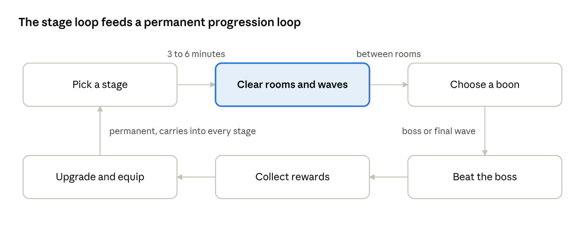

<!-- from md/01-design.md -->

## 3. Core loops

The game is four nested loops, and the inner two are where the skill lives. Everything in the outer loops exists to send the player back into the inner ones with a new reason.

**Moment to moment (1 to 3 seconds).** Read a telegraph, decide: parry it, dodge it, or ignore it and reposition. A successful parry opens a punish window; the auto-attack fills it. Failure costs health, never progress.

**Room (20 to 60 seconds).** A room is one wave or a small set of waves with a fixed enemy mix and a hazard rule. Rooms end when the last enemy dies. Between rooms the player picks one of three boons (temporary in-stage upgrades that expire when the stage ends).

**Stage (3 to 6 minutes, bosses 6 to 10).** Three to five rooms, then a final wave or a boss. Stages are authored; the order of rooms is fixed, so the player can learn and plan. Clearing a stage pays experience, currency, and at milestones an equipment or skill unlock.

Text version of this diagram: [images/03-stage-loop.md](../images/03-stage-loop.md)

Each stage ends in rewards and a permanent upgrade step, so the next stage is entered stronger and with a new problem.

**Session (10 to 20 minutes).** The home screen shows the next stage, any claimable reward and any quest that is one stage from completion, in that order. A session is two to four stages. Everything saves on stage completion and on room completion, so a phone call costs at most the current room.

**Meta (hours to weeks).** Worlds unlock in order, each with a new enemy family, a new mechanic, a boss, and side dungeons and trials that remix the world's rules. Character progression (section 8) and the engagement layer (section 13) sit on top of this and are never a substitute for it.
