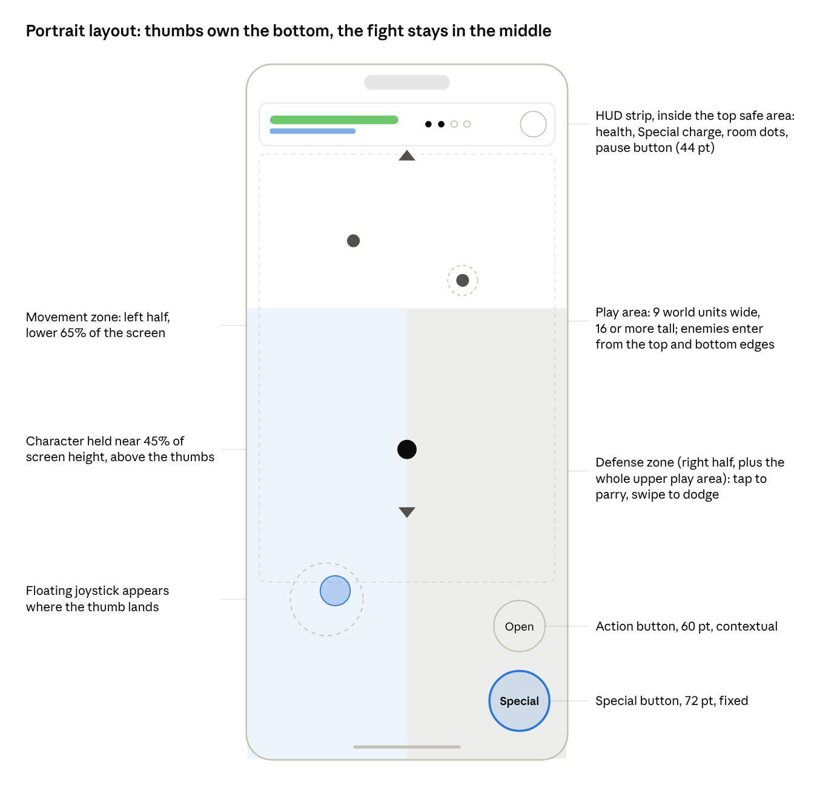

<!-- from md/01-design.md -->

## 6. Camera and portrait presentation

The camera is width-locked at 9 world units, follows the character vertically with a lead toward the enemies, and arenas are tall rectangles, so a narrow screen shows a full fight without zooming out. Taller phones see more of the arena above and below; nothing is ever cropped horizontally.

Text version of this diagram: [images/06-portrait-layout.md](../images/06-portrait-layout.md)

The thumbs own the lower third, the HUD sits in the top safe area, and the character is held above the thumb band so the fight is never under a hand.

**Camera rules**

| Rule | Specification |
| --- | --- |
| Projection | 2D orthographic, width-locked: exactly 9 world units are visible horizontally on every phone |
| Visible height | 16 units at 9:16, about 19.5 units at 9:19.5, 21 at 9:21. Arenas are authored for 16 and decorated beyond it. |
| Tablets and foldables (3:4, near 1:1) | Width grows to 12 units with the arena's decorative margin visible; UI stays at phone proportions, centred, with themed side panels. No landscape. |
| Follow | Damped follow, 150 ms smoothing. Vertical follow is free; horizontal follow is clamped to the arena so the walls never show gaps. |
| Character anchor | The character is held at 45% of screen height (measured from the top), above the control band, and drifts up to 15% toward the enemy centroid. |
| Lead | Camera leads 1.5 units toward the centroid of enemies that are winding up an attack, so telegraphs are on screen before the hit. |
| Threat band | The lower 22% of the screen sits under the thumbs. Any telegraph that originates there is mirrored as an edge indicator drawn just above the band. Arenas are designed so most threats come from above. |
| Hit stop | On parry the camera freezes for 80 ms with the world. No shake during hit stop. |
| Shake | Capped at 0.2 units, 120 ms, only on Executes, boss slams and the player's death. Off in reduced-motion mode. |
| Zoom | None during combat. A 10% zoom-in over 400 ms on Execute, released over 600 ms. Boss intro uses a 1.5 s pull-out from the boss to the arena. |

**Arenas for a vertical screen**

- Arena footprint is 9 wide by 20 to 28 tall. Width never exceeds 9, so the whole horizontal extent is always visible.
- Enemies spawn at the top and bottom edges, each spawn announced by a marker on that edge 1 second ahead. Side spawns do not exist.
- Hazards (pits, fire lines, pushers) are horizontal bands, because a horizontal band is read at a glance on a tall screen and a vertical one hides behind the character.
- Bosses are placed at the top of the arena and the camera's lead keeps both the boss and the character in frame; boss arenas are 9 by 16 so the fight needs no vertical scroll.
- Projectiles travel mostly vertically; diagonal shots are slow enough to read.

**Scale.** One world unit is one ninth of the screen width (43 pt on the reference phone). The character is 1.2 units tall; normal enemies 1 to 1.6 units; elites 2; bosses 3 to 4. Art is authored at 2x and 3x for a 1-unit grid, so sprites never scale non-integer on the reference phone.

**Safe areas.** The HUD strip starts 8 pt below the top safe area (Dynamic Island and notches), and no button sits within the bottom 34 pt home-indicator area. Both values come from the OS at runtime, never hard-coded.

**Portrait-specific readability checks** (run on every stage before it ships)

- Every telegraph that can hit the character is fully on screen at the moment it starts, on a 9:16 device.
- No enemy attack originates from inside the threat band without an edge indicator.
- Text in the play area is never smaller than 14 pt on the reference phone.
- A playtester holding the phone one-handed (right thumb only, movement by tilting is not supported) can clear world 1 stages, since world 1 is designed to need little movement.
