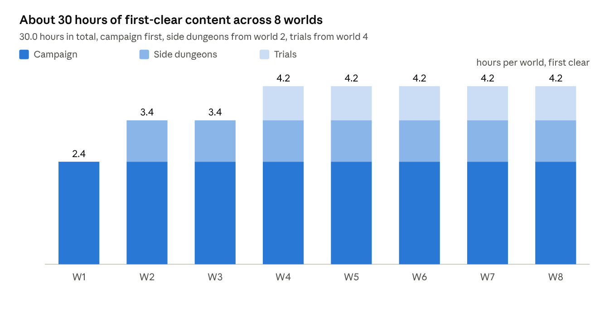

<!-- from md/01-design.md -->

## 9. Content structure and the 30-hour budget

The campaign is 8 worlds of 25 stages (24 stages and a boss), 63 side-dungeon stages and 30 trials: 293 authored stages that take about 30 hours to clear once at average skill, with retries counted and no stage repeated for resources.

Text version of this diagram: [images/09-hours-by-world.md](../images/09-hours-by-world.md)

Each world adds about 2.4 hours of campaign; side dungeons and trials lift the later worlds to over 4 hours each.

**Inventory and timing assumptions**

| Content | Count | Minutes per first clear (with retries) | Hours |
| --- | --- | --- | --- |
| Campaign stages | 192 | 5.5 | 17.6 |
| Campaign bosses | 8 | 12 | 1.6 |
| Side dungeon stages (3 dungeons of 3 stages per world, worlds 2 to 8) | 63 | 6.5 | 6.8 |
| Trials (6 per world, worlds 4 to 8) | 30 | 8 | 4.0 |
| Total first-clear | 293 |  | 30.0 |

Mastery objectives, boss re-fights with modifiers, daily challenge stages and events are on top of this and are not counted. The per-stage minutes are design targets; the prototype gate (section 17) measures real values on stages 1-1 to 1-8 and the budget is re-run from them.

**Worlds.** Each world introduces one enemy family and one arena rule, then spends its stages recombining them with everything before. Names and themes are original placeholders.

| World | Theme | New enemy family | Arena rule | Boss beat |
| --- | --- | --- | --- | --- |
| 1 Hollow Orchard | Overgrown farmland | Thornbacks: slow melee with long white telegraphs | None; teaches the grammar | Single break cycle, one unparryable slam |
| 2 Salt Flats | Dry seabed | Shellbacks: shielded fronts that only a parry opens | Tide bands that push horizontally | Shield phases; break opens the shell |
| 3 Lantern Marsh | Fog and still water | Wisps: short-range teleports before attacking | Shock pools that chain between enemies standing in them | Boss splits into three wisps after each break |
| 4 Clockwork Quarry | Machines and conveyors | Automata: unparryable red slams, parryable jabs | Conveyor bands that move the character | Two break cycles; conveyors reverse after the first |
| 5 Ember Vaults | Furnace halls | Stokers: buffers that empower others (blue pulse) | Burn lines that cross the arena on a timer | Boss summons stokers; kill order matters |
| 6 Frost Reliquary | Ice crypt | Sentinels: delayed area rings with white edges | Chill floors that slow dodges | Rings overlap; parry the white edges to clear space |
| 7 Sky Bastion | Floating ramparts | Archers: volleys that can be reflected by parry | Wind bands that bend projectiles | Reflection-only damage phase |
| 8 The Undercrown | Below everything | All families, recombined | Rotating rules from worlds 2 to 7 | Three phases, two break cycles each |

**Stage cadence inside a world** (24 stages)

- Stages 1 to 4: the new family alone, the new rule alone, then together.
- Stages 5 to 12: the new family mixed with one earlier family per stage; a mid-world elite at stage 12.
- Stages 13 to 20: two earlier families plus the rule; hazards at full strength; stage 20 is a gauntlet (five rooms, no boon in the last two).
- Stages 21 to 24: boss preparation, each stage rehearsing one boss mechanic in a normal fight.
- Stage 25: the boss.

Every stage must pass the "new decision" test: a designer can name the decision this stage asks that the previous one did not. If not, the stage is cut or changed.

**Side dungeons** (unlocked by mastery stars from the same world). Three stages that remix the world's rule: for example, in Salt Flats, a dungeon where every enemy is shielded and boons are parry-only. Rewards are rings and crafting materials.

**Trials** (unlocked by clearing the world's boss). Fixed-loadout and modifier fights: boss rush, no-damage rooms, Special disabled, parry-only (dodge disabled), speed clears, and a "mirror" trial where telegraph colours are swapped as a grammar test. Rewards are Legendary materials and cosmetics.

**Endgame after world 8.** Boss re-fights with stackable modifiers, mastery hunts (all stars in a world), and the rotating challenge stage from the engagement layer. This is where new content updates land (section 13).
