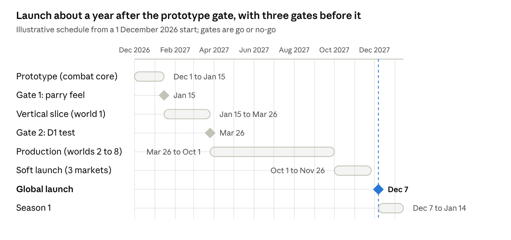

<!-- from md/01-design.md -->

## 17. Production plan

The plan is gated on the one thing the research could not settle: whether tap-to-parry feels good enough under touch latency to carry the whole game. Six weeks of prototype answer that before anything else is built, and a world-1 vertical slice must hit D1 30% in a closed test before production of the other seven worlds starts.

Text version of this diagram: [images/17-production-timeline.md](../images/17-production-timeline.md)

Gates are go or no-go; a failed gate loops the phase, it does not skip it.

**Phases and gates**

| Phase | Weeks | Builds | Gate to pass |
| --- | --- | --- | --- |
| Prototype | 1 to 6 | Combat core with Blade and Hammer, Thornback and Shellback, stages 1-1 to 1-8 in grey-box art, the section 6 camera, haptics, sound for parry only | Section 14 feel checklist; precise parry rate above 50% by stage 1-4 in a 20-person test; testers choose the parry build over an "attack button" control variant in a blind A/B |
| Vertical slice | 7 to 16 | World 1 complete in final art, boss, FTUE, HUD, save, analytics, stage editor and both bots, Forge basics | D1 30% or better in a 300-install closed test; first-clear times within 20% of the section 9 targets; both bots pass on all 25 stages |
| Production | 17 to 44 | Worlds 2 to 8, side dungeons, trials, three classes, full Forge, engagement layer, monetization, cloud save, localization hooks | Content complete: 293 stages pass validation; economy targets in section 12 hold on the bots' first-clear path |
| Soft launch | 45 to 52 | Three markets, remote-config tuning, two season cycles rehearsed | D7 8% or better; crash-free 99.5%; no stage above 3 deaths per clear in the campaign |
| Global launch and Season 1 | 53 onward | Launch, Season 1, first event dungeon | Section 16 targets reviewed at day 30 and day 60 |

**Team** (steady state in production; the prototype needs four people)

| Role | Count | Owns |
| --- | --- | --- |
| Design lead and producer | 1 | This document, gates, schedule |
| Content designers | 2 | 293 stages, bosses, boons, quests; about 10 stages per week between them with the editor |
| Gameplay engineer | 1 | Simulation, combat, enemies, bots |
| Platform and tools engineer | 1 | Editor, save, stores, analytics, performance |
| UI engineer | 1 | HUD, screens, contextual Action, safe areas |
| Character and enemy artist | 1 | Silhouettes, telegraph poses |
| Environment and UI artist | 1 | Arena templates, palettes, UI |
| Animator and VFX | 1 | Attack poses, parry and Execute effects |
| Audio (contract) | 0.5 | Telegraph sounds, parry sound, music |
| QA | 1 | Aspect-ratio matrix, device matrix, content validation |

**Risks and responses**

| Risk | Likelihood | Response |
| --- | --- | --- |
| Parry does not feel decisive on touch | Medium | Gate 1 exists for this; fallback is a larger precise window and a stronger soft tier, then a dedicated parry button variant |
| 293 stages at quality | High | Templates, two bots and the editor are built in the slice, before production; cut side dungeons to two per world before cutting campaign stages |
| Revenue without gacha or energy | Medium | Pass and cosmetics sized on the Brawl Stars precedent; soft launch measures attach before global |
| Six enemies crowd a narrow screen | Medium | Caps in section 10; perfect bot rejects unreadable overlaps |
| Android fragmentation on frame time | Medium | 30 fps floor, slow-frame budget, device matrix in QA from the slice onward |
| Engine or runtime decision slips | Low | Decide before the prototype starts; the open question in section 18 |
| Scope creep from LiveOps | Medium | Engagement layer is fixed in section 13; new systems need a gate review |
